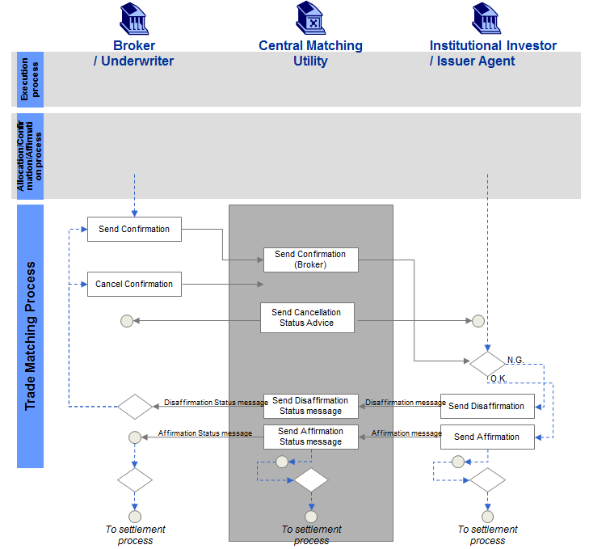
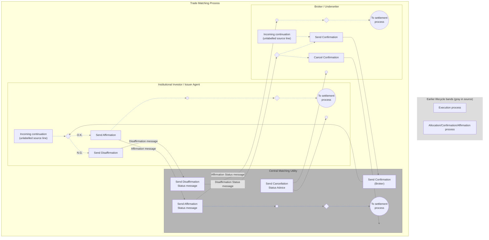

# Own-account local matching activity

## Source evidence

[src-000180](../../../../../../../../raw-input/post_trade_matching/ISO20022_MDRPart1_PostTradeMatching_2024_2025_v2.docx); Description of BusinessActivities / BusinessProcess – Local Matching / Own Account Trade Type; direct-body paragraph P155; word/media/image5.tmp. [Unchanged original figure or complete rendered document](../../../../../../assets/src-000180/originals/image5.tmp).

## Mermaid reconstruction

## Actors, activities and relationships

Broker / Underwriter sends its confirmation through CMU to Institutional Investor / Issuer Agent. The recipient compares details: N.G. leads to disaffirmation and a status returning to the sender; O.K. leads to affirmation, status and settlement continuations. Cancellation enters the CMU lane at an unlabelled endpoint; a separate cancellation-status action points to sender and recipient receipts. P154 binds the trade on affirmation. T10 preserves cancellation/new-confirmation alternatives and disaffirmation conditions.

Slash-separated actor labels describe source alternatives, not a merger of institutions or role definitions.

| Source-scoped participant | Canonical record |
| --- | --- |
| broker | [broker](../../../../../../../../shared/reference/participants/participant-src-000180-broker.md) |
| underwriter | [underwriter](../../../../../../../../shared/reference/participants/participant-src-000180-underwriter.md) |
| central matching utility cmu | [central matching utility cmu](../../../../../../../../shared/reference/participants/participant-src-000180-central-matching-utility-cmu.md) |
| central matching utility jasdec | [central matching utility jasdec](../../../../../../../../shared/reference/participants/participant-src-000180-central-matching-utility-jasdec.md) |
| institutional investor | [institutional investor](../../../../../../../../shared/reference/participants/participant-src-000180-institutional-investor.md) |
| issuer agent | [issuer agent](../../../../../../../../shared/reference/participants/participant-src-000180-issuer-agent.md) |

Reusable source flow: [Own Account Trade Type](../../flows/flow-src-000180-p153-own-account-trade-type.md). All narrative conditions and activity-table rows remain there.

Responsibilities and activities: [Source table T10](../../documents/src-000180/tables/tbl-0010.md).

## Review evidence

Opened the complete source figure and rendered reconstruction. Compared actor/lane labels, arrow direction and endpoints, all activity labels, N.G./O.K. and unmatched/matched branches, cancellation receipt paths, settlement/NAV outcomes, and source boundary/color distinctions where present. Source geometry is adapted; labelled reconstruction cues and the overlapping listed-derivatives boundary limitation are explicit. Final corrected render reopened after endpoint/style changes. Parsed and rendered with Mermaid 12.3.0 and Chromium156.0.8078.81; visual comparison 2026-11-09 Europe/Warsaw.

[Compared reconstruction](../../../../../../assets/src-000180/reconstructed-processes/fig-0008.png).
