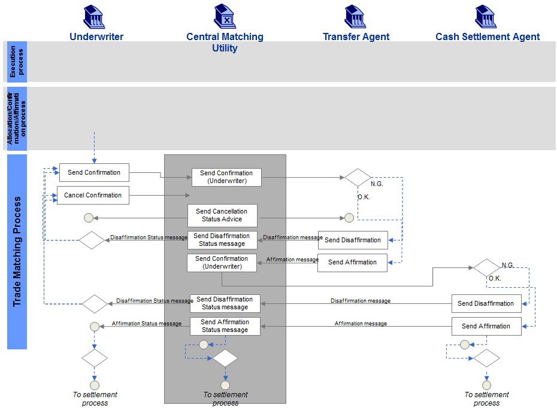
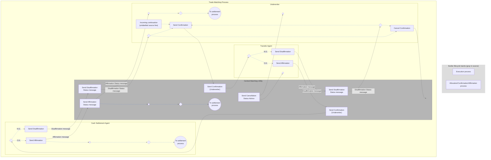

# Duplex local matching activity

## Source evidence

[src-000180](../../../../../../../../raw-input/post_trade_matching/ISO20022_MDRPart1_PostTradeMatching_2024_2025_v2.docx); Description of BusinessActivities / BusinessProcess – Local Matching / Duplex Type; direct-body paragraph P161; word/media/image6.tmp. [Unchanged original figure or complete rendered document](../../../../../../assets/src-000180/originals/image6.tmp).

## Mermaid reconstruction

## Actors, activities and relationships

Underwriter confirmation first goes through CMU to Transfer Agent. N.G. returns a disaffirmation status and rework/cancellation path to Underwriter. O.K. sends affirmation to CMU, which forwards the same underwriter confirmation to Cash Settlement Agent. Its N.G. and O.K. branches separately disaffirm or affirm. CMU sends the final status to Underwriter; accepted trade continues to settlement. The cancellation-status action has source arrows to Underwriter and Transfer Agent receipts; no additional cash-agent cancellation arrow is inserted in this activity diagram. P160 and T11 supply the corresponding responsibilities and conditions.

The sequence figures use CashCorrespondent for a related fourth actor. The source labels remain distinct; the linked sequence preserves its own cancellation arrows.

| Source-scoped participant | Canonical record |
| --- | --- |
| underwriter | [underwriter](../../../../../../../../shared/reference/participants/participant-src-000180-underwriter.md) |
| central matching utility cmu | [central matching utility cmu](../../../../../../../../shared/reference/participants/participant-src-000180-central-matching-utility-cmu.md) |
| central matching utility jasdec | [central matching utility jasdec](../../../../../../../../shared/reference/participants/participant-src-000180-central-matching-utility-jasdec.md) |
| transfer agent | [transfer agent](../../../../../../../../shared/reference/participants/participant-src-000180-transfer-agent.md) |
| cash settlement agent | [cash settlement agent](../../../../../../../../shared/reference/participants/participant-src-000180-cash-settlement-agent.md) |

Reusable source flow: [Duplex Type](../../flows/flow-src-000180-p159-duplex-type.md). All narrative conditions and activity-table rows remain there.

Responsibilities and activities: [Source table T11](../../documents/src-000180/tables/tbl-0011.md).

## Review evidence

Opened the complete source figure and rendered reconstruction. Compared actor/lane labels, arrow direction and endpoints, all activity labels, N.G./O.K. and unmatched/matched branches, cancellation receipt paths, settlement/NAV outcomes, and source boundary/color distinctions where present. Source geometry is adapted; labelled reconstruction cues and the overlapping listed-derivatives boundary limitation are explicit. Final corrected render reopened after endpoint/style changes. Parsed and rendered with Mermaid 12.3.0 and Chromium156.0.8078.81; visual comparison 2026-11-09 Europe/Warsaw.

[Compared reconstruction](../../../../../../assets/src-000180/reconstructed-processes/fig-0009.png).
