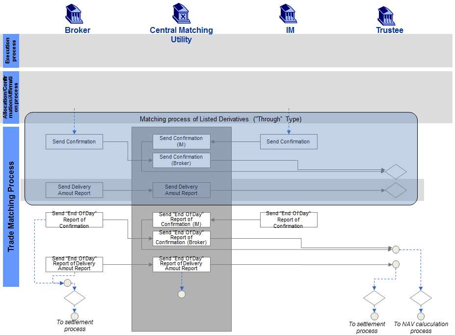
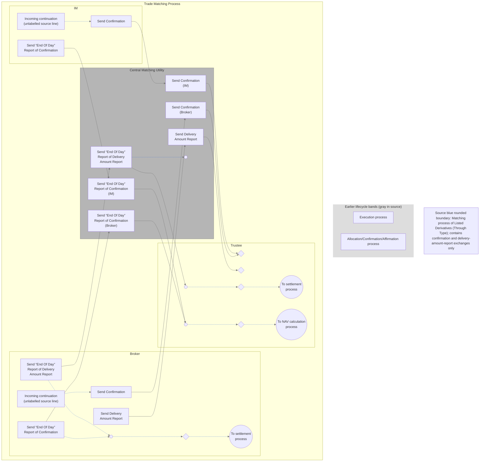

# Listed-derivatives end-of-process reporting activity

## Source evidence

[src-000180](../../../../../../../../raw-input/post_trade_matching/ISO20022_MDRPart1_PostTradeMatching_2024_2025_v2.docx); Description of BusinessActivities / BusinessProcess – Local Matching / End of Process Report for Listed Derivatives; direct-body paragraph P168; word/media/image7.tmp. [Unchanged original figure or complete rendered document](../../../../../../assets/src-000180/originals/image7.tmp).

## Mermaid reconstruction

## Actors, activities and relationships

The source blue rounded area groups the initial through-type confirmation exchanges and delivery amount reporting. Broker and IM confirmations are forwarded separately to Trustee. Broker Delivery Amount Report is forwarded to Trustee as a separate exchange. After the respective daily confirmations, Broker and IM send End Of Day Report of Confirmation; CMU forwards both into one Trustee receipt marker leading to NAV calculation. Broker End Of Day Report of Delivery Amount Report is forwarded into a separate Trustee receipt leading to settlement. Broker settlement continuation receives dashed lines from both of its report actions. CMU has its own unlabelled end marker after delivery-report forwarding. P166 and T12 preserve timing and responsibilities.

The original blue grouping and darker delivery row span several participant lanes. Mermaid describes this complete boundary in an explicit labelled note rather than duplicating the same node inside overlapping subgraphs. Source grouping, not additional process ordering, is intended. DeliveryAmountReport is explicitly proprietary in sequence figure21/P229; it is not merged with ISO SecuritiesEndOfProcessReport.

| Source-scoped participant | Canonical record |
| --- | --- |
| broker | [broker](../../../../../../../../shared/reference/participants/participant-src-000180-broker.md) |
| investment manager | [investment manager](../../../../../../../../shared/reference/participants/participant-src-000180-investment-manager.md) |
| central matching utility cmu | [central matching utility cmu](../../../../../../../../shared/reference/participants/participant-src-000180-central-matching-utility-cmu.md) |
| central matching utility jasdec | [central matching utility jasdec](../../../../../../../../shared/reference/participants/participant-src-000180-central-matching-utility-jasdec.md) |
| trustee | [trustee](../../../../../../../../shared/reference/participants/participant-src-000180-trustee.md) |
| trust bank | [trust bank](../../../../../../../../shared/reference/participants/participant-src-000180-trust-bank.md) |

Reusable source flow: [End of Process Report for Listed Derivatives](../../flows/flow-src-000180-p165-end-of-process-report-for-listed-derivatives.md). All narrative conditions and activity-table rows remain there.

Responsibilities and activities: [Source table T12](../../documents/src-000180/tables/tbl-0012.md).

## Review evidence

Opened the complete source figure and rendered reconstruction. Compared actor/lane labels, arrow direction and endpoints, all activity labels, N.G./O.K. and unmatched/matched branches, cancellation receipt paths, settlement/NAV outcomes, and source boundary/color distinctions where present. Source geometry is adapted; labelled reconstruction cues and the overlapping listed-derivatives boundary limitation are explicit. Final corrected render reopened after endpoint/style changes. Parsed and rendered with Mermaid 12.3.0 and Chromium156.0.8078.81; visual comparison 2026-11-09 Europe/Warsaw.

[Compared reconstruction](../../../../../../assets/src-000180/reconstructed-processes/fig-0010.png).
