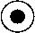

# fig-0004 - original figure evidence

Source: [src-000180](../../../../../../../../../raw-input/post_trade_matching/ISO20022_MDRPart1_PostTradeMatching_2024_2025_v2.docx). Locator: direct-body paragraph P137; Description of BusinessActivities; /w:document/w:body/w:p[137].

Original extracted asset: [image2.jpeg](../../../../../../../assets/src-000180/originals/image2.jpeg)

## Classified source item

This occurrence has a recorded visual classification. Its original asset and source locator are retained. The disposition below explains its role as source notation, a component of a complete figure, retained text, or a decorative exclusion. It is not an independent reconstructed business diagram.

## Inventory disposition

Preserved activity-notation legend symbol: start/end marker, P137. Its source explanation is retained in the extracted section. This is substantive notation context rather than a separate business flow or decorative exclusion.
