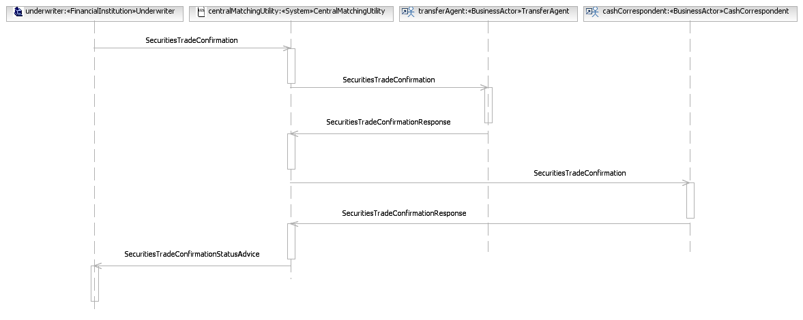

# fig-0018 - original figure evidence

Source: [src-000180](../../../../../../../../../raw-input/post_trade_matching/ISO20022_MDRPart1_PostTradeMatching_2024_2025_v2.docx). Locator: direct-body paragraph P216; BusinessTransactions / BusinessTransactions - Local Matching Scenarios / Duplex Type Scenarios / Duplex Type; /w:document/w:body/w:p[216].

Original extracted asset: [image15.png](../../../../../../../assets/src-000180/originals/image15.png)

## Canonical reconstruction and review

[Canonical diagram, source qualifications, participant/flow links and recorded review evidence](../../../diagrams/business-transactions/fig-0018.md). Original media and this occurrence's precise locator are retained. Rendering and visual comparison results above are copied from the canonical reference; any unresolved business, version or contextual limitation remains open.

## Source reconstruction

[Duplex Type](../../../diagrams/business-transactions/fig-0018.md). Full original and rendered reconstruction visually compared; any source contradiction remains explicit.
