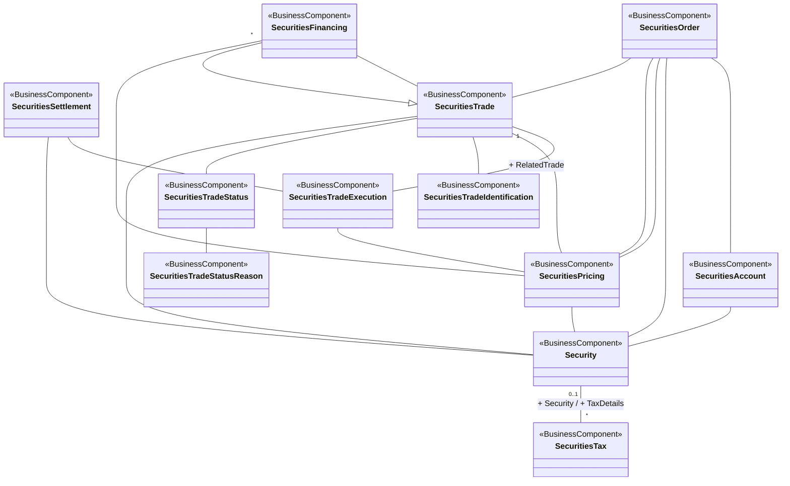

# Post-trade matching conceptual model

[src-000182](../../../../../../../../../raw-input/post_trade_matching/ISO20022_MDRPart3_PostTradeMatching_2024_2025_v1.xlsx), PostTradeMatching!A2:U41; xl/drawings/drawing2.xml; anchor 1. Original image SHA-256: 6a6f0bb111305c10c7a68b7cb7f9d3b6b01cc2f7ae0fabf7c44a218b50bdb21e.

[Original complete figure](../../../../../../../assets/src-000182/media/image2.png) · [Rendered Mermaid SVG](../../../../../../../assets/src-000182/reconstructed/src-000182-fig-0002.svg) · [Rendered Mermaid PNG](../../../../../../../assets/src-000182/reconstructed/src-000182-fig-0002.png)

## Source reconstruction

## Entities and relationships

SecuritiesOrder connects account, security, trade and pricing. Two distinct unlabelled lines connect SecuritiesOrder and SecuritiesPricing; both are retained. SecuritiesFinancing connects SecuritiesTrade with both an unlabelled association and a hollow-triangle generalization, and connects pricing with multiplicity * at the financing end. Trade connects execution (RelatedTrade, multiplicity 1 at the trade end), pricing, identification, status and security. Settlement connects execution and security. Account and pricing also connect security. Status connects status reason. Security–SecuritiesTax is labelled Security (0..1 at the security end) and TaxDetails (* at the tax end). No other unprinted multiplicity is inferred. The figure establishes entity associations, not an ordered message flow.

All 12 visible node occurrences and 20 relationship lines are retained. All printed endpoint multiplicities are retained: 1 at SecuritiesTrade on the execution association; * at SecuritiesFinancing on its pricing association; 0..1 at Security and * at SecuritiesTax. Blank ends mean no multiplicity is printed, not a default cardinality. The source prints no package names or enclosing package boundaries, so the reconstruction adds none. Association labels retain literal +/− prefixes and combined end names. Their re-layout position is not additional navigability evidence. The native class inheritance marker is reserved for the source’s hollow-triangle generalizations. Source editor/navigation icons are omitted as interface decoration; no business entity or relationship is excluded.

## Complete relationship register

| From node | To node | Source relationship kind | Visible source label(s) | From-end multiplicity | To-end multiplicity |
| --- | --- | --- | --- | --- | --- |
| SecuritiesOrder | SecuritiesAccount | association | (unlabelled in source) | not printed | not printed |
| SecuritiesOrder | Security | association | (unlabelled in source) | not printed | not printed |
| SecuritiesOrder | SecuritiesPricing | association | (unlabelled in source) | not printed | not printed |
| SecuritiesOrder | SecuritiesPricing | association | (unlabelled in source) | not printed | not printed |
| SecuritiesOrder | SecuritiesTrade | association | (unlabelled in source) | not printed | not printed |
| SecuritiesFinancing | SecuritiesTrade | association | (unlabelled in source) | not printed | not printed |
| SecuritiesFinancing | SecuritiesTrade | generalization: subtype to supertype | (unlabelled in source) | not printed | not printed |
| SecuritiesFinancing | SecuritiesPricing | association | (unlabelled in source) | * | not printed |
| SecuritiesSettlement | SecuritiesTradeExecution | association | (unlabelled in source) | not printed | not printed |
| SecuritiesSettlement | Security | association | (unlabelled in source) | not printed | not printed |
| SecuritiesTrade | SecuritiesTradeExecution | association | + RelatedTrade | 1 | not printed |
| SecuritiesTrade | SecuritiesPricing | association | (unlabelled in source) | not printed | not printed |
| SecuritiesTrade | SecuritiesTradeIdentification | association | (unlabelled in source) | not printed | not printed |
| SecuritiesTrade | SecuritiesTradeStatus | association | (unlabelled in source) | not printed | not printed |
| SecuritiesTrade | Security | association | (unlabelled in source) | not printed | not printed |
| SecuritiesTradeExecution | SecuritiesPricing | association | (unlabelled in source) | not printed | not printed |
| SecuritiesAccount | Security | association | (unlabelled in source) | not printed | not printed |
| SecuritiesPricing | Security | association | (unlabelled in source) | not printed | not printed |
| SecuritiesTradeStatus | SecuritiesTradeStatusReason | association | (unlabelled in source) | not printed | not printed |
| Security | SecuritiesTax | association | + Security / + TaxDetails | 0..1 | * |

## Entity definitions and precise workbook locators

| Visible label | Source package / stereotype | Definition evidence |
| --- | --- | --- |
| SecuritiesOrder | not printed in figure / BusinessComponent | [FullBusinessModel!A4044:D4044](../sheets/02-fullbusinessmodel/tbl-0022.md) — Intention to transfer an ownership of a financial instrument. |
| SecuritiesFinancing | not printed in figure / BusinessComponent | [FullBusinessModel!A3959:D3959](../sheets/02-fullbusinessmodel/tbl-0021.md) — Process of lending or borrowing cash or securities against securities or cash collateral. It aims at optimising liquidity, support a trading strategy, or increase settlement efficiency. |
| SecuritiesSettlement | not printed in figure / BusinessComponent | [FullBusinessModel!A4404:D4404](../sheets/02-fullbusinessmodel/tbl-0024.md) — Settlement of the securities in a securities transaction, that is, the instruction to deliver or receive securities, involving the payment of an amount of money or not. |
| SecuritiesTrade | not printed in figure / BusinessComponent | [FullBusinessModel!A4487:D4487](../sheets/02-fullbusinessmodel/tbl-0024.md) — Specifies trades linked to securities operations such as the exchange of securities, the lending of securities and the transactions related to investment funds. |
| SecuritiesAccount | not printed in figure / BusinessComponent | [FullBusinessModel!A3819:D3819](../sheets/02-fullbusinessmodel/tbl-0021.md) — Account to or from which a securities entry is made. |
| SecuritiesTradeExecution | not printed in figure / BusinessComponent | [FullBusinessModel!A4508:D4508](../sheets/02-fullbusinessmodel/tbl-0024.md) — Transaction between two counterparties in which they agree to buy and sell a financial instrument. A trade transaction occurs with the matching of the two counterparties orders. There could be several trade transactions necessary to execute the trade. |
| SecuritiesTradeIdentification | not printed in figure / BusinessComponent | [FullBusinessModel!A4521:D4521](../sheets/02-fullbusinessmodel/tbl-0024.md) — Specifies the different identifications associated with a securities transaction. |
| SecuritiesTradeStatus | not printed in figure / BusinessComponent | [FullBusinessModel!A4540:D4540](../sheets/02-fullbusinessmodel/tbl-0024.md) — Status of a securities trade. |
| SecuritiesPricing | not printed in figure / BusinessComponent | [FullBusinessModel!A4190:D4190](../sheets/02-fullbusinessmodel/tbl-0022.md) — Characteristics related to the price of the security. |
| SecuritiesTradeStatusReason | not printed in figure / BusinessComponent | [FullBusinessModel!A4557:D4557](../sheets/02-fullbusinessmodel/tbl-0024.md) — Specifies the underlying reason for a status of a securities trade. |
| Security | not printed in figure / BusinessComponent | [FullBusinessModel!A4589:D4589](../sheets/02-fullbusinessmodel/tbl-0024.md) — Financial instruments representing a sum of rights of the investor vis-a-vis the issuer. |
| SecuritiesTax | not printed in figure / BusinessComponent | [FullBusinessModel!A4469:D4469](../sheets/02-fullbusinessmodel/tbl-0024.md) — Amount of money due to the government or tax authority, according to various pre-defined parameters such as thresholds or income. |

## Participant and flow navigation

This is a conceptual entity model, not a message exchange diagram. A business component or relationship label is not automatically a functional participant or institution. [Message-set participant references](../../../participants.md) and [Message-set business flows](../../../flows/index.md) provide the independently sourced actor/process context. These references are navigational; source figure associations do not establish message direction.

## Rendering and visual review

2026-11-09: Mermaid 12.3.0 parsed and rendered successfully with Mermaid browser API + Chromium 156.0.8078.81. Compared all 12 entities, 20 relationship lines, hollow-triangle generalization, four printed multiplicity labels, literal association names and absence of package boundaries with original artwork. Traced both unlabelled Order–Pricing lines and distinct Financing–Trade association/generalization. Used top-to-bottom layout to keep cardinalities adjacent to the correct links; visually compared final rendered PNG and original enlarged source. [Renderer evidence](../../../../../../../../../work/posttrade-workbook-models/render-report.json).

## Source review note

Source PostTradeMatching!A1 threaded comment says the model is too short and requests Securities Settlement, TradePartyRole, SecuritiesDeliveryObligation and Asset, plus a change in the vertical presentation of SecuritiesTrade/SecuritiesFinancing. The supplied drawing is reconstructed as supplied; the comment is retained as publication review context, not applied as an instruction to invent or change source edges.

[Complete literal A1 comment and workbook context](../sheets/04-posttradematching/index.md)
