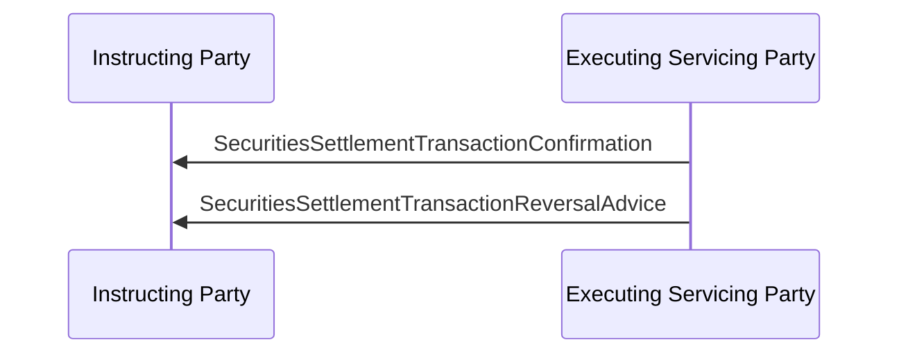

# Settlement reversal advice sequence

## Source and original artwork

[src-000196](<../../../../../../../../raw-input/settlement_and_reconciliation/ISO20022_MDRPart1_SettlementAndReconciliation_2025_2026_v2.docx>), §6.14 Reversal Advice, paragraph626. Paragraph IDs count direct-body paragraphs. Archive member `word/media/image71.png`.

[Unchanged original figure](<../../../../../../assets/src-000196/originals/image71.png>)

## Mermaid reconstruction

## Entities and relationships

Both confirmation and reversal travel from executing/servicing to instructing party. Reversal reverses the prior confirmation; it is not an instructing-party cancellation request.

[Flow, participants, steps and alternatives](<../../flows/reversal-advice.md>)

## Review evidence

| Check | Result | Evidence |
| --- | --- | --- |
| Original figure inspection | performed | Source raster/EMF preview inspected on 2026-11-08 |
| Mermaid parse/render | pass | Mermaid 12.3.0; Chromium 156.0.8078.81; 2026-11-08 |
| Rendered reconstruction compared with original | pass | Compared two servicer-to-instructing-party arrows, confirmation then reversal, exact labels. |

[Pilot diagram index](<index.md>)

[Validated SVG](<../../../../../../assets/src-000196/reconstructed/05-reversal-sequence.svg>) · [Readable rendered PNG](<../../../../../../assets/src-000196/reconstructed/05-reversal-sequence.png>)

Visual review applies to this reconstructed view; it does not claim complete source-wide figure coverage or resolve source semantic defects.
