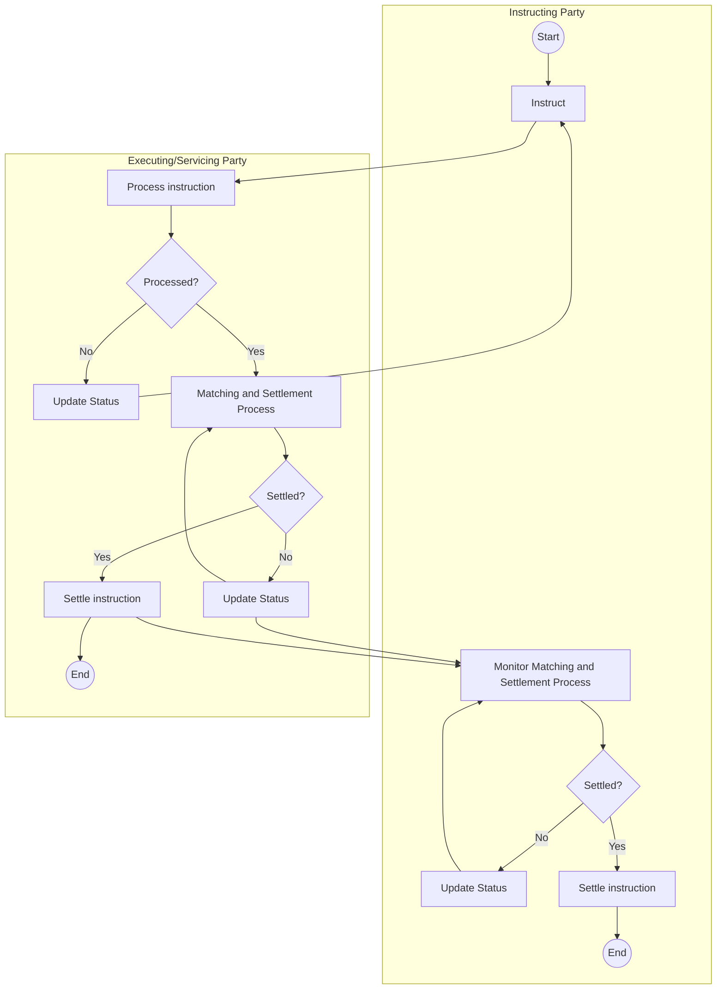

# Typical instruction and confirmation activity

## Source and original artwork

[src-000196](<../../../../../../../../raw-input/settlement_and_reconciliation/ISO20022_MDRPart1_SettlementAndReconciliation_2025_2026_v2.docx>), §5.1 Instruction and Confirmation – Typical Process, paragraph198; table28. Paragraph IDs count direct-body paragraphs. Archive member `word/media/image10.emf`.

[Unchanged original figure](<../../../../../../assets/src-000196/originals/image10.emf>)

Original is an EMF vector figure. A separate working PNG was rasterized through Windows System.Drawing for source inspection; original vector file is unchanged.

## Mermaid reconstruction

## Entities and relationships

Swimlanes preserve responsibility. Not-processed status returns to instruction; pending settlement cycles back into matching and monitoring. Each party maintains a settlement decision and settle-instruction activity. Table28 permits a successful-validation status update intentionally absent from artwork.

[Flow, participants, steps and alternatives](<../../flows/instruction-confirmation.md>)

## Review evidence

| Check | Result | Evidence |
| --- | --- | --- |
| Original figure inspection | performed | Source raster/EMF preview inspected on 2026-11-08 |
| Mermaid parse/render | pass | Mermaid 12.3.0; Chromium 156.0.8078.81; 2026-11-08 |
| Rendered reconstruction compared with original | pass | Compared responsible-party boundaries, start/end points, both settlement decisions, successful/unsuccessful validation, pending loops and cross-party status paths to EMF preview; omitted successful-validation update remains explicitly stated in text. |

[Pilot diagram index](<index.md>)

[Validated SVG](<../../../../../../assets/src-000196/reconstructed/07-typical-activity.svg>) · [Readable rendered PNG](<../../../../../../assets/src-000196/reconstructed/07-typical-activity.png>)

Visual review applies to this reconstructed view; it does not claim complete source-wide figure coverage or resolve source semantic defects.

<!-- RENDERED-SOURCE-START -->
## Rendered source page context

[Read-only Word-rendered source PDF](../../../../../../../../work/docx-render/src-000196/document.pdf); file page(s) 19. The page association is established by exact original-asset SHA-256 in the Word shape inventory, not by shape ordinal. Full-page/composite visual comparison is pending unless a separate dated review is recorded.
<!-- RENDERED-SOURCE-END -->
