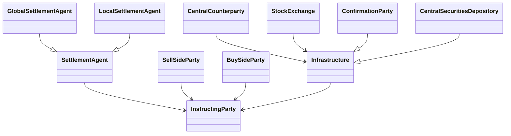

# Business roles and functional participant overview

## Source and original artwork

[src-000196](<../../../../../../../../raw-input/settlement_and_reconciliation/ISO20022_MDRPart1_SettlementAndReconciliation_2025_2026_v2.docx>), §3 BusinessRoles and Participants, paragraph172. Paragraph IDs count direct-body paragraphs. Archive member `word/media/image4.png`.

[Unchanged original figure](<../../../../../../assets/src-000196/originals/image4.png>)

## Mermaid reconstruction

## Entities and relationships

Eleven labels and ten relationships retained. Hollow triangles are generalization; open arrows remain directional associations. No cardinality or business ownership inferred. Source actor glyphs become class-shaped role nodes; this notation difference is explicit. The artwork omits executing/servicing role, which remains in the participant library.

## Review evidence

| Check | Result | Evidence |
| --- | --- | --- |
| Original figure inspection | performed | Source raster/EMF preview inspected on 2026-11-08 |
| Mermaid parse/render | pass | Mermaid 12.3.0; Chromium 156.0.8078.81; 2026-11-08 |
| Rendered reconstruction compared with original | pass | High-priority explicit review: compared 11 labels, 10 relationships, 4 hollow-triangle generalizations and 6 directed associations. Actor glyphs represented by class boxes; limitation documented; no cardinalities added. |

[Pilot diagram index](<index.md>)

[Validated SVG](<../../../../../../assets/src-000196/reconstructed/08-role-model.svg>) · [Readable rendered PNG](<../../../../../../assets/src-000196/reconstructed/08-role-model.png>)

Visual review applies to this reconstructed view; it does not claim complete source-wide figure coverage or resolve source semantic defects.

<!-- RENDERED-SOURCE-START -->
## Rendered source page context

[Read-only Word-rendered source PDF](../../../../../../../../work/docx-render/src-000196/document.pdf); file page(s) 12. The page association is established by exact original-asset SHA-256 in the Word shape inventory, not by shape ordinal. Full-page/composite visual comparison is pending unless a separate dated review is recorded.
<!-- RENDERED-SOURCE-END -->
