# Settlement communication scope and account relationships

[src-000196](../../../../../../../../raw-input/settlement_and_reconciliation/ISO20022_MDRPart1_SettlementAndReconciliation_2025_2026_v2.docx); direct-body paragraph P145; Scope and Functionality / Scope; `/w:document/w:body/w:p[145]`.

[Unchanged original asset](../../../../../../assets/src-000196/originals/image1.png) · [Readable original/complete vector preview](../../../../../../assets/src-000196/originals/image1.png)

## Mermaid source reconstruction

```mermaid
%%{init: {"themeVariables": {"edgeLabelBackground": "#ffffff"}, "themeCSS": ".edgeLabel rect { fill: #fff !important; opacity: 1 !important; }"}}%%
flowchart LR
  Customer["Customer"]
  Custodian["Custodian"]
  Sub["Sub-Custodian<br/>Account Owner 3"]
  Broker["Broker"]
  Agent["Broker's Local Agent<br/>Account Owner 2"]
  CSD["Central Securities Depository<br/>Account Servicer 3 / Account Servicer 2"]
  Customer -->|Receipt or Delivery instruction| Custodian
  Custodian -->|Settlement Status and Processing Advice| Customer
  Custodian -->|Settlement Confirmation| Customer
  Custodian -->|Centrally Generated Transaction Advice| Customer
  Custodian -->|Allegement| Customer
  Custodian -->|Receipt or Delivery instruction| Sub
  Sub -->|Settlement Status and Processing Advice| Custodian
  Sub -->|Settlement Confirmation| Custodian
  Sub -->|Centrally Generated Transaction Advice| Custodian
  Sub -->|Allegement| Custodian
  Broker -->|Receipt or Delivery instruction| Agent
  Agent -->|Settlement Status and Processing Advice| Broker
  Agent -->|Settlement Confirmation| Broker
  Agent -->|Centrally Generated Transaction Advice| Broker
  Agent -->|Allegement| Broker
  Sub -->|Receipt or Delivery instruction| CSD
  Sub -->|Transaction Processing Command| CSD
  CSD -->|Settlement Status and Processing Advice| Sub
  CSD -->|Settlement Confirmation| Sub
  CSD -->|Centrally Generated Transaction Advice| Sub
  CSD -->|Allegement| Sub
  Agent -->|Receipt or Delivery instruction| CSD
  Agent -->|Transaction Processing Command| CSD
  CSD -->|Settlement Status and Processing Advice| Agent
  CSD -->|Settlement Confirmation| Agent
  CSD -->|Centrally Generated Transaction Advice| Agent
  CSD -->|Allegement| Agent
  Sub -.-|Account Owner 3 / Account Servicer 3| CSD
  Agent -.-|Account Owner 2 / Account Servicer 2| CSD
```

## Participants and flow context

- [scope customer](../../../../../../../../shared/reference/participants/settlement-reconciliation-scope-customer.md)
- [scope custodian](../../../../../../../../shared/reference/participants/settlement-reconciliation-scope-custodian.md)
- [scope sub custodian](../../../../../../../../shared/reference/participants/settlement-reconciliation-scope-sub-custodian.md)
- [scope broker](../../../../../../../../shared/reference/participants/settlement-reconciliation-scope-broker.md)
- [scope brokers local agent](../../../../../../../../shared/reference/participants/settlement-reconciliation-scope-brokers-local-agent.md)
- [account owner](../../../../../../../../shared/reference/participants/settlement-reconciliation-account-owner.md)
- [account servicer](../../../../../../../../shared/reference/participants/settlement-reconciliation-account-servicer.md)
- [csd icsd](../../../../../../../../shared/reference/participants/settlement-reconciliation-csd-icsd.md)

- [instruction confirmation](../../flows/instruction-confirmation.md)
- [transaction generation](../../flows/transaction-generation.md)
- [allegement](../../flows/allegement.md)

## Semantics and limitations

- This is a communication-scope illustration, not a temporal sequence or a requirement to send every category. Generic message categories remain generic and are not assigned an exact message definition solely from this picture.
- Customer, Custodian, Sub-Custodian, Broker, Broker’s Local Agent and Central Securities Depository are the source labels. The sub-custodian/local-agent appearances repeated in different parts of the original artwork are consolidated into one node per exact labeled participant here.
- The original dotted account relationships explicitly pair Account Owner 3 with Account Servicer 3 and Account Owner 2 with Account Servicer 2. These are depicted relationships, not claims that an institution always holds that role. Institution pictograms are represented as labeled boxes; the original asset preserves their appearance.

## Rendering and visual review

Parse/render passed using Mermaid 12.3.0 with Mermaid browser API + Chromium 156.0.8078.81. [Rendered SVG](../../../../../../assets/src-000196/settlement-activities/fig-0001.svg) · [Rendered PNG](../../../../../../assets/src-000196/settlement-activities/fig-0001.png).

On 2026-11-09 (Europe/Warsaw), the original/full vector preview and the final reconstruction were directly compared for labels, role boundaries, decisions, branches, feedback paths, arrowheads/plain connections, start/end symbols and source synchronization bars. Result: **visual relationship fidelity pass**. Native layout reflows the lanes; original assets remain authoritative for pictorial layout. The machine render date is UTC 2026-11-08.

[Hash-bound review evidence](../../../../../../../../tracking/reviews/settlement-activities.json)

<!-- RENDERED-SOURCE-START -->
## Rendered source page context

[Read-only Word-rendered source PDF](../../../../../../../../work/docx-render/src-000196/document.pdf); file page(s) 8. The page association is established by exact original-asset SHA-256 in the Word shape inventory, not by shape ordinal. Full-page/composite visual comparison is pending unless a separate dated review is recorded.
<!-- RENDERED-SOURCE-END -->
