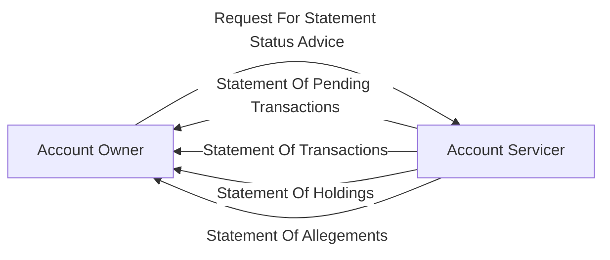

# Reporting communication overview

[src-000196](../../../../../../../../raw-input/settlement_and_reconciliation/ISO20022_MDRPart1_SettlementAndReconciliation_2025_2026_v2.docx); direct-body paragraph P147; Scope and Functionality / Scope; `/w:document/w:body/w:p[147]`.

[Unchanged original asset](../../../../../../assets/src-000196/originals/image2.png) · [Readable original/complete vector preview](../../../../../../assets/src-000196/originals/image2.png)

## Mermaid source reconstruction

## Participants and flow context

- [account owner](../../../../../../../../shared/reference/participants/settlement-reconciliation-account-owner.md)
- [account servicer](../../../../../../../../shared/reference/participants/settlement-reconciliation-account-servicer.md)

- [reporting push](../../flows/reporting-push.md)
- [reporting pull](../../flows/reporting-pull.md)

## Semantics and limitations

- This is a scope/communication overview, not an ordered sequence. Generic labels are retained, including the owner-to-servicer “Request For Statement Status Advice” label; they are not silently replaced with modern exact message names.

## Rendering and visual review

Parse/render passed using Mermaid 12.3.0 with Mermaid browser API + Chromium 156.0.8078.81. [Rendered SVG](../../../../../../assets/src-000196/settlement-activities/fig-0002.svg) · [Rendered PNG](../../../../../../assets/src-000196/settlement-activities/fig-0002.png).

On 2026-11-09 (Europe/Warsaw), the original/full vector preview and the final reconstruction were directly compared for labels, role boundaries, decisions, branches, feedback paths, arrowheads/plain connections, start/end symbols and source synchronization bars. Result: **visual relationship fidelity pass**. Native layout reflows the lanes; original assets remain authoritative for pictorial layout. The machine render date is UTC 2026-11-08.

[Hash-bound review evidence](../../../../../../../../tracking/reviews/settlement-activities.json)

<!-- RENDERED-SOURCE-START -->
## Rendered source page context

[Read-only Word-rendered source PDF](../../../../../../../../work/docx-render/src-000196/document.pdf); file page(s) 9. The page association is established by exact original-asset SHA-256 in the Word shape inventory, not by shape ordinal. Full-page/composite visual comparison is pending unless a separate dated review is recorded.
<!-- RENDERED-SOURCE-END -->
