# Financing instruction activity — three parties

[src-000196](../../../../../../../../raw-input/settlement_and_reconciliation/ISO20022_MDRPart1_SettlementAndReconciliation_2025_2026_v2.docx); direct-body paragraph P210; Description of BusinessActivities / Securities Financing Instruction / Securities Financing Instruction and Confirmation / Three Parties; `/w:document/w:body/w:p[210]`.

[Unchanged original asset](../../../../../../assets/src-000196/originals/image13.emf) · [Readable original/complete vector preview](../../../../../../assets/src-000196/derived-previews/image13.emf.png)

## Mermaid source reconstruction

```mermaid
%%{init: {"themeVariables": {"edgeLabelBackground": "#ffffff"}, "themeCSS": ".edgeLabel rect { fill: #fff !important; opacity: 1 !important; }"}}%%
flowchart TB
  subgraph I["Securities Financing Instructing Party"]
    IS@{shape: f-circ, label: " "}
    IA("Instruct securities financing transaction")
    IS --> IA
    IM("Monitor securities financing transaction")
    IU("Update Status")
    IOD{"Opening Settled?"}
    ICD{"Closing settled?"}
    IOS(["Settle Opening"])
    ICS(["Settle Closing"])
    ISJ@{shape: fork, label: " "}
    IOJ@{shape: fork, label: " "}
    IEnd@{shape: framed-circle, label: " "}
    IM --> IOD
    IOD -->|No| ISJ
    IOD -->|Yes| IOS
    IOS --> ICD
    ICD -->|No| ISJ
    ICD -->|Yes| ICS
    ISJ --> IU
    IU --> IM
    IOS --> IOJ
    ICS --> IOJ
    ICS --> IEnd
    IOJ --> IU
  end
  subgraph B["Securities Financing Servicing Party"]
    BP("Process instruction")
    BD{"Processed?"}
    BR("Update Status")
    BP --> BD
    BD -->|No| BR
    BA("Instruct settlement and monitor")
    BD -->|Yes| BA
    BM("Monitor securities financing transaction")
    BU("Update Status")
    BOD{"Opening Settled?"}
    BCD{"Closing settled?"}
    BOS(["Settle Opening"])
    BCS(["Settle Closing"])
    BSJ@{shape: fork, label: " "}
    BOJ@{shape: fork, label: " "}
    BEnd@{shape: framed-circle, label: " "}
    BM --> BOD
    BOD -->|No| BSJ
    BOD -->|Yes| BOS
    BOS --> BCD
    BCD -->|No| BSJ
    BCD -->|Yes| BCS
    BSJ --> BU
    BU --> BM
    BOS --> BOJ
    BCS --> BOJ
    BCS --> BEnd
  end
  subgraph C["Settlement Executing Party"]
    CO("Process instruction")
    CC("Process instruction")
    CD{"Processed?"}
    CR("Update Status")
    CM("Matching and Settlement Process")
    CS{"Settled?"}
    CU("Update Status")
    CX(["Settle instruction"])
    CE@{shape: framed-circle, label: " "}
    CO --> CD
    CC --> CD
    CD -->|No| CR
    CD -->|Yes| CM
    CM --> CS
    CS -->|No| CU
    CU --> CM
    CS -->|Yes| CX
    CX --> CE
  end
  BA -->|Opening leg| CO
  BA -->|Closing leg| CC
  CR --> BA
  CU -->|Opening Statuses / Closing Statuses| BM
  CX -->|Opening Settlement / Closing Settlement| BM
  IA --> BP
  BR --> IA
  BU --> IM
  BOJ --> IM
  classDef main fill:#d1d8b8,stroke:#111,color:#111
  classDef context fill:#c0d1e5,stroke:#111,color:#111
  class IA,IM,IOD,ICD,IOS,ICS,BP,BD,BA,BM,BOD,BCD,BOS,BCS main
  class IU,BU,BR context
  class CO,CC,CD,CR,CM,CS,CU,CX context
  classDef fork fill:#111,stroke:#111
  class ISJ,IOJ,BSJ,BOJ fork
  classDef framedcircle fill:#fff,stroke:#111,stroke-width:3px
  class IEnd,BEnd,CE framedcircle
  classDef fcirc fill:#4472c4,stroke:#4472c4
  class IS fcirc
```

## Participants and flow context

- [financing instructing party](../../../../../../../../shared/reference/participants/settlement-reconciliation-financing-instructing-party.md)
- [financing servicing party](../../../../../../../../shared/reference/participants/settlement-reconciliation-financing-servicing-party.md)
- [settlement executing party](../../../../../../../../shared/reference/participants/settlement-reconciliation-settlement-executing-party.md)

- [financing instruction three parties](../../flows/financing-instruction-three-parties.md)

[Activity table T31 — all steps, definitions and Initiator values](../../documents/src-000196/tables/tbl-0031.md). These source responsibilities are distinct from message sender/receiver assertions.

## Semantics and limitations

- Separate opening and closing instructions feed the settlement executing party. Opening and closing settlement checks, both status loops and four source bars remain distinct. The source outcome bars connect opening/closing outcomes onward without asserting that mutually exclusive routes must complete together.

Swimlane ownership is represented by native flowchart subgraphs. Decisions retain their source labels and branch labels; start/end symbols and explicit source bars use native Mermaid shapes. The layout is reflowed without changing endpoints. Green/blue fills preserve the source’s distinction between the foreground activities and surrounding status/context activities where visible.

## Rendering and visual review

Parse/render passed using Mermaid 12.3.0 with Mermaid browser API + Chromium 156.0.8078.81. [Rendered SVG](../../../../../../assets/src-000196/settlement-activities/fig-0013.svg) · [Rendered PNG](../../../../../../assets/src-000196/settlement-activities/fig-0013.png).

On 2026-11-09 (Europe/Warsaw), the original/full vector preview and the final reconstruction were directly compared for labels, role boundaries, decisions, branches, feedback paths, arrowheads/plain connections, start/end symbols and source synchronization bars. Result: **visual relationship fidelity pass**. Native layout reflows the lanes; original assets remain authoritative for pictorial layout. The machine render date is UTC 2026-11-08.

[Hash-bound review evidence](../../../../../../../../tracking/reviews/settlement-activities.json)

<!-- RENDERED-SOURCE-START -->
## Rendered source page context

[Read-only Word-rendered source PDF](../../../../../../../../work/docx-render/src-000196/document.pdf); file page(s) 24. The page association is established by exact original-asset SHA-256 in the Word shape inventory, not by shape ordinal. Full-page/composite visual comparison is pending unless a separate dated review is recorded.
<!-- RENDERED-SOURCE-END -->
