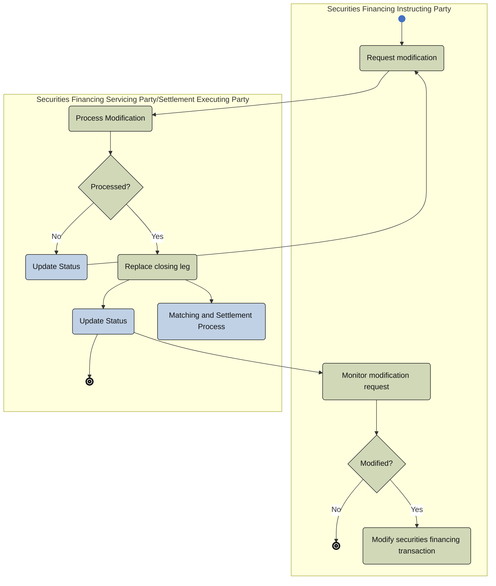

# Financing modification activity — two parties

[src-000196](../../../../../../../../raw-input/settlement_and_reconciliation/ISO20022_MDRPart1_SettlementAndReconciliation_2025_2026_v2.docx); direct-body paragraph P231; Description of BusinessActivities / Securities Financing Instruction / Modification Process  / Changes That Do Not Impact the Securities Position; `/w:document/w:body/w:p[231]`.

[Unchanged original asset](../../../../../../assets/src-000196/originals/image16.emf) · [Readable original/complete vector preview](../../../../../../assets/src-000196/derived-previews/image16.emf.png)

## Mermaid source reconstruction

## Participants and flow context

- [financing instructing party](../../../../../../../../shared/reference/participants/settlement-reconciliation-financing-instructing-party.md)
- [financing servicing settlement executing party](../../../../../../../../shared/reference/participants/settlement-reconciliation-financing-servicing-settlement-executing-party.md)

- [financing modification two parties](../../flows/financing-modification-two-parties.md)

[Activity table T34 — all steps, definitions and Initiator values](../../documents/src-000196/tables/tbl-0034.md). These source responsibilities are distinct from message sender/receiver assertions.

## Semantics and limitations

- The combined servicing/executing party replaces the closing leg and enters matching/settlement processing. The source picture does not add an endpoint after Modify securities financing transaction or Matching and Settlement Process.

Swimlane ownership is represented by native flowchart subgraphs. Decisions retain their source labels and branch labels; start/end symbols and explicit source bars use native Mermaid shapes. The layout is reflowed without changing endpoints. Green/blue fills preserve the source’s distinction between the foreground activities and surrounding status/context activities where visible.

## Rendering and visual review

Parse/render passed using Mermaid 12.3.0 with Mermaid browser API + Chromium 156.0.8078.81. [Rendered SVG](../../../../../../assets/src-000196/settlement-activities/fig-0016.svg) · [Rendered PNG](../../../../../../assets/src-000196/settlement-activities/fig-0016.png).

On 2026-11-09 (Europe/Warsaw), the original/full vector preview and the final reconstruction were directly compared for labels, role boundaries, decisions, branches, feedback paths, arrowheads/plain connections, start/end symbols and source synchronization bars. Result: **visual relationship fidelity pass**. Native layout reflows the lanes; original assets remain authoritative for pictorial layout. The machine render date is UTC 2026-11-08.

[Hash-bound review evidence](../../../../../../../../tracking/reviews/settlement-activities.json)

<!-- RENDERED-SOURCE-START -->
## Rendered source page context

[Read-only Word-rendered source PDF](../../../../../../../../work/docx-render/src-000196/document.pdf); file page(s) 30. The page association is established by exact original-asset SHA-256 in the Word shape inventory, not by shape ordinal. Full-page/composite visual comparison is pending unless a separate dated review is recorded.
<!-- RENDERED-SOURCE-END -->
