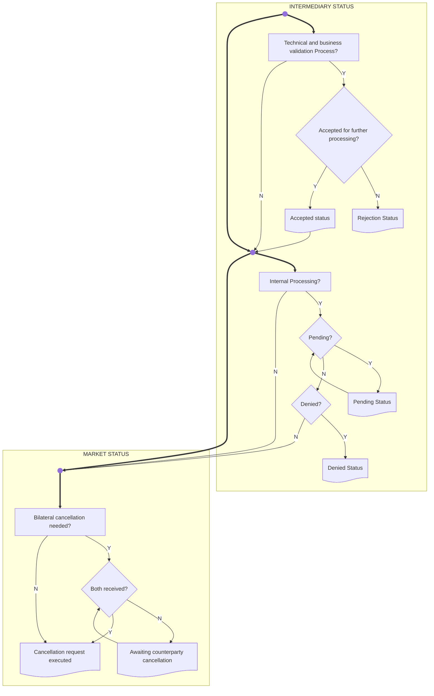

# Cancellation-request status processes

[src-000196](../../../../../../../../raw-input/settlement_and_reconciliation/ISO20022_MDRPart1_SettlementAndReconciliation_2025_2026_v2.docx); direct-body paragraph P249; Description of BusinessActivities / Status Reporting Process  / Cancellation Request Status Advice; `/w:document/w:body/w:p[249]`.

[Unchanged original asset](../../../../../../assets/src-000196/originals/image20.png) · [Readable original/complete vector preview](../../../../../../assets/src-000196/originals/image20.png)

## Mermaid source reconstruction

## Participants and flow context

- [instructing party](../../../../../../../../shared/reference/participants/settlement-reconciliation-instructing-party.md)
- [executing servicing party](../../../../../../../../shared/reference/participants/settlement-reconciliation-executing-servicing-party.md)

- [cancellation request](../../flows/cancellation-request.md)

## Semantics and limitations

- Intermediary and market status boundaries, rejection, accepted, pending, denied and bilateral-cancellation paths are retained. Pending returns to its decision; awaiting counterparty cancellation returns to Both received?. Neither accepted status nor pending status means the cancellation request has been executed. Small unlabeled junctions reproduce the original process spine.

## Rendering and visual review

Parse/render passed using Mermaid 12.3.0 with Mermaid browser API + Chromium 156.0.8078.81. [Rendered SVG](../../../../../../assets/src-000196/settlement-activities/fig-0020.svg) · [Rendered PNG](../../../../../../assets/src-000196/settlement-activities/fig-0020.png).

On 2026-11-09 (Europe/Warsaw), the original/full vector preview and the final reconstruction were directly compared for labels, role boundaries, decisions, branches, feedback paths, arrowheads/plain connections, start/end symbols and source synchronization bars. Result: **visual relationship fidelity pass**. Native layout reflows the lanes; original assets remain authoritative for pictorial layout. The machine render date is UTC 2026-11-08.

[Hash-bound review evidence](../../../../../../../../tracking/reviews/settlement-activities.json)

<!-- RENDERED-SOURCE-START -->
## Rendered source page context

[Read-only Word-rendered source PDF](../../../../../../../../work/docx-render/src-000196/document.pdf); file page(s) 36. The page association is established by exact original-asset SHA-256 in the Word shape inventory, not by shape ordinal. Full-page/composite visual comparison is pending unless a separate dated review is recorded.
<!-- RENDERED-SOURCE-END -->
