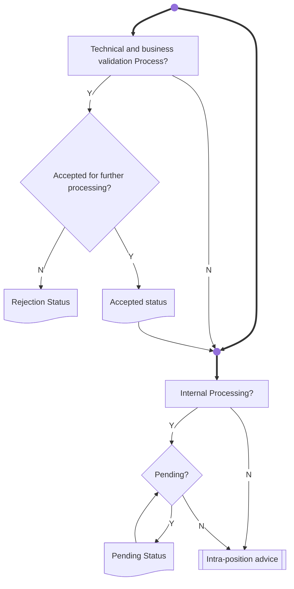

# Intra-position instruction status processes

[src-000196](../../../../../../../../raw-input/settlement_and_reconciliation/ISO20022_MDRPart1_SettlementAndReconciliation_2025_2026_v2.docx); direct-body paragraph P254; Description of BusinessActivities / Status Reporting Process  / Intra-position Instruction Status Advice; `/w:document/w:body/w:p[254]`.

[Unchanged original asset](../../../../../../assets/src-000196/originals/image22.jpeg) · [Readable original/complete vector preview](../../../../../../assets/src-000196/originals/image22.jpeg)

## Mermaid source reconstruction

## Participants and flow context

- [instructing party](../../../../../../../../shared/reference/participants/settlement-reconciliation-instructing-party.md)
- [executing servicing party](../../../../../../../../shared/reference/participants/settlement-reconciliation-executing-servicing-party.md)

- [intra position instruction](../../flows/intra-position-instruction.md)

## Semantics and limitations

- All source branches are retained, including bypassing technical validation and internal processing when the corresponding process box has an N branch. The bottom label is the source’s generic Intra-position advice; no exact message identifier is inferred from that label alone.

## Rendering and visual review

Parse/render passed using Mermaid 12.3.0 with Mermaid browser API + Chromium 156.0.8078.81. [Rendered SVG](../../../../../../assets/src-000196/settlement-activities/fig-0022.svg) · [Rendered PNG](../../../../../../assets/src-000196/settlement-activities/fig-0022.png).

On 2026-11-09 (Europe/Warsaw), the original/full vector preview and the final reconstruction were directly compared for labels, role boundaries, decisions, branches, feedback paths, arrowheads/plain connections, start/end symbols and source synchronization bars. Result: **visual relationship fidelity pass**. Native layout reflows the lanes; original assets remain authoritative for pictorial layout. The machine render date is UTC 2026-11-08.

[Hash-bound review evidence](../../../../../../../../tracking/reviews/settlement-activities.json)
