# Reporting pull activity

[src-000196](../../../../../../../../raw-input/settlement_and_reconciliation/ISO20022_MDRPart1_SettlementAndReconciliation_2025_2026_v2.docx); direct-body paragraph P301; Description of BusinessActivities / Reconciliation and Reporting Process / Pull Mode; `/w:document/w:body/w:p[301]`.

[Unchanged original asset](../../../../../../assets/src-000196/originals/image32.emf) · [Readable original/complete vector preview](../../../../../../assets/src-000196/derived-previews/image32.emf.png)

## Mermaid source reconstruction

```mermaid
%%{init: {"themeVariables": {"edgeLabelBackground": "#ffffff"}, "themeCSS": ".edgeLabel rect { fill: #fff !important; opacity: 1 !important; }"}}%%
flowchart TB
  subgraph I["Instructing Party"]
    Request("Request statement")
    Reconcile("Reconciliation process") --> Investigate("Investigate and solve breaks")
  end
  subgraph E["Executing/Servicing Party"]
    Process("Process Request") --> PD{"Processed?"}
    PD -->|No| Update("Update Status")
    PD -->|Yes| Requested{"Statement requested?"}
    Requested --> TransSplit@{shape: fork, label: " "}
    TransSplit --> RT("Report Transactions")
    TransSplit --> RI("Report Intra-position movements")
    Requested --> HoldSplit@{shape: fork, label: " "}
    HoldSplit --> RC("Report holdings (custody)")
    HoldSplit --> RA("Report holdings (accounting)")
    Requested --> PendingSplit@{shape: fork, label: " "}
    PendingSplit --> RP("Report Pending Transaction")
    PendingSplit --> RL("Report Allegements")
    RT --> Holds@{shape: fork, label: " "}
    RI --> Holds
    RC --> Holds
    RA --> Holds
    RP --> Pending@{shape: fork, label: " "}
    RL --> Pending
  end
  Request --> Process
  Update --> Request
  Holds --> Reconcile
  Pending --> Reconcile
  classDef focus fill:#d1d8b8,stroke:#111,color:#111
  class Request,Reconcile,Investigate,Process,PD,Update,Requested,RT,RI,RC,RA,RP,RL focus
  classDef fork fill:#111,stroke:#111
  class TransSplit,HoldSplit,PendingSplit,Holds,Pending fork
```

## Participants and flow context

- [instructing party](../../../../../../../../shared/reference/participants/settlement-reconciliation-instructing-party.md)
- [executing servicing party](../../../../../../../../shared/reference/participants/settlement-reconciliation-executing-servicing-party.md)
- [reporting third party](../../../../../../../../shared/reference/participants/settlement-reconciliation-reporting-third-party.md)

- [reporting pull](../../flows/reporting-pull.md)

[Activity table T44 — all steps, definitions and Initiator values](../../documents/src-000196/tables/tbl-0044.md). These source responsibilities are distinct from message sender/receiver assertions.

## Semantics and limitations

- The source Statement requested? diamond distributes to three bars for transaction/intra-position, holdings and pending/allegement report categories. No Yes/No branch labels or default report are invented. Both result bars feed the reconciliation process.
- The diagram shows only the two main parties. The full pull flow includes the Third Party named in the narrative and detailed sequence.

Swimlane ownership is represented by native flowchart subgraphs. Decisions retain their source labels and branch labels; start/end symbols and explicit source bars use native Mermaid shapes. The layout is reflowed without changing endpoints. Green/blue fills preserve the source’s distinction between the foreground activities and surrounding status/context activities where visible.

## Rendering and visual review

Parse/render passed using Mermaid 12.3.0 with Mermaid browser API + Chromium 156.0.8078.81. [Rendered SVG](../../../../../../assets/src-000196/settlement-activities/fig-0032.svg) · [Rendered PNG](../../../../../../assets/src-000196/settlement-activities/fig-0032.png).

On 2026-11-09 (Europe/Warsaw), the original/full vector preview and the final reconstruction were directly compared for labels, role boundaries, decisions, branches, feedback paths, arrowheads/plain connections, start/end symbols and source synchronization bars. Result: **visual relationship fidelity pass**. Native layout reflows the lanes; original assets remain authoritative for pictorial layout. The machine render date is UTC 2026-11-08.

[Hash-bound review evidence](../../../../../../../../tracking/reviews/settlement-activities.json)

<!-- RENDERED-SOURCE-START -->
## Rendered source page context

[Read-only Word-rendered source PDF](../../../../../../../../work/docx-render/src-000196/document.pdf); file page(s) 50. The page association is established by exact original-asset SHA-256 in the Word shape inventory, not by shape ordinal. Full-page/composite visual comparison is pending unless a separate dated review is recorded.
<!-- RENDERED-SOURCE-END -->
