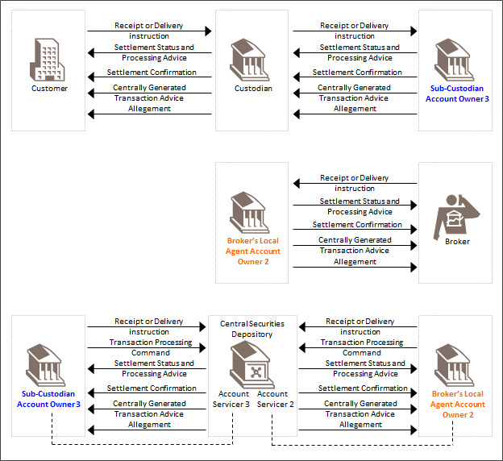

# fig-0001 - original figure evidence

Source: [src-000196](../../../../../../../../../raw-input/settlement_and_reconciliation/ISO20022_MDRPart1_SettlementAndReconciliation_2025_2026_v2.docx). Locator: direct-body paragraph P145; Scope and Functionality / Scope; /w:document/w:body/w:p[145].

Original extracted asset: [image1.png](../../../../../../../assets/src-000196/originals/image1.png)

## Canonical reconstruction and review

[Canonical diagram, source qualifications, participant/flow links and recorded review evidence](../../../diagrams/settlement-activities/fig-0001.md). Original media and this occurrence's precise locator are retained. Rendering and visual comparison results above are copied from the canonical reference; any unresolved business, version or contextual limitation remains open.

<!-- CANONICAL-ACTIVITY-START -->
[Canonical source reconstruction and review evidence](../../../diagrams/settlement-activities/fig-0001.md)
<!-- CANONICAL-ACTIVITY-END -->
