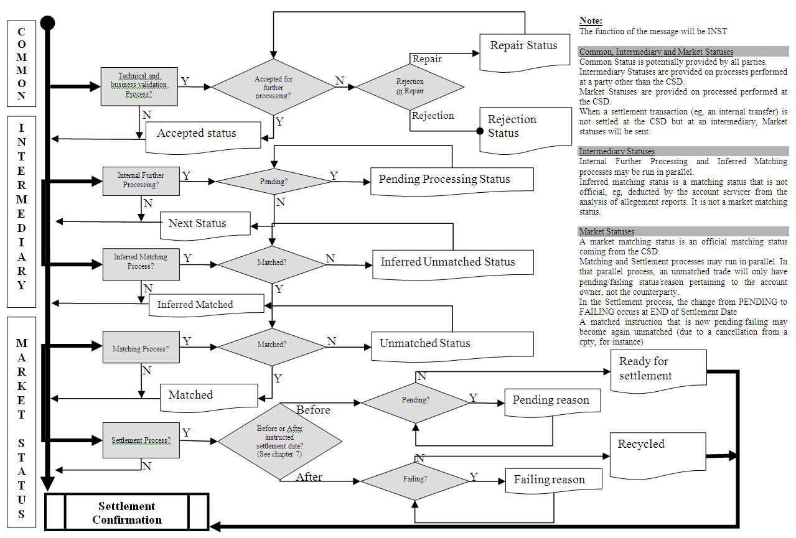

# fig-0019 - original figure evidence

Source: [src-000196](../../../../../../../../../raw-input/settlement_and_reconciliation/ISO20022_MDRPart1_SettlementAndReconciliation_2025_2026_v2.docx). Locator: direct-body paragraph P247; Description of BusinessActivities / Status Reporting Process  / Instruction Status Advice; /w:document/w:body/w:p[247].

Original extracted asset: [image19.jpeg](../../../../../../../assets/src-000196/originals/image19.jpeg)

## Canonical reconstruction and review

[Canonical diagram, source qualifications, participant/flow links and recorded review evidence](../../../diagrams/settlement-activities/fig-0019.md). Original media and this occurrence's precise locator are retained. Rendering and visual comparison results above are copied from the canonical reference; any unresolved business, version or contextual limitation remains open.

<!-- CANONICAL-ACTIVITY-START -->
[Canonical source reconstruction and review evidence](../../../diagrams/settlement-activities/fig-0019.md)
<!-- CANONICAL-ACTIVITY-END -->
