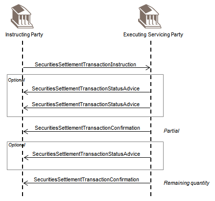

# fig-0039 - original figure evidence

Source: [src-000196](../../../../../../../../../raw-input/settlement_and_reconciliation/ISO20022_MDRPart1_SettlementAndReconciliation_2025_2026_v2.docx). Locator: direct-body paragraph P343; BusinessTransactions / Partial Settlement Confirmation; /w:document/w:body/w:p[343].

Original extracted asset: [image39.png](../../../../../../../assets/src-000196/originals/image39.png)

## Canonical reconstruction and review

[Canonical diagram, source qualifications, participant/flow links and recorded review evidence](../../../diagrams/pilot/02-partial-sequence.md). Original media and this occurrence's precise locator are retained. Rendering and visual comparison results above are copied from the canonical reference; any unresolved business, version or contextual limitation remains open.

## Canonical reconstructed view

[Source reconstruction, Mermaid and recorded render/visual comparison](<../../../diagrams/pilot/02-partial-sequence.md>). The source artwork is retained above. This link does not establish complete source-wide coverage or resolve source semantic conflicts.

[Canonical source reconstruction, participant/flow context and completed visual review](../../../diagrams/pilot/02-partial-sequence.md)
