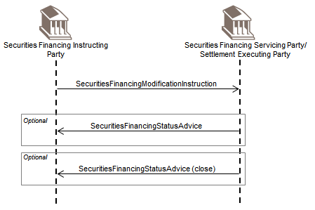

# fig-0043 - original figure evidence

Source: [src-000196](../../../../../../../../../raw-input/settlement_and_reconciliation/ISO20022_MDRPart1_SettlementAndReconciliation_2025_2026_v2.docx). Locator: direct-body paragraph P382; BusinessTransactions / Securities Financing / Securities Financing Modification / Changes That Do Not Impact the Securities Position ; /w:document/w:body/w:p[382].

Original extracted asset: [image43.png](../../../../../../../assets/src-000196/originals/image43.png)

## Canonical reconstruction and review

[Canonical diagram, source qualifications, participant/flow links and recorded review evidence](../../../diagrams/settlement-sequences/fig-0043.md). Original media and this occurrence's precise locator are retained. Rendering and visual comparison results above are copied from the canonical reference; any unresolved business, version or contextual limitation remains open.

<!-- CANONICAL-SEQUENCE-START -->
[Canonical sequence reconstruction, roles and review evidence](../../../diagrams/settlement-sequences/fig-0043.md)
<!-- CANONICAL-SEQUENCE-END -->
