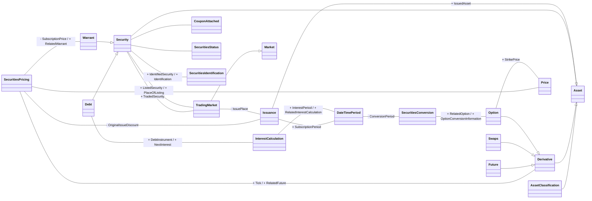

# Fin. Instrument Attrib. conceptual business model

Source: [src-000198](<../../../../../../../../../raw-input/settlement_and_reconciliation/ISO20022_MDRPart3_SettlementAndReconciliation_2025_2026_v1.xlsx>), worksheet `Fin. Instrument Attrib.`, drawing anchor `A1:T42` (including recorded offsets in extraction coverage), `xl/drawings/drawing3.xml`.

## Mermaid reconstruction

## Complete relationship inventory

The source labels are transcribed below. A blank label means this artwork leaves the association unlabelled. `--|>` denotes the visible hollow-triangle generalization. `--` is an association, not a message direction. Visible plus/minus prefixes are preserved. Numeric end labels appear only when visible; blank cardinality is not asserted as one.

| Node A | Relationship | Node B | Source labels | A cardinality | B cardinality |
| --- | --- | --- | --- | --- | --- |
| SecuritiesPricing | -- | Issuance | - OriginalIssueDiscount |  |  |
| SecuritiesPricing | -- | Price |  |  |  |
| SecuritiesPricing | -- | Derivative | + Tick / + RelatedFuture |  |  |
| SecuritiesPricing | -- | Warrant | - SubscriptionPrice / + RelatedWarrant |  |  |
| AssetClassification | -- | Asset |  |  |  |
| Asset | -- | Issuance | + IssuedAsset |  |  |
| Derivative | --\|&gt; | Asset |  |  |  |
| Security | --\|&gt; | Asset |  |  |  |
| TradingMarket | --\|&gt; | Market |  |  |  |
| TradingMarket | -- | Issuance | - IssuePlace |  |  |
| Security | -- | TradingMarket | + TradedSecurity |  |  |
| Security | -- | TradingMarket | + ListedSecurity / + PlaceOfListing |  |  |
| Security | -- | CouponAttached |  |  |  |
| Security | -- | SecuritiesStatus |  |  |  |
| Future | --\|&gt; | Derivative |  |  |  |
| Swaps | --\|&gt; | Derivative |  |  |  |
| Option | --\|&gt; | Derivative |  |  |  |
| Debt | --\|&gt; | Security |  |  |  |
| Warrant | --\|&gt; | Security |  |  |  |
| Security | -- | SecuritiesIdentification | + IdentifiedSecurity / + Identification |  |  |
| Issuance | -- | DateTimePeriod | + SubscriptionPeriod |  |  |
| Debt | -- | InterestCalculation | + DebtInstrument / + NextInterest |  |  |
| InterestCalculation | -- | DateTimePeriod | + InterestPeriod / + RelatedInterestCalculation |  |  |
| DateTimePeriod | -- | SecuritiesConversion | - ConversionPeriod |  |  |
| SecuritiesConversion | -- | Option | + RelatedOption / + OptionConversionInformation |  |  |
| Option | -- | Price | + StrikePrice |  |  |

## Entities and textual model context

- **SecuritiesPricing**: Characteristics related to the price of the security. (src-000198 `FullBusinessModel!A4260:F4260`.)
- **Issuance**: Preparation/bringing to market of a security (also known as primary market or Initial Public Offering (IPO) issuance). (src-000198 `FullBusinessModel!A2496:F2496`.)
- **AssetClassification**: Other classification type of the security, ie, other than ISO 10962. (src-000198 `FullBusinessModel!A281:F281`.)
- **Asset**: Tangible items of value to a business. (src-000198 `FullBusinessModel!A258:F258`.)
- **Market**: Context or geographic environment in which trading parties execute trades. (src-000198 `FullBusinessModel!A2735:F2735`.)
- **TradingMarket**: Context or geographic environment in which trading parties may meet in order to negotiate and execute trades among themselves. It also identifies the primary market where an asset is issued. (src-000198 `FullBusinessModel!A5146:F5146`.)
- **Derivative**: Specifies the parameters of a derivative instrument based on a specific asset. (src-000198 `FullBusinessModel!A1549:F1549`.)
- **Security**: Financial instruments representing a sum of rights of the investor vis-a-vis the issuer. (src-000198 `FullBusinessModel!A4659:F4659`.)
- **CouponAttached**: Physical certificates representing rights attached to the physical certificates representing a security. (src-000198 `FullBusinessModel!A1274:F1274`.)
- **SecuritiesStatus**: Specifies the status of the security within its lifecycle. (src-000198 `FullBusinessModel!A4524:F4524`.)
- **Future**: Parameters for contracts which obligate the buyer to receive and the seller to deliver in the future the assets specified at an agreed price. (src-000198 `FullBusinessModel!A1961:F1961`.)
- **Swaps**: Derivative contract through which two parties exchange financial instruments. (src-000198 `FullBusinessModel!A4877:F4877`.)
- **Debt**: Financial instruments evidencing moneys owed by the issuer to the holder on terms as specified. (src-000198 `FullBusinessModel!A1452:F1452`.)
- **Warrant**: Financial instrument that gives the holder the right to purchase shares or bonds at a given price within a specified time. (src-000198 `FullBusinessModel!A5434:F5434`.)
- **SecuritiesIdentification**: Unique and unambiguous identifier of a security, assigned under a formal or proprietary identification scheme. (src-000198 `FullBusinessModel!A4067:F4067`.)
- **DateTimePeriod**: Time span defined by a start date and time, and an end date and time. (src-000198 `FullBusinessModel!A1363:F1363`.)
- **InterestCalculation**: Set of parameters used to calculate an interest amount. (src-000198 `FullBusinessModel!A2156:F2156`.)
- **Price**: Amount of money for which goods, services or assets are offered, sold, or bought. (src-000198 `FullBusinessModel!A3491:F3491`.)
- **Option**: Contracts which grant to the holder either the privilege to purchase or the privilege to sell the assets specified at a predetermined price or formula at or within a time in the future. (src-000198 `FullBusinessModel!A2924:F2924`.)
- **SecuritiesConversion**: Conversion exchange of securities, generally convertible bonds or preferred equities, into another form of securities, usually common equities. (src-000198 `FullBusinessModel!A3957:F3957`.)

## Scope and limitations

Source association-end labels are preserved as combined labels in Mermaid and separately listed below. Positioning of a label in this re-layout is not an independent assertion of navigability. No multiplicities or database keys are supplied by this view.

This is a reconstruction of a supplied conceptual model, not an XSD-derived view. It does not establish cardinality/defaults for any message schema.

## Review evidence

Original and rendered reconstruction visually compared on 2026-11-08. Compared 20 nodes and 26 associations/generalizations, source labels and inheritance endpoints to original. Combined end labels retained in relationship table. Mermaid 12.3.0 and Chromium 156.0.8078.81 parsed and rendered this view successfully. The relationship inventory preserves all26 transcribed links; no figure-specific source ambiguity was recorded in this bounded review.

[Workbook index](<../index.md>)

[Validated SVG](<../../../../../../../assets/src-000198/reconstructed/fig-0003.svg>) · [Rendered comparison image](<../../../../../../../assets/src-000198/reconstructed/fig-0003.png>)

[Contextual participants](<../../../participants.md>)
