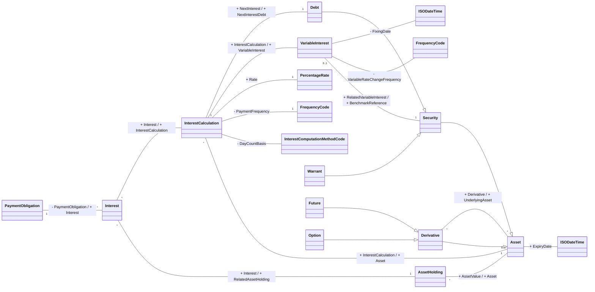

# Fin. Instrument Interest conceptual business model

Source: [src-000198](<../../../../../../../../../raw-input/settlement_and_reconciliation/ISO20022_MDRPart3_SettlementAndReconciliation_2025_2026_v1.xlsx>), worksheet `Fin. Instrument Interest`, drawing anchor `A2:V32` (including recorded offsets in extraction coverage), `xl/drawings/drawing4.xml`.

## Mermaid reconstruction

## Complete relationship inventory

The source labels are transcribed below. A blank label means this artwork leaves the association unlabelled. `--|>` denotes the visible hollow-triangle generalization. `--` is an association, not a message direction. Visible plus/minus prefixes are preserved. Numeric end labels appear only when visible; blank cardinality is not asserted as one.

| Node A | Relationship | Node B | Source labels | A cardinality | B cardinality |
| --- | --- | --- | --- | --- | --- |
| Interest | -- | AssetHolding | + Interest / + RelatedAssetHolding | * | 1 |
| AssetHolding | -- | Asset | + AssetValue / + Asset | * | 1 |
| Asset | -- | ExpiryISODateTime | + ExpiryDate |  |  |
| PaymentObligation | -- | Interest | - PaymentObligation / + Interest | 1 | * |
| Interest | -- | InterestCalculation | + Interest / + InterestCalculation | * |  |
| InterestCalculation | -- | Asset | + InterestCalculation / + Asset | * | 0..1 |
| Security | --\|&gt; | Asset |  |  |  |
| Derivative | --\|&gt; | Asset |  |  |  |
| Derivative | -- | Asset | + Derivative / + UnderlyingAsset | * | * |
| Debt | --\|&gt; | Security |  |  |  |
| Warrant | --\|&gt; | Security |  |  |  |
| Future | --\|&gt; | Derivative |  |  |  |
| Option | --\|&gt; | Derivative |  |  |  |
| InterestCalculation | -- | InterestComputationMethodCode | - DayCountBasis |  |  |
| InterestCalculation | -- | PaymentFrequencyCode | - PaymentFrequency |  | 1 |
| InterestCalculation | -- | PercentageRate | + Rate |  | 1 |
| InterestCalculation | -- | VariableInterest | + InterestCalculation / + VariableInterest |  |  |
| InterestCalculation | -- | Debt | + NextInterest / + NextInterestDebt | 1 | 1 |
| VariableInterest | -- | Security | + RelatedVariableInterest / + BenchmarkReference | 0..1 | 1 |
| VariableInterest | -- | VariableFrequencyCode | - VariableRateChangeFrequency |  |  |
| VariableInterest | -- | FixingISODateTime | - FixingDate |  |  |

## Entities and textual model context

- **Interest**: Consideration, such as amount of money,  paid or received in exchange for an asset that has been invested, loaned or borrowed for a certain period. The interest is expressed as a fixed amount or percentage of the amount upon which the interest is applied. (src-000198 `FullBusinessModel!A2133:F2133`.)
- **AssetHolding**: Specifies in terms of value and quantity the assets. (src-000198 `FullBusinessModel!A289:F289`.)
- **Asset**: Tangible items of value to a business. (src-000198 `FullBusinessModel!A258:F258`.)
- **ISODateTime**: shown by this source drawing; corresponding component definition not located in FullBusinessModel. No definition is invented.
- **PaymentObligation**: Obligation for the debtor to pay the creditor an amount of cash. (src-000198 `FullBusinessModel!A3166:F3166`.)
- **InterestCalculation**: Set of parameters used to calculate an interest amount. (src-000198 `FullBusinessModel!A2156:F2156`.)
- **Security**: Financial instruments representing a sum of rights of the investor vis-a-vis the issuer. (src-000198 `FullBusinessModel!A4659:F4659`.)
- **Derivative**: Specifies the parameters of a derivative instrument based on a specific asset. (src-000198 `FullBusinessModel!A1549:F1549`.)
- **InterestComputationMethodCode**: shown by this source drawing; corresponding component definition not located in FullBusinessModel. No definition is invented.
- **FrequencyCode**: shown by this source drawing; corresponding component definition not located in FullBusinessModel. No definition is invented.
- **PercentageRate**: shown by this source drawing; corresponding component definition not located in FullBusinessModel. No definition is invented.
- **VariableInterest**: Specifies the estimated interest rate and the parameters used for determining its value. (src-000198 `FullBusinessModel!A5367:F5367`.)
- **Debt**: Financial instruments evidencing moneys owed by the issuer to the holder on terms as specified. (src-000198 `FullBusinessModel!A1452:F1452`.)
- **Warrant**: Financial instrument that gives the holder the right to purchase shares or bonds at a given price within a specified time. (src-000198 `FullBusinessModel!A5434:F5434`.)
- **Future**: Parameters for contracts which obligate the buyer to receive and the seller to deliver in the future the assets specified at an agreed price. (src-000198 `FullBusinessModel!A1961:F1961`.)
- **Option**: Contracts which grant to the holder either the privilege to purchase or the privilege to sell the assets specified at a predetermined price or formula at or within a time in the future. (src-000198 `FullBusinessModel!A2924:F2924`.)
- **FrequencyCode**: shown by this source drawing; corresponding component definition not located in FullBusinessModel. No definition is invented.
- **ISODateTime**: shown by this source drawing; corresponding component definition not located in FullBusinessModel. No definition is invented.

## Scope and limitations

The source has overlapping cardinality/association labels around InterestCalculation, VariableInterest and Debt. Visible 1/0..1/star values are transcribed where their endpoints are legible; the InterestCalculation–VariableInterest endpoint cardinalities need further confirmation against the original. Preserve the original rather than treating unlabelled Mermaid ends as 1. The image shows Interest–PaymentObligation and InterestCalculation–Asset associations and NextInterestDebt naming not mirrored by this workbook’s detailed table. Those source discrepancies remain unresolved.

This is a reconstruction of a supplied conceptual model, not an XSD-derived view. It does not establish cardinality/defaults for any message schema. Repeated ISODateTime/FrequencyCode drawing occurrences keep separate rendering identifiers while retaining their source labels.

## Review evidence

Original and rendered reconstruction visually compared on 2026-11-08. Compared 18 rendered node occurrences and 21 relationships to original and magnified source crop. Image/table discrepancies and overlapping InterestCalculation–VariableInterest cardinalities remain issue-000015; review incomplete for those ends. Mermaid 12.3.0 and Chromium 156.0.8078.81 parsed and rendered this view successfully. The relationship inventory preserves all transcribed links; this does not resolve the stated source inconsistencies.

[Workbook index](<../index.md>)

[Validated SVG](<../../../../../../../assets/src-000198/reconstructed/fig-0004.svg>) · [Rendered comparison image](<../../../../../../../assets/src-000198/reconstructed/fig-0004.png>)

[Source ambiguities: issue-000015](<../../../../../../../../../tracking/issues.md>) · [Contextual participants](<../../../participants.md>)
