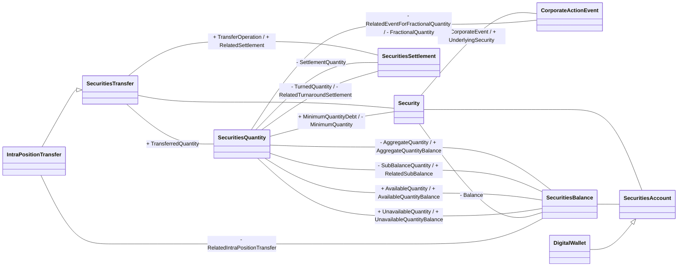

# Intra Position conceptual business model

Source: [src-000198](<../../../../../../../../../raw-input/settlement_and_reconciliation/ISO20022_MDRPart3_SettlementAndReconciliation_2025_2026_v1.xlsx>), worksheet `Intra Position`, drawing anchor `A1:R30` (including recorded offsets in extraction coverage), `xl/drawings/drawing5.xml`.

## Mermaid reconstruction

## Complete relationship inventory

The source labels are transcribed below. A blank label means this artwork leaves the association unlabelled. `--|>` denotes the visible hollow-triangle generalization. `--` is an association, not a message direction. Visible plus/minus prefixes are preserved. Numeric end labels appear only when visible; blank cardinality is not asserted as one.

| Node A | Relationship | Node B | Source labels | A cardinality | B cardinality |
| --- | --- | --- | --- | --- | --- |
| SecuritiesTransfer | -- | Security |  |  |  |
| SecuritiesTransfer | -- | SecuritiesQuantity | + TransferredQuantity |  |  |
| SecuritiesTransfer | -- | SecuritiesSettlement | + TransferOperation / + RelatedSettlement |  |  |
| Security | -- | CorporateActionEvent | + CorporateEvent / + UnderlyingSecurity |  |  |
| SecuritiesQuantity | -- | Security | + MinimumQuantityDebt / - MinimumQuantity |  |  |
| SecuritiesQuantity | -- | CorporateActionEvent | - RelatedEventForFractionalQuantity / - FractionalQuantity |  |  |
| SecuritiesQuantity | -- | SecuritiesSettlement | - SettlementQuantity |  |  |
| SecuritiesQuantity | -- | SecuritiesSettlement | - TurnedQuantity / - RelatedTurnaroundSettlement |  |  |
| SecuritiesQuantity | -- | SecuritiesBalance | - AggregateQuantity / + AggregateQuantityBalance |  |  |
| SecuritiesQuantity | -- | SecuritiesBalance | - SubBalanceQuantity / + RelatedSubBalance |  |  |
| SecuritiesQuantity | -- | SecuritiesBalance | + AvailableQuantity / + AvailableQuantityBalance |  |  |
| SecuritiesQuantity | -- | SecuritiesBalance | + UnavailableQuantity / + UnavailableQuantityBalance |  |  |
| Security | -- | SecuritiesBalance | - Balance |  |  |
| Security | -- | SecuritiesAccount |  |  |  |
| SecuritiesBalance | -- | SecuritiesAccount |  |  |  |
| IntraPositionTransfer | -- | SecuritiesBalance | - RelatedIntraPositionTransfer |  |  |
| IntraPositionTransfer | --\|&gt; | SecuritiesTransfer |  |  |  |
| DigitalWallet | --\|&gt; | SecuritiesAccount |  |  |  |

## Entities and textual model context

- **SecuritiesTransfer**: Completion of a securities settlement instruction, wherein securities are delivered/debited from a securities account and received/credited to the designated securities account. (src-000198 `FullBusinessModel!A4642:F4642`.)
- **Security**: Financial instruments representing a sum of rights of the investor vis-a-vis the issuer. (src-000198 `FullBusinessModel!A4659:F4659`.)
- **CorporateActionEvent**: An event determined by a corporation's board of directors, that changes the existing corporate capital structure or financial condition. (src-000198 `FullBusinessModel!A1083:F1083`.)
- **SecuritiesQuantity**: Quantity of a security. (src-000198 `FullBusinessModel!A4350:F4350`.)
- **SecuritiesSettlement**: Settlement of the securities in a securities transaction, that is, the instruction to deliver or receive securities, involving the payment of an amount of money or not. (src-000198 `FullBusinessModel!A4474:F4474`.)
- **IntraPositionTransfer**: Transfer of securities from one sub-balance to another or from one balance status to another. (src-000198 `FullBusinessModel!A2187:F2187`.)
- **SecuritiesBalance**: Net position of a segregated holding, in a single security, within the overall position held in a securities account. A securities balance is calculated from the sum of securities' receipts minus the sum of securities' deliveries. (src-000198 `FullBusinessModel!A3921:F3921`.)
- **SecuritiesAccount**: Account to or from which a securities entry is made. (src-000198 `FullBusinessModel!A3889:F3889`.)
- **DigitalWallet**: Digital account where digital assets or digital tokens can be stored and where an entry is made. (src-000198 `FullBusinessModel!A1575:F1575`.)

## Scope and limitations

The source shows four separate quantity/balance relationships sharing a visual route. They remain four Mermaid associations, not one collapsed field. It shows no numeric multiplicities. IntraPositionTransfer inherits SecuritiesTransfer; DigitalWallet inherits SecuritiesAccount. These are conceptual business relationships, not database keys or XML containment.

This is a reconstruction of a supplied conceptual model, not an XSD-derived view. It does not establish cardinality/defaults for any message schema. Repeated ISODateTime/FrequencyCode drawing occurrences keep separate rendering identifiers while retaining their source labels.

## Review evidence

Original and rendered reconstruction visually compared on 2026-11-08. Compared nine nodes and eighteen relationships to original, including four distinct balance/quantity associations, both generalizations, and unlabelled associations. No numeric multiplicities inferred. Mermaid 12.3.0 and Chromium 156.0.8078.81 parsed and rendered this view successfully. The relationship inventory preserves all transcribed links. No unresolved diagram-specific source ambiguity remains in this view.

[Workbook index](<../index.md>)

[Validated SVG](<../../../../../../../assets/src-000198/reconstructed/fig-0005.svg>) · [Rendered comparison image](<../../../../../../../assets/src-000198/reconstructed/fig-0005.png>)

[Contextual participants](<../../../participants.md>)

On 2026-11-09 the source workbook checksum, reviewed Mermaid checksum and all page links were rechecked and passed. The diagram scope is reviewed; issue-000015 concerns other model views and remains open for those views.

## Exact-image occurrence in src-000382 fig-0002

[T2S SettlementRestrictions — T2S-SettlementRestrictions](../../../../../t2s-settlement-restrictions/september-2025/workbooks/src-000382/diagrams/fig-0002.md) retains its archive-member provenance and message-set context. Full source-figure SHA-256 and all visible component parent/definition claims match; see its declaration-row comparison.
