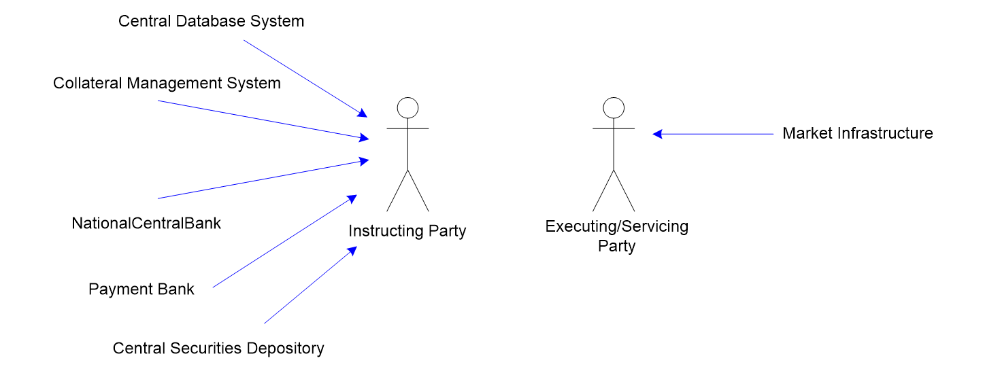
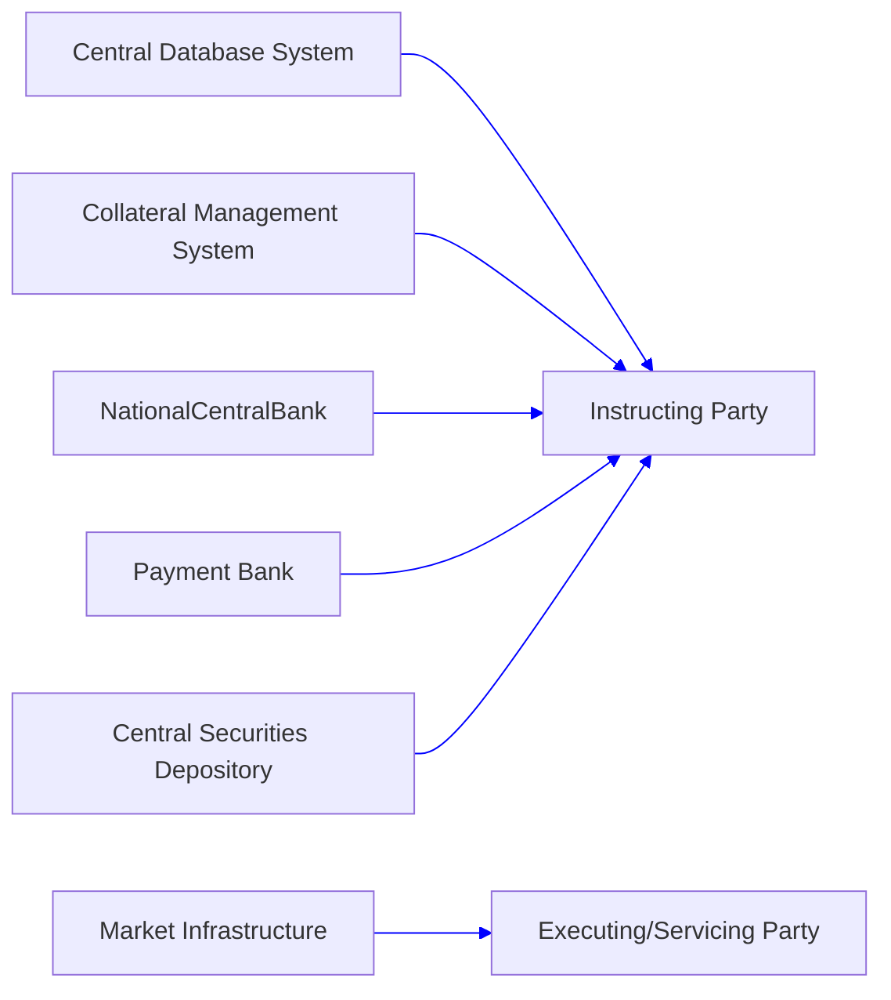

# Billing business roles and functional participants

## Source evidence

[src-000347](../../../../../../../../raw-input/target2securities_t2s/ISO20022_MDR_Target2Securities_August_2026_v1.zip) archive member `ISO20022_MDR_Target2Securities_August_2026_v1/Target2-Securities_Billing_MessageSet/ISO20022_MDRPart1_Target2Securities_Billing_v2.docx`; BusinessRoles and Participants; direct-body paragraph P97; word/media/image1.emf. [Unchanged original asset or complete source render](../../../../../../assets/src-000347/originals/image1.emf).

## Mermaid reconstruction

## Participants, responsibilities and alternatives

Five blue directed associations point from Central Database System, Collateral Management System, NationalCentralBank, Payment Bank and Central Securities Depository to Instructing Party. Market Infrastructure points to Executing/Servicing Party. These are source role associations, not message-exchange arrows. T5 defines these functional participants. T7 instead uses Account Servicer and Account Owner columns, omits Central Database System and does not establish equivalence to T5. Both vocabularies remain separate under issue-000038.

| Source-scoped role | Canonical reference |
| --- | --- |
| central database system | [central database system](../../../../../../../../shared/reference/participants/participant-src-000347-central-database-system.md) |
| collateral management system | [collateral management system](../../../../../../../../shared/reference/participants/participant-src-000347-collateral-management-system.md) |
| national central bank | [national central bank](../../../../../../../../shared/reference/participants/participant-src-000347-national-central-bank.md) |
| payment bank | [payment bank](../../../../../../../../shared/reference/participants/participant-src-000347-payment-bank.md) |
| central securities depository csd | [central securities depository csd](../../../../../../../../shared/reference/participants/participant-src-000347-central-securities-depository-csd.md) |
| market infrastructure | [market infrastructure](../../../../../../../../shared/reference/participants/participant-src-000347-market-infrastructure.md) |
| instructing party | [instructing party](../../../../../../../../shared/reference/participants/participant-src-000347-instructing-party.md) |
| executing servicing party | [executing servicing party](../../../../../../../../shared/reference/participants/participant-src-000347-executing-servicing-party.md) |
| account servicer | [account servicer](../../../../../../../../shared/reference/participants/participant-src-000347-account-servicer.md) |
| account owner | [account owner](../../../../../../../../shared/reference/participants/participant-src-000347-account-owner.md) |

Full source table: [T7](../../documents/src-000347/tables/tbl-0007.md).

## Review evidence

Opened complete source artwork and rendered reconstruction; compared every actor/lane label, arrow direction, condition and branch, native fork/join bar, end point, message-family label and status. Composite sequences compared against full Word file pages14-16, not isolated decorative fragments. The visual reconstruction matches the role figure, while T7 role-matrix inconsistency remains unresolved under issue-000038; page stays needs-review. Mermaid12.3.0 / Chromium156.0.8078.81; visual comparison2026-11-09 Europe/Warsaw.

[Compared reconstruction](../../../../../../assets/src-000347/reconstructed/fig-0001.png).
