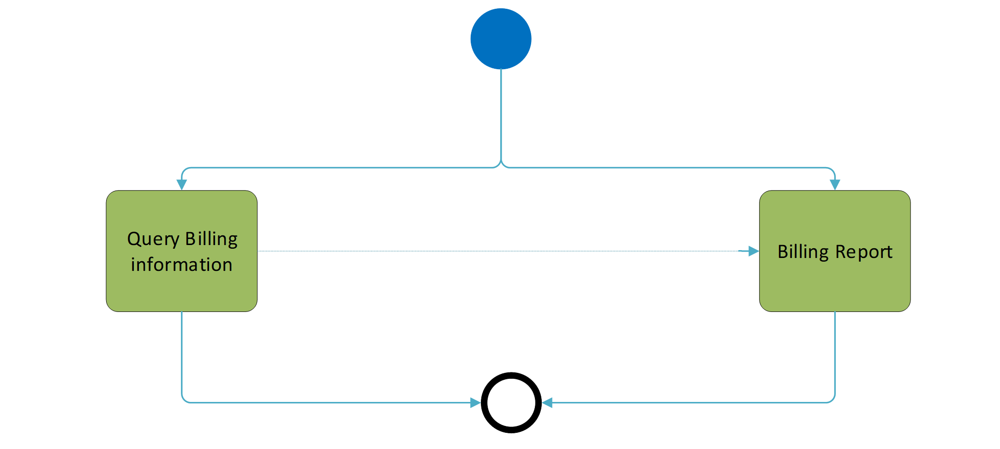
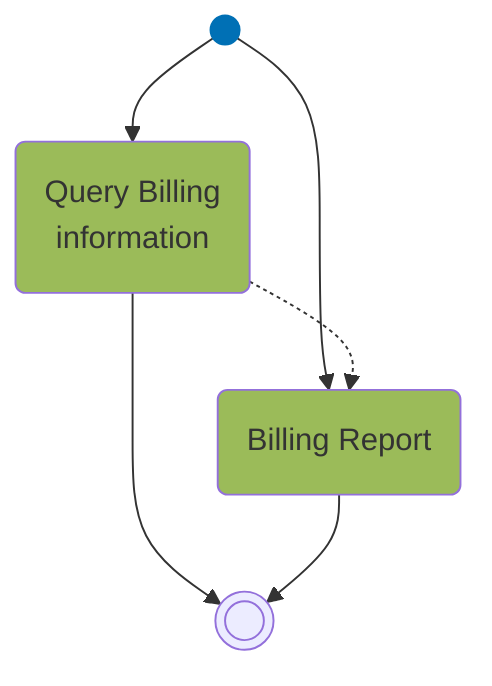

# Billing process overview

## Source evidence

[src-000347](../../../../../../../../raw-input/target2securities_t2s/ISO20022_MDR_Target2Securities_August_2026_v1.zip) archive member `ISO20022_MDR_Target2Securities_August_2026_v1/Target2-Securities_Billing_MessageSet/ISO20022_MDRPart1_Target2Securities_Billing_v2.docx`; BusinessProcess Description; direct-body paragraph P108; word/media/image2.png. [Unchanged original asset or complete source render](../../../../../../assets/src-000347/originals/image2.png).

## Mermaid reconstruction

## Participants, responsibilities and alternatives

One source start point has separate arrows to Query Billing information and Billing Report. A dotted directed relationship goes from the query to the report. Both process boxes lead to a shared end point. The overview does not draw an exclusive-choice diamond or a parallel bar. T8 provides the formal trigger, preconditions and postconditions.

| Source-scoped role | Canonical reference |
| --- | --- |
| system member | [system member](../../../../../../../../shared/reference/participants/participant-src-000347-system-member.md) |
| central system | [central system](../../../../../../../../shared/reference/participants/participant-src-000347-central-system.md) |
| instructing party | [instructing party](../../../../../../../../shared/reference/participants/participant-src-000347-instructing-party.md) |
| executing servicing party | [executing servicing party](../../../../../../../../shared/reference/participants/participant-src-000347-executing-servicing-party.md) |

Full source table: [T8](../../documents/src-000347/tables/tbl-0008.md).

## Exact message evidence

The supplied companion MDR Part2 src-000346 defines BillingReportRequestV01 at file pages4-10 and BillingReportV01 at pages11-111. P46 explicitly directs variant/version lookup to Part2.

| Exact supplied definition | Canonical reference |
| --- | --- |
| camt.076.001.01 | [camt.076.001.01](../../../../../messages/camt.076.001.01/index.md) |
| camt.077.001.01 | [camt.077.001.01](../../../../../messages/camt.077.001.01/index.md) |

Reusable flow: [Billing Report](../../flows/flow-src-000347-p110-billing-report.md).

## Review evidence

Opened complete source artwork and rendered reconstruction; compared every actor/lane label, arrow direction, condition and branch, native fork/join bar, end point, message-family label and status. Composite sequences compared against full Word file pages14-16, not isolated decorative fragments. Mermaid12.3.0 / Chromium156.0.8078.81; visual comparison2026-11-09 Europe/Warsaw.

[Compared reconstruction](../../../../../../assets/src-000347/reconstructed/fig-0002.png).
