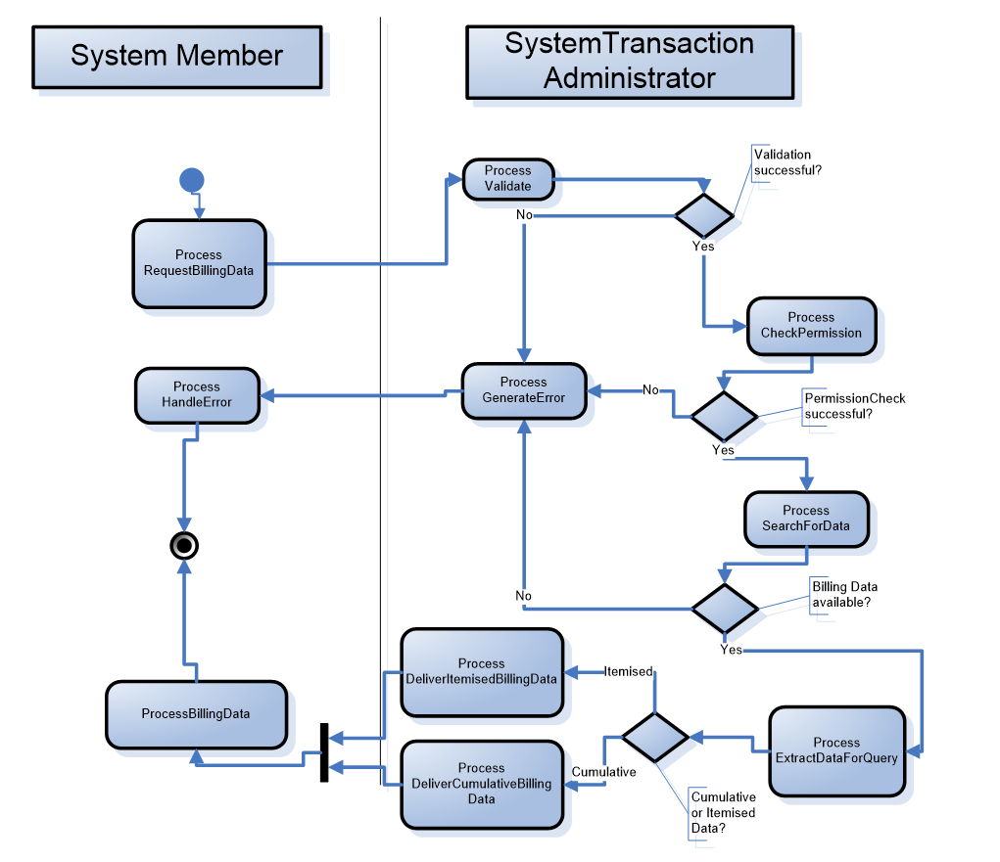
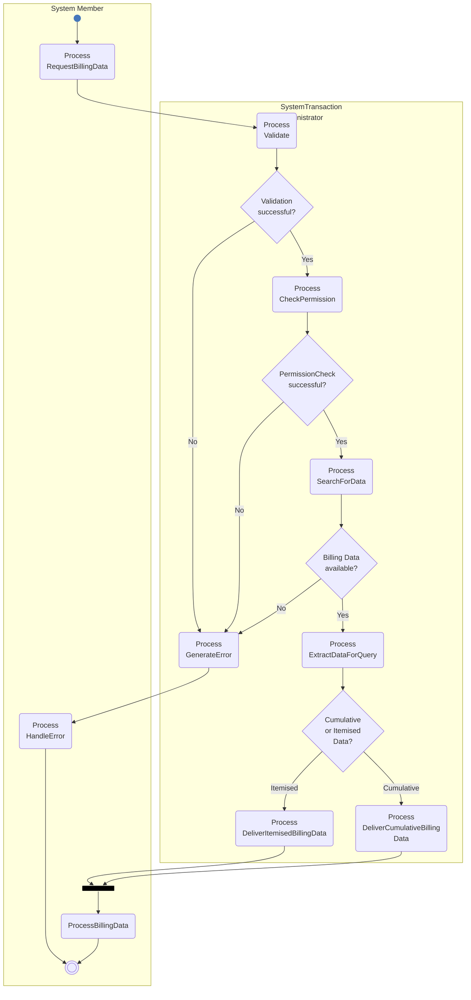

# Query billing information activity

## Source evidence

[src-000347](../../../../../../../../raw-input/target2securities_t2s/ISO20022_MDR_Target2Securities_August_2026_v1.zip) archive member `ISO20022_MDR_Target2Securities_August_2026_v1/Target2-Securities_Billing_MessageSet/ISO20022_MDRPart1_Target2Securities_Billing_v2.docx`; Description of BusinessActivities / Billing / Query Billing Information; direct-body paragraph P119; word/media/image7.png. [Unchanged original asset or complete source render](../../../../../../assets/src-000347/originals/image7.png).

## Mermaid reconstruction

## Participants, responsibilities and alternatives

System Member starts by requesting billing data. System Transaction Administrator checks validation, permission and availability in sequence; any No branch generates an error, returned for handling before termination. All Yes branches reach extraction and the cumulative/itemised choice. The selected delivery path crosses the source black bar before System Member processes the data and reaches the shared end. P117 maps System Member to Instructing Party and System Transaction Administrator to executing party. T10 additionally checks new/already-handled occurrence and requires REJECTED with errors/reasons when validation fails. The bar is preserved as drawn; the mutually exclusive data-type branches are not silently converted into a requirement for both reports.

| Source-scoped role | Canonical reference |
| --- | --- |
| system member | [system member](../../../../../../../../shared/reference/participants/participant-src-000347-system-member.md) |
| system transaction administrator | [system transaction administrator](../../../../../../../../shared/reference/participants/participant-src-000347-system-transaction-administrator.md) |
| instructing party | [instructing party](../../../../../../../../shared/reference/participants/participant-src-000347-instructing-party.md) |
| executing servicing party | [executing servicing party](../../../../../../../../shared/reference/participants/participant-src-000347-executing-servicing-party.md) |

Full source table: [T10](../../documents/src-000347/tables/tbl-0010.md).

## Exact message evidence

The supplied companion MDR Part2 src-000346 defines BillingReportRequestV01 at file pages4-10 and BillingReportV01 at pages11-111. P46 explicitly directs variant/version lookup to Part2.

| Exact supplied definition | Canonical reference |
| --- | --- |
| camt.076.001.01 | [camt.076.001.01](../../../../../messages/camt.076.001.01/index.md) |
| camt.077.001.01 | [camt.077.001.01](../../../../../messages/camt.077.001.01/index.md) |

Reusable flow: [Query Billing Information](../../flows/flow-src-000347-p116-query-billing-information.md).

## Review evidence

Opened complete source artwork and rendered reconstruction; compared every actor/lane label, arrow direction, condition and branch, native fork/join bar, end point, message-family label and status. Composite sequences compared against full Word file pages14-16, not isolated decorative fragments. Mermaid12.3.0 / Chromium156.0.8078.81; visual comparison2026-11-09 Europe/Warsaw.

[Compared reconstruction](../../../../../../assets/src-000347/reconstructed/fig-0007.png).
