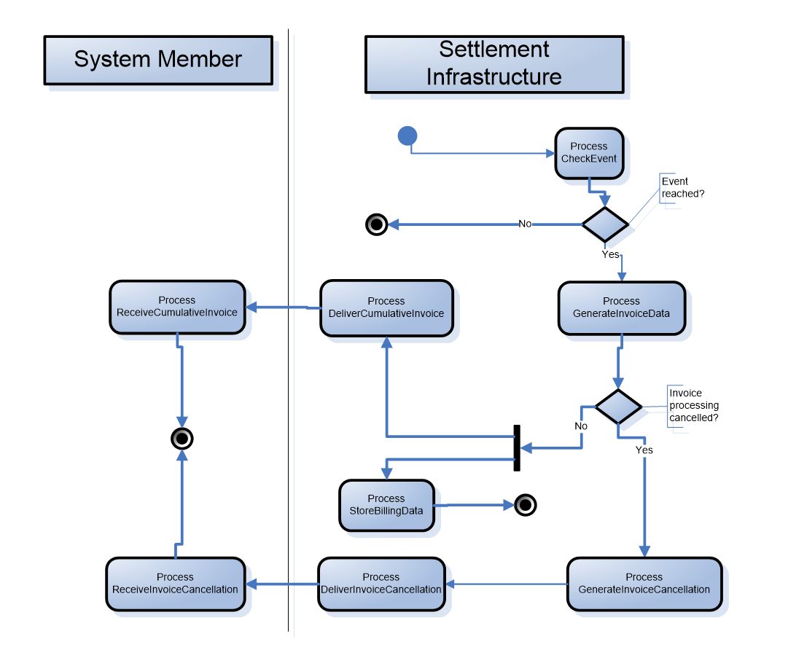
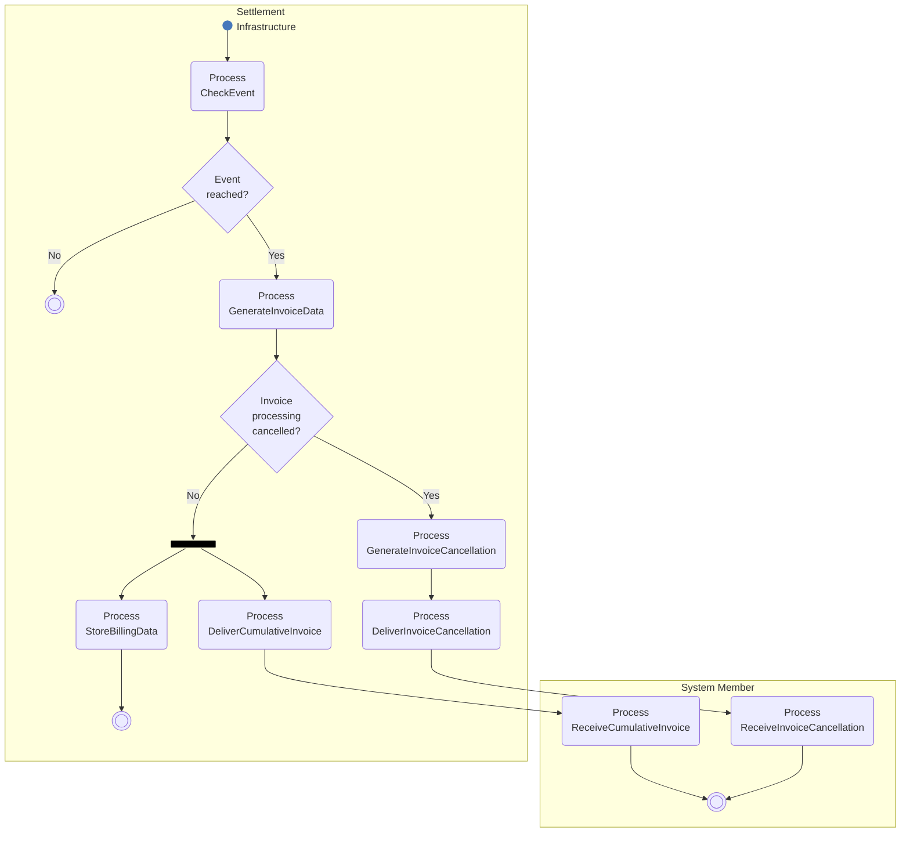

# Billing report activity

## Source evidence

[src-000347](../../../../../../../../raw-input/target2securities_t2s/ISO20022_MDR_Target2Securities_August_2026_v1.zip) archive member `ISO20022_MDR_Target2Securities_August_2026_v1/Target2-Securities_Billing_MessageSet/ISO20022_MDRPart1_Target2Securities_Billing_v2.docx`; Description of BusinessActivities / Billing / Billing Report; direct-body paragraph P124; word/media/image8.png. [Unchanged original asset or complete source render](../../../../../../assets/src-000347/originals/image8.png).

## Mermaid reconstruction

## Participants, responsibilities and alternatives

Settlement Infrastructure checks whether the event has been reached. No ends locally; Yes generates invoice data. If invoice processing is not cancelled, the source parallel bar initiates cumulative-invoice delivery and billing-data storage; storage ends locally, while System Member receives the invoice. If cancelled, cancellation is generated and delivered to System Member. Both receipt paths lead to its shared end. P122 explicitly maps Settlement Infrastructure to executing party and System Member to Instructing Party. T11 says periodic processing returns invoices to subscribed instructing parties. P161-P168 separately describes official invoice/NCB-only consumption reports at the business-day event and cancellation-status reports after processing an operator cancellation request.

| Source-scoped role | Canonical reference |
| --- | --- |
| system member | [system member](../../../../../../../../shared/reference/participants/participant-src-000347-system-member.md) |
| settlement infrastructure | [settlement infrastructure](../../../../../../../../shared/reference/participants/participant-src-000347-settlement-infrastructure.md) |
| instructing party | [instructing party](../../../../../../../../shared/reference/participants/participant-src-000347-instructing-party.md) |
| executing servicing party | [executing servicing party](../../../../../../../../shared/reference/participants/participant-src-000347-executing-servicing-party.md) |
| operator | [operator](../../../../../../../../shared/reference/participants/participant-src-000347-operator.md) |
| national central bank | [national central bank](../../../../../../../../shared/reference/participants/participant-src-000347-national-central-bank.md) |

Full source table: [T11](../../documents/src-000347/tables/tbl-0011.md).

## Exact message evidence

The supplied companion MDR Part2 src-000346 defines BillingReportRequestV01 at file pages4-10 and BillingReportV01 at pages11-111. P46 explicitly directs variant/version lookup to Part2.

| Exact supplied definition | Canonical reference |
| --- | --- |
| camt.077.001.01 | [camt.077.001.01](../../../../../messages/camt.077.001.01/index.md) |

Reusable flow: [Billing Report](../../flows/flow-src-000347-p121-billing-report.md).

## Review evidence

Opened complete source artwork and rendered reconstruction; compared every actor/lane label, arrow direction, condition and branch, native fork/join bar, end point, message-family label and status. Composite sequences compared against full Word file pages14-16, not isolated decorative fragments. Mermaid12.3.0 / Chromium156.0.8078.81; visual comparison2026-11-09 Europe/Warsaw.

[Compared reconstruction](../../../../../../assets/src-000347/reconstructed/fig-0008.png).
