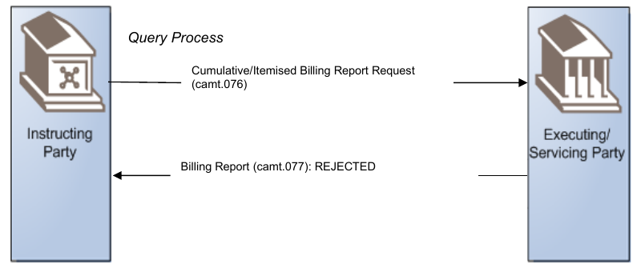
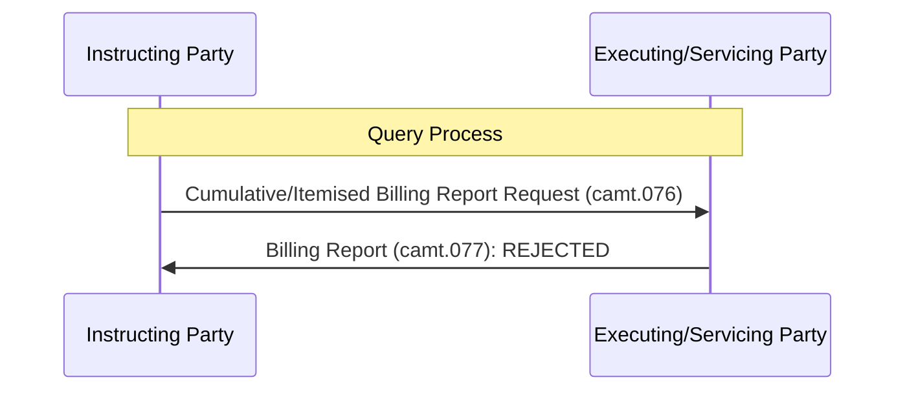

# Rejected billing information query

## Source evidence

[src-000347](../../../../../../../../raw-input/target2securities_t2s/ISO20022_MDR_Target2Securities_August_2026_v1.zip) archive member `ISO20022_MDR_Target2Securities_August_2026_v1/Target2-Securities_Billing_MessageSet/ISO20022_MDRPart1_Target2Securities_Billing_v2.docx`; BusinessTransactions / Query Billing Information / Negative Scenario; direct-body paragraph P145; Word rendered file page 15. [Unchanged original asset or complete source render](../../../../../../../../work/docx-render/src-000347/document.pdf).

## Mermaid reconstruction

## Participants, responsibilities and alternatives

The Instructing Party requests cumulative or itemised billing data, specifying invoice, period and (for itemised queries) securities account, cash account or participant. The Executing/Servicing Party returns REJECTED and the business or operational error causing the rejection. The report is not a settlement reversal or invoice-cancellation instruction.

| Source-scoped role | Canonical reference |
| --- | --- |
| instructing party | [instructing party](../../../../../../../../shared/reference/participants/participant-src-000347-instructing-party.md) |
| executing servicing party | [executing servicing party](../../../../../../../../shared/reference/participants/participant-src-000347-executing-servicing-party.md) |
| system member | [system member](../../../../../../../../shared/reference/participants/participant-src-000347-system-member.md) |
| system transaction administrator | [system transaction administrator](../../../../../../../../shared/reference/participants/participant-src-000347-system-transaction-administrator.md) |

## Exact message evidence

The supplied companion MDR Part2 src-000346 defines BillingReportRequestV01 at file pages4-10 and BillingReportV01 at pages11-111. P46 explicitly directs variant/version lookup to Part2.

| Exact supplied definition | Canonical reference |
| --- | --- |
| camt.076.001.01 | [camt.076.001.01](../../../../../messages/camt.076.001.01/index.md) |
| camt.077.001.01 | [camt.077.001.01](../../../../../messages/camt.077.001.01/index.md) |

Reusable flow: [Negative Scenario](../../flows/flow-src-000347-p142-negative-scenario.md).

## Review evidence

Opened complete source artwork and rendered reconstruction; compared every actor/lane label, arrow direction, condition and branch, native fork/join bar, end point, message-family label and status. Composite sequences compared against full Word file pages14-16, not isolated decorative fragments. Mermaid12.3.0 / Chromium156.0.8078.81; visual comparison2026-11-09 Europe/Warsaw.

[Compared reconstruction](../../../../../../assets/src-000347/reconstructed/fig-0010.png).
