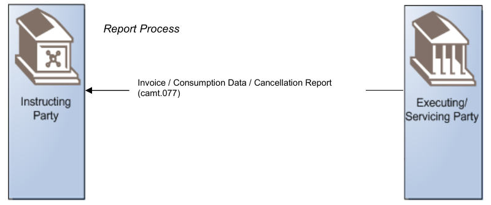
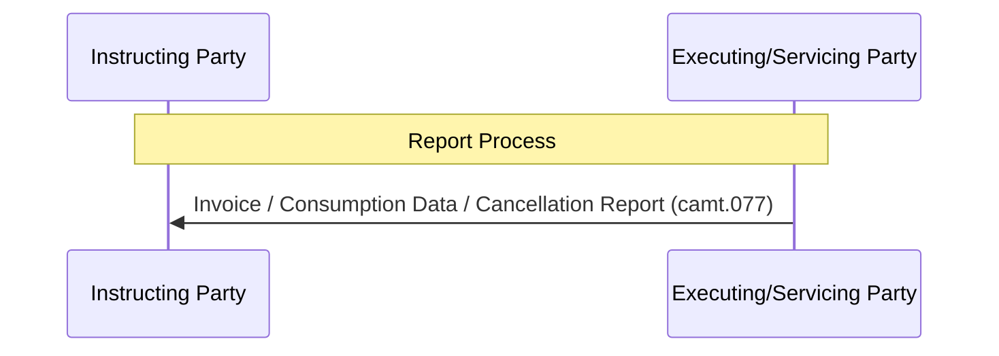

# Billing report push sequence

## Source evidence

[src-000347](../../../../../../../../raw-input/target2securities_t2s/ISO20022_MDR_Target2Securities_August_2026_v1.zip) archive member `ISO20022_MDR_Target2Securities_August_2026_v1/Target2-Securities_Billing_MessageSet/ISO20022_MDRPart1_Target2Securities_Billing_v2.docx`; BusinessTransactions / Billing Report; direct-body paragraph P158; Word rendered file page 16. [Unchanged original asset or complete source render](../../../../../../../../work/docx-render/src-000347/document.pdf).

## Mermaid reconstruction

## Participants, responsibilities and alternatives

Executing/Servicing Party sends one depicted billing report to Instructing Party. Official invoice and consumption data (for NCBs only) are communicated when the specific business-day event is reached. Invoice cancellation status is communicated after processing a cancellation request previously submitted by the operator. The operator and its preceding request are narrative context, intentionally absent from this one-arrow report illustration; no cancellation-request message identifier is invented.

| Source-scoped role | Canonical reference |
| --- | --- |
| instructing party | [instructing party](../../../../../../../../shared/reference/participants/participant-src-000347-instructing-party.md) |
| executing servicing party | [executing servicing party](../../../../../../../../shared/reference/participants/participant-src-000347-executing-servicing-party.md) |
| system member | [system member](../../../../../../../../shared/reference/participants/participant-src-000347-system-member.md) |
| settlement infrastructure | [settlement infrastructure](../../../../../../../../shared/reference/participants/participant-src-000347-settlement-infrastructure.md) |
| operator | [operator](../../../../../../../../shared/reference/participants/participant-src-000347-operator.md) |
| national central bank | [national central bank](../../../../../../../../shared/reference/participants/participant-src-000347-national-central-bank.md) |

## Exact message evidence

The supplied companion MDR Part2 src-000346 defines BillingReportRequestV01 at file pages4-10 and BillingReportV01 at pages11-111. P46 explicitly directs variant/version lookup to Part2.

| Exact supplied definition | Canonical reference |
| --- | --- |
| camt.077.001.01 | [camt.077.001.01](../../../../../messages/camt.077.001.01/index.md) |

Reusable flow: [Billing Report](../../flows/flow-src-000347-p156-billing-report.md).

## Review evidence

Opened complete source artwork and rendered reconstruction; compared every actor/lane label, arrow direction, condition and branch, native fork/join bar, end point, message-family label and status. Composite sequences compared against full Word file pages14-16, not isolated decorative fragments. Mermaid12.3.0 / Chromium156.0.8078.81; visual comparison2026-11-09 Europe/Warsaw.

[Compared reconstruction](../../../../../../assets/src-000347/reconstructed/fig-0011.png).
