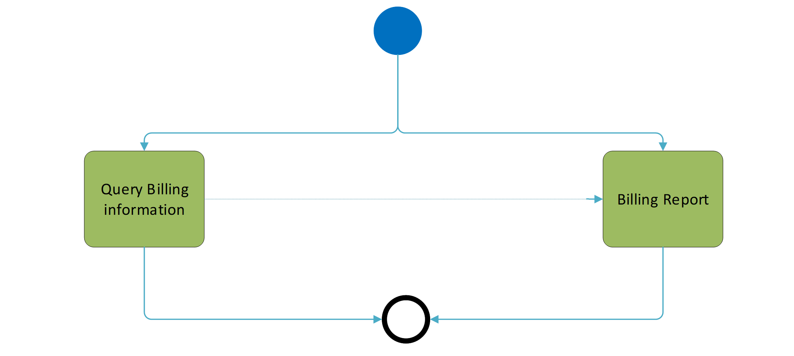

# fig-0002 - original figure evidence

Source: [src-000347](../../../../../../../../../raw-input/target2securities_t2s/ISO20022_MDR_Target2Securities_August_2026_v1.zip) archive member `ISO20022_MDR_Target2Securities_August_2026_v1/Target2-Securities_Billing_MessageSet/ISO20022_MDRPart1_Target2Securities_Billing_v2.docx`. Locator: direct-body paragraph P108; BusinessProcess Description; /w:document/w:body/w:p[108].

Original extracted asset: [image2.png](../../../../../../../assets/src-000347/originals/image2.png)

## Canonical reconstruction and review

[Canonical diagram, source qualifications, participant/flow links and recorded review evidence](../../../diagrams/curated/fig-0002.md). Original media and this occurrence's precise locator are retained. Rendering and visual comparison results above are copied from the canonical reference; any unresolved business, version or contextual limitation remains open.

## Source reconstruction

[Billing process overview](../../../diagrams/curated/fig-0002.md). Complete source artwork and reconstruction visually compared.
