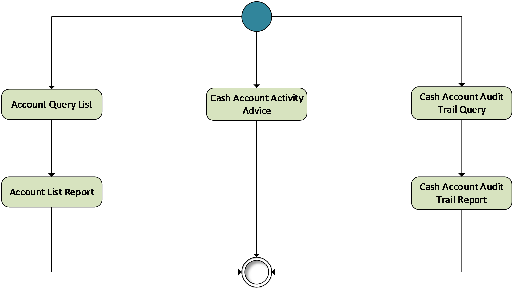
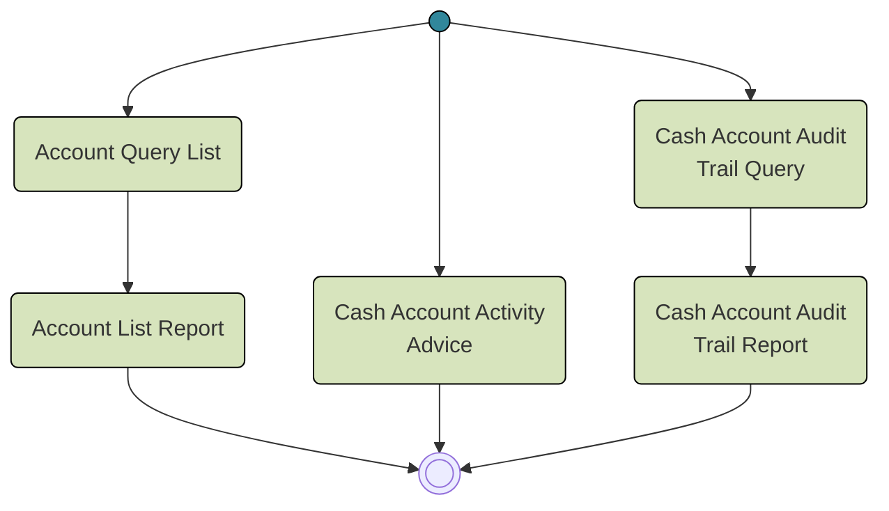

# Cash account query, report and advice overview

## Source evidence

[src-000350](../../../../../../../../raw-input/target2securities_t2s/ISO20022_MDR_Target2Securities_August_2026_v1.zip) archive member `ISO20022_MDR_Target2Securities_August_2026_v1/Target2-Securities_CashAccountQueryAndReport_MessageSet/ISO20022_MDRPart1_Target2Securities_CashAccountQueryAndReport_v2.docx`; BusinessProcess Description; direct-body paragraph P122; word/media/image2.emf. [Unchanged original figure](../../../../../../assets/src-000350/originals/image2.emf).

## Mermaid reconstruction

## Roles, activities and alternatives

One start symbol leads to three paths: Account Query List followed by Account List Report; unsolicited Cash Account Activity Advice; and Cash Account Audit Trail Query followed by Cash Account Audit Trail Report. All converge at a common end. No exclusive-choice diamond or parallel bar is drawn. T8/T9 require both parties to know the query type and define report content as all retrieved records. T10 requires a standing instruction for automatically produced activity advice and names acknowledgement of sending as postcondition; this does not add an acknowledgement arrow to the artwork.

| Source-scoped role | Canonical reference |
| --- | --- |
| instructing party | [instructing party](../../../../../../../../shared/reference/participants/participant-src-000350-instructing-party.md) |
| executing servicing party | [executing servicing party](../../../../../../../../shared/reference/participants/participant-src-000350-executing-servicing-party.md) |
| recipient party | [recipient party](../../../../../../../../shared/reference/participants/participant-src-000350-recipient-party.md) |

Source responsibilities/conditions: [T8](../../documents/src-000350/tables/tbl-0008.md), [T9](../../documents/src-000350/tables/tbl-0009.md), [T10](../../documents/src-000350/tables/tbl-0010.md).

## Exact message evidence

| Source family | Exact supplied definition | Companion MDR Part2 locator |
| --- | --- | --- |
| acmt.025 | [acmt.025.001.02](../../../../../messages/acmt.025.001.02/index.md) | src-000351; 2 acmt.025.001.02 AccountQueryListV02; file pages4-47 |
| acmt.026 | [acmt.026.001.02](../../../../../messages/acmt.026.001.02/index.md) | src-000351; 3 acmt.026.001.02 AccountListReportV02; file pages48-107 |
| reda.038 | [reda.038.001.01](../../../../../messages/reda.038.001.01/index.md) | src-000351; 4 reda.038.001.01 CashAccountActivityAdviceV01; file pages108-112 |
| reda.039 | [reda.039.001.01](../../../../../messages/reda.039.001.01/index.md) | src-000351; 5 reda.039.001.01 CashAccountAuditTrailQueryV01; file pages113-117 |
| reda.040 | [reda.040.001.01](../../../../../messages/reda.040.001.01/index.md) | src-000351; 6 reda.040.001.01 CashAccountAuditTrailReportV01; file pages118-129 |

Reusable flows: [Account Query List](../../flows/flow-src-000350-p123-account-query-list.md), [Cash Account Audit Trail Query](../../flows/flow-src-000350-p124-cash-account-audit-trail-query.md), [Cash Account Activity Advice](../../flows/flow-src-000350-p125-cash-account-activity-advice.md).

## Review evidence

Opened full original EMF preview and rendered reconstruction. Compared actor/lane labels, hollow triangle endpoints in role overview, process/action labels, complete arrow order and direction, solid/dashed error response distinction, lifecycle paths and source labels. The source activity request scope exclusion and alternative responses are documented without adding messages. Mermaid12.3.0 / Chromium156.0.8078.81; visual comparison2026-11-09 Europe/Warsaw.

[Compared reconstruction](../../../../../../assets/src-000350/reconstructed/fig-0002.png). [Unchanged native assets and provenance](../../documents/src-000350/native-embeddings.md). Hidden native layers remain outside this visible-artwork review.
