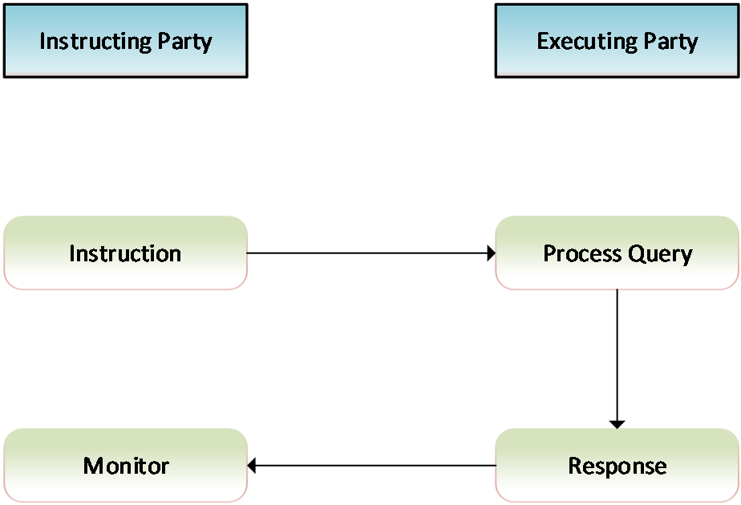
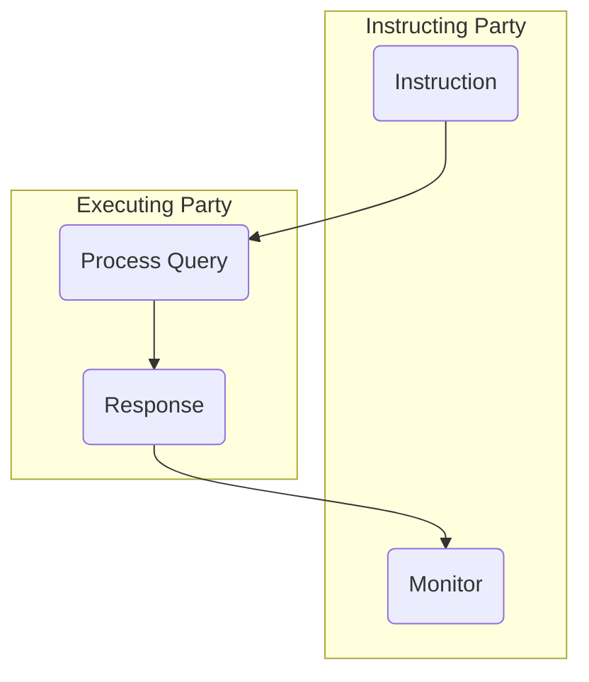

# Cash account query/response activity reused in two processes

## Source evidence

[src-000350](../../../../../../../../raw-input/target2securities_t2s/ISO20022_MDR_Target2Securities_August_2026_v1.zip) archive member `ISO20022_MDR_Target2Securities_August_2026_v1/Target2-Securities_CashAccountQueryAndReport_MessageSet/ISO20022_MDRPart1_Target2Securities_CashAccountQueryAndReport_v2.docx`; Description of BusinessActivities / Cash Account Query and Report / Account Query List - Account List Response process; direct-body paragraph P132; word/media/image7.emf. [Unchanged original figure](../../../../../../assets/src-000350/originals/image7.emf).

## Mermaid reconstruction

## Roles, activities and alternatives

Instructing Party Instruction goes to Executing Party Process Query, followed by Response returning to Instructing Party Monitor. This exact source media is reused at P132 for Account Query List and P141 for Cash Account Audit Trail Query/Response. T12 and T14 retain separate business scope while sharing these four actions. Excessive processing time or inability to provide a positive response causes an error with code and explanation; those narrative alternatives are not drawn as separate branches here. No extra decision is invented.

| Source-scoped role | Canonical reference |
| --- | --- |
| instructing party | [instructing party](../../../../../../../../shared/reference/participants/participant-src-000350-instructing-party.md) |
| executing servicing party | [executing servicing party](../../../../../../../../shared/reference/participants/participant-src-000350-executing-servicing-party.md) |

Source responsibilities/conditions: [T12](../../documents/src-000350/tables/tbl-0012.md), [T14](../../documents/src-000350/tables/tbl-0014.md).

## Exact message evidence

| Source family | Exact supplied definition | Companion MDR Part2 locator |
| --- | --- | --- |
| acmt.025 | [acmt.025.001.02](../../../../../messages/acmt.025.001.02/index.md) | src-000351; 2 acmt.025.001.02 AccountQueryListV02; file pages4-47 |
| acmt.026 | [acmt.026.001.02](../../../../../messages/acmt.026.001.02/index.md) | src-000351; 3 acmt.026.001.02 AccountListReportV02; file pages48-107 |
| reda.039 | [reda.039.001.01](../../../../../messages/reda.039.001.01/index.md) | src-000351; 5 reda.039.001.01 CashAccountAuditTrailQueryV01; file pages113-117 |
| reda.040 | [reda.040.001.01](../../../../../messages/reda.040.001.01/index.md) | src-000351; 6 reda.040.001.01 CashAccountAuditTrailReportV01; file pages118-129 |

Reusable flows: [Account Query List - Account List Response process](../../flows/flow-src-000350-p130-account-query-list-account-list-response-process.md), [Cash Account Audit Trail Query/Response process](../../flows/flow-src-000350-p140-cash-account-audit-trail-query-response-process.md).

The same unchanged image7.emf occurs twice (P132/fig-0007 and P141/fig-0009). It is reconstructed once; both distinct flow records and source occurrences link here.

## Review evidence

Opened full original EMF preview and rendered reconstruction. Compared actor/lane labels, hollow triangle endpoints in role overview, process/action labels, complete arrow order and direction, solid/dashed error response distinction, lifecycle paths and source labels. The source activity request scope exclusion and alternative responses are documented without adding messages. Mermaid12.3.0 / Chromium156.0.8078.81; visual comparison2026-11-09 Europe/Warsaw.

[Compared reconstruction](../../../../../../assets/src-000350/reconstructed/fig-0007.png). [Unchanged native assets and provenance](../../documents/src-000350/native-embeddings.md). Hidden native layers remain outside this visible-artwork review.
