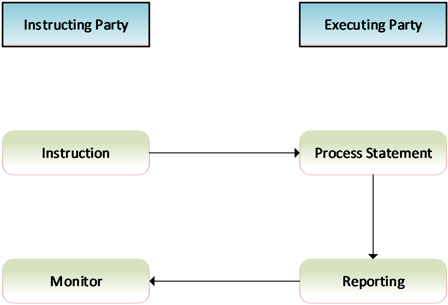
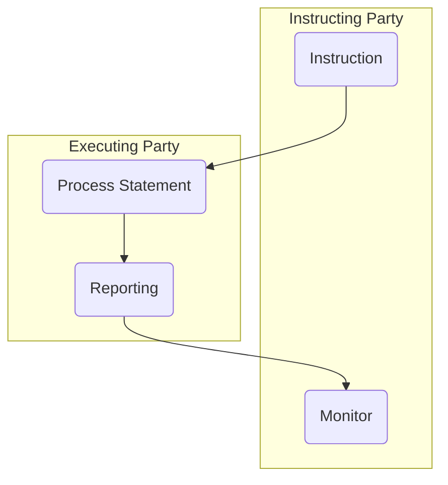

# Cash account activity advice activity

## Source evidence

[src-000350](../../../../../../../../raw-input/target2securities_t2s/ISO20022_MDR_Target2Securities_August_2026_v1.zip) archive member `ISO20022_MDR_Target2Securities_August_2026_v1/Target2-Securities_CashAccountQueryAndReport_MessageSet/ISO20022_MDRPart1_Target2Securities_CashAccountQueryAndReport_v2.docx`; Description of BusinessActivities / Cash Account Query and Report / Cash Account Activity Advice process; direct-body paragraph P137; word/media/image8.emf. [Unchanged original figure](../../../../../../assets/src-000350/originals/image8.emf).

## Mermaid reconstruction

## Roles, activities and alternatives

The source activity includes an Instruction arrow to Process Statement, then Reporting back to Monitor. T13 explicitly says a request to run a statement is outside the current process and NO message will be created for it. T10 supplies the actual standing-instruction precondition and automatic trigger, and P95/P164 says advice is pushed unilaterally to subscribing parties. The diagram is reconstructed as drawn while that scope exclusion remains explicit; no request message is invented.

| Source-scoped role | Canonical reference |
| --- | --- |
| instructing party | [instructing party](../../../../../../../../shared/reference/participants/participant-src-000350-instructing-party.md) |
| executing servicing party | [executing servicing party](../../../../../../../../shared/reference/participants/participant-src-000350-executing-servicing-party.md) |
| recipient party | [recipient party](../../../../../../../../shared/reference/participants/participant-src-000350-recipient-party.md) |

Source responsibilities/conditions: [T10](../../documents/src-000350/tables/tbl-0010.md), [T13](../../documents/src-000350/tables/tbl-0013.md).

## Exact message evidence

| Source family | Exact supplied definition | Companion MDR Part2 locator |
| --- | --- | --- |
| reda.038 | [reda.038.001.01](../../../../../messages/reda.038.001.01/index.md) | src-000351; 4 reda.038.001.01 CashAccountActivityAdviceV01; file pages108-112 |

Reusable flows: [Cash Account Activity Advice process](../../flows/flow-src-000350-p135-cash-account-activity-advice-process.md).

## Review evidence

Opened full original EMF preview and rendered reconstruction. Compared actor/lane labels, hollow triangle endpoints in role overview, process/action labels, complete arrow order and direction, solid/dashed error response distinction, lifecycle paths and source labels. The source activity request scope exclusion and alternative responses are documented without adding messages. Mermaid12.3.0 / Chromium156.0.8078.81; visual comparison2026-11-09 Europe/Warsaw.

[Compared reconstruction](../../../../../../assets/src-000350/reconstructed/fig-0008.png). [Unchanged native assets and provenance](../../documents/src-000350/native-embeddings.md). Hidden native layers remain outside this visible-artwork review.
