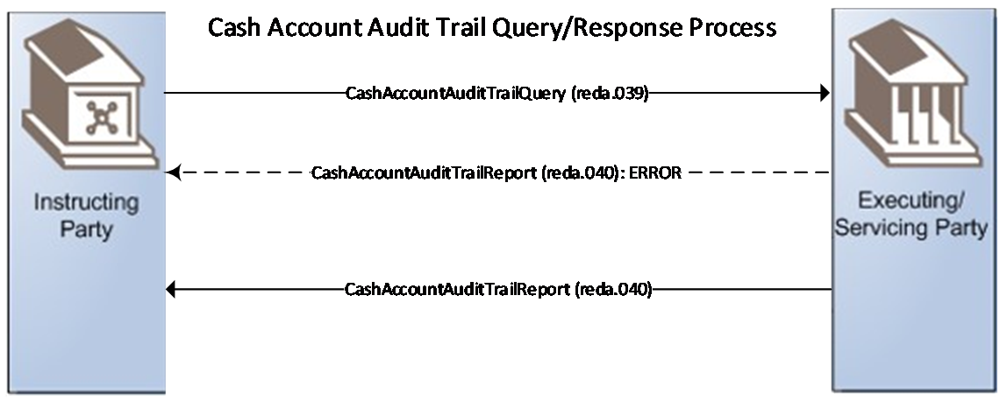
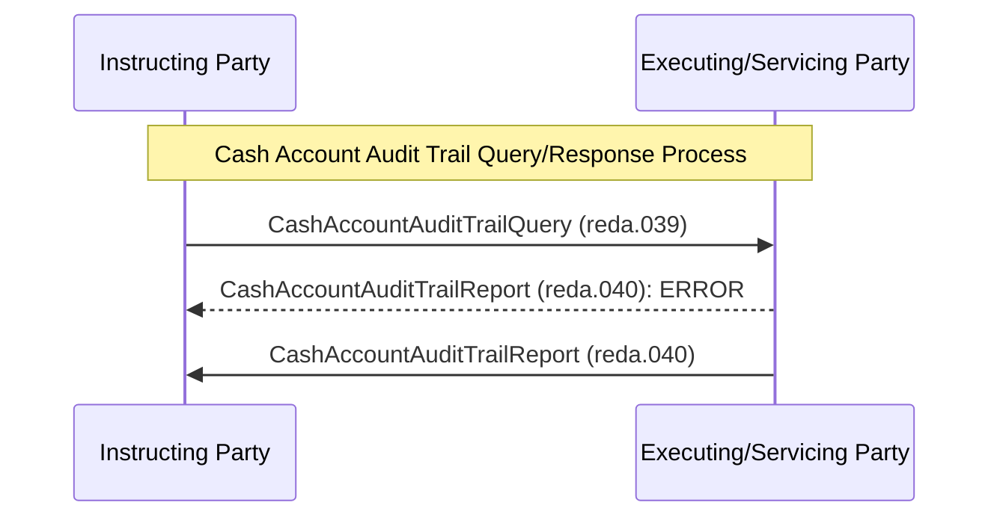

# Cash account audit-trail query/response sequence

## Source evidence

[src-000350](../../../../../../../../raw-input/target2securities_t2s/ISO20022_MDR_Target2Securities_August_2026_v1.zip) archive member `ISO20022_MDR_Target2Securities_August_2026_v1/Target2-Securities_CashAccountQueryAndReport_MessageSet/ISO20022_MDRPart1_Target2Securities_CashAccountQueryAndReport_v2.docx`; BusinessTransactions / Query/Response Process / Cash Account Audit Trail Query/ Report Scenario; direct-body paragraph P167; word/media/image11.emf. [Unchanged original figure](../../../../../../assets/src-000350/originals/image11.emf).

## Mermaid reconstruction

## Roles, activities and alternatives

The source displays a query from Instructing Party to Executing/Servicing Party, a dashed ERROR response and a solid normal response in that vertical order. The narrative distinguishes negative and successful scenarios: excessive processing time, wrong criteria combination or no result may produce the error. Both response arrows are preserved as alternatives, not a requirement to send an error followed by a normal result. The audit-trail process retrieves a complete audit trail for the specified cash account; the account-query process returns data meeting its query criteria.

| Source-scoped role | Canonical reference |
| --- | --- |
| instructing party | [instructing party](../../../../../../../../shared/reference/participants/participant-src-000350-instructing-party.md) |
| executing servicing party | [executing servicing party](../../../../../../../../shared/reference/participants/participant-src-000350-executing-servicing-party.md) |

## Exact message evidence

| Source family | Exact supplied definition | Companion MDR Part2 locator |
| --- | --- | --- |
| reda.039 | [reda.039.001.01](../../../../../messages/reda.039.001.01/index.md) | src-000351; 5 reda.039.001.01 CashAccountAuditTrailQueryV01; file pages113-117 |
| reda.040 | [reda.040.001.01](../../../../../messages/reda.040.001.01/index.md) | src-000351; 6 reda.040.001.01 CashAccountAuditTrailReportV01; file pages118-129 |

Reusable flows: [Cash Account Audit Trail Query/ Report Scenario](../../flows/flow-src-000350-p166-cash-account-audit-trail-query-report-scenario.md).

## Review evidence

Opened full original EMF preview and rendered reconstruction. Compared actor/lane labels, hollow triangle endpoints in role overview, process/action labels, complete arrow order and direction, solid/dashed error response distinction, lifecycle paths and source labels. The source activity request scope exclusion and alternative responses are documented without adding messages. Mermaid12.3.0 / Chromium156.0.8078.81; visual comparison2026-11-09 Europe/Warsaw.

[Compared reconstruction](../../../../../../assets/src-000350/reconstructed/fig-0012.png). [Unchanged native assets and provenance](../../documents/src-000350/native-embeddings.md). Hidden native layers remain outside this visible-artwork review.
