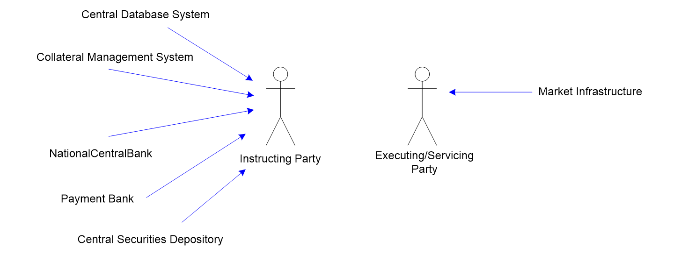
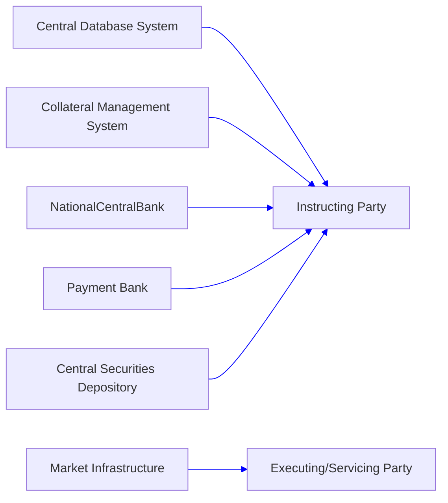

# Collateral-reference business-role context

## Source evidence

[src-000353](../../../../../../../../raw-input/target2securities_t2s/ISO20022_MDR_Target2Securities_August_2026_v1.zip) archive member `ISO20022_MDR_Target2Securities_August_2026_v1/Target2-Securities_CollateralManagementReferenceData_MessageSet/ISO20022_MDRPart1_Target2Securities_CollateralManagementReferenceData_v2.docx`; BusinessRoles and Participants; direct-body paragraph P93; word/media/image1.emf. [Unchanged original figure](../../../../../../assets/src-000353/originals/image1.emf).

## Mermaid reconstruction

## Roles, activities and alternatives

Five blue directed role associations point to Instructing Party; Market Infrastructure points to Executing/Servicing Party. T5 defines those functional participants. T7 instead labels its columns Account Servicer/Account Owner, with the five first business roles (including Central Database System in this publication) mapped as servicers and Market Infrastructure as owner. No equivalence with T5 is established. Both vocabularies remain separate under issue-000038. These role associations are not message exchanges.

| Source-scoped role | Canonical reference |
| --- | --- |
| instructing party | [instructing party](../../../../../../../../shared/reference/participants/participant-src-000353-instructing-party.md) |
| executing servicing party | [executing servicing party](../../../../../../../../shared/reference/participants/participant-src-000353-executing-servicing-party.md) |
| central database system | [central database system](../../../../../../../../shared/reference/participants/participant-src-000353-central-database-system.md) |
| collateral management system | [collateral management system](../../../../../../../../shared/reference/participants/participant-src-000353-collateral-management-system.md) |
| national central bank | [national central bank](../../../../../../../../shared/reference/participants/participant-src-000353-national-central-bank.md) |
| payment bank | [payment bank](../../../../../../../../shared/reference/participants/participant-src-000353-payment-bank.md) |
| central securities depository csd | [central securities depository csd](../../../../../../../../shared/reference/participants/participant-src-000353-central-securities-depository-csd.md) |
| market infrastructure | [market infrastructure](../../../../../../../../shared/reference/participants/participant-src-000353-market-infrastructure.md) |
| account servicer | [account servicer](../../../../../../../../shared/reference/participants/participant-src-000353-account-servicer.md) |
| account owner | [account owner](../../../../../../../../shared/reference/participants/participant-src-000353-account-owner.md) |

Source responsibilities/conditions: [T5](../../documents/src-000353/tables/tbl-0005.md), [T6](../../documents/src-000353/tables/tbl-0006.md), [T7](../../documents/src-000353/tables/tbl-0007.md).

## Review evidence

Opened complete source artwork and rendered reconstruction; compared every role/lane label, arrow direction and endpoint, six overview activities, accepted/rejected choices, dashed retry loop, status labels and exact family strings where present. The four composite sequences were compared with complete Word file/printed pages16-19, including all multi-object labels. Visible correspondence passes; source inconsistency issue-000038 remains unresolved, so reviewed page status is withheld. Mermaid12.3.0 / Chromium156.0.8078.81; visual comparison2026-11-09 Europe/Warsaw.

[Compared reconstruction](../../../../../../assets/src-000353/reconstructed/fig-0001.png).
