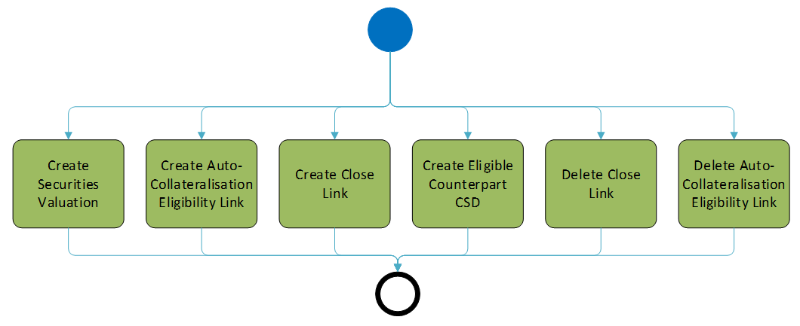
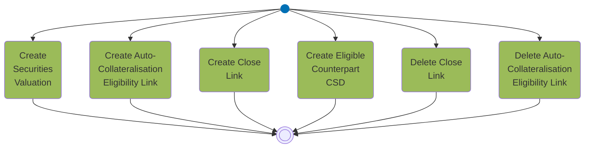

# Collateral-reference maintenance overview

## Source evidence

[src-000353](../../../../../../../../raw-input/target2securities_t2s/ISO20022_MDR_Target2Securities_August_2026_v1.zip) archive member `ISO20022_MDR_Target2Securities_August_2026_v1/Target2-Securities_CollateralManagementReferenceData_MessageSet/ISO20022_MDRPart1_Target2Securities_CollateralManagementReferenceData_v2.docx`; BusinessProcess Description; direct-body paragraph P102; word/media/image2.png. [Unchanged original figure](../../../../../../assets/src-000353/originals/image2.png).

## Mermaid reconstruction

## Roles, activities and alternatives

The source start branches into six maintenance activities: four creations (securities valuation, auto-collateralisation eligibility link, close link and eligible counterpart CSD) and two deletions (close link and auto-collateralisation eligibility link). All lead to the same end. No exclusive-choice or parallel bar is drawn. T8/T9 require the instructing party to be known and to identify the required coverage change; acknowledgement of processing is the stated postcondition. Their creation/deletion conditions remain separate.

| Source-scoped role | Canonical reference |
| --- | --- |
| instructing party | [instructing party](../../../../../../../../shared/reference/participants/participant-src-000353-instructing-party.md) |
| executing servicing party | [executing servicing party](../../../../../../../../shared/reference/participants/participant-src-000353-executing-servicing-party.md) |

Source responsibilities/conditions: [T8](../../documents/src-000353/tables/tbl-0008.md), [T9](../../documents/src-000353/tables/tbl-0009.md).

## Exact message evidence

| Source family | Exact supplied definition | Companion MDR Part2 locator |
| --- | --- | --- |
| reda.024 | [reda.024.001.01](../../../../../messages/reda.024.001.01/index.md) | src-000354; 2 reda.024.001.01 CollateralValueCreationRequestV01; file pages6-15 |
| reda.025 | [reda.025.001.01](../../../../../messages/reda.025.001.01/index.md) | src-000354; 3 reda.025.001.01 EligibleSecuritiesCreationRequestV01; file pages16-21 |
| reda.026 | [reda.026.001.01](../../../../../messages/reda.026.001.01/index.md) | src-000354; 4 reda.026.001.01 EligibleCounterpartCSDCreationRequestV01; file pages22-29 |
| reda.027 | [reda.027.001.01](../../../../../messages/reda.027.001.01/index.md) | src-000354; 5 reda.027.001.01 CloseLinkCreationRequestV01; file pages30-35 |
| reda.028 | [reda.028.001.01](../../../../../messages/reda.028.001.01/index.md) | src-000354; 6 reda.028.001.01 CollateralDataStatusAdviceV01; file pages36-45 |
| reda.044 | [reda.044.001.01](../../../../../messages/reda.044.001.01/index.md) | src-000354; 7 reda.044.001.01 EligibleCounterpartCSDStatusAdviceV01; file pages46-50 |
| reda.075 | [reda.075.001.01](../../../../../messages/reda.075.001.01/index.md) | src-000354; 8 reda.075.001.01 EligibleSecuritiesDeletionRequestV01; file pages51-56 |
| reda.077 | [reda.077.001.01](../../../../../messages/reda.077.001.01/index.md) | src-000354; 9 reda.077.001.01 CloseLinkDeletionRequestV01; file pages57-62 |

Reusable flows: [Collateral Reference Data creation](../../flows/flow-src-000353-p104-collateral-reference-data-creation.md), [Collateral Reference Data deletion](../../flows/flow-src-000353-p105-collateral-reference-data-deletion.md).

## Review evidence

Opened complete source artwork and rendered reconstruction; compared every role/lane label, arrow direction and endpoint, six overview activities, accepted/rejected choices, dashed retry loop, status labels and exact family strings where present. The four composite sequences were compared with complete Word file/printed pages16-19, including all multi-object labels. Mermaid12.3.0 / Chromium156.0.8078.81; visual comparison2026-11-09 Europe/Warsaw.

[Compared reconstruction](../../../../../../assets/src-000353/reconstructed/fig-0002.png).
