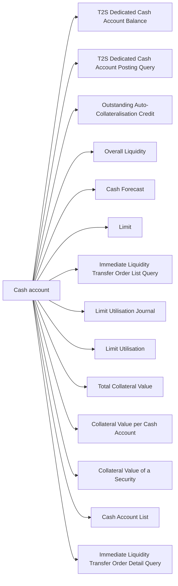

# Fourteen cash-account queries

Focused view of [the complete source query taxonomy](fig-0002.md). Source src-000356, direct-body P130, word/media/image2.png. This view partitions the artwork for readable retrieval; it adds no new query permissions or message bindings.

[Complete unchanged source](../../../../../../assets/src-000356/originals/image2.png).

## Review evidence

Compared with original image2.png and Word page13: every included label and edge checked; all25 query leaves are preserved across the focused details. Mermaid12.3.0 / Chromium156.0.8078.81 render and visual comparison passed2026-11-09. [Compared focused reconstruction](../../../../../../assets/src-000356/reconstructed/fig-0002-cash.png).
