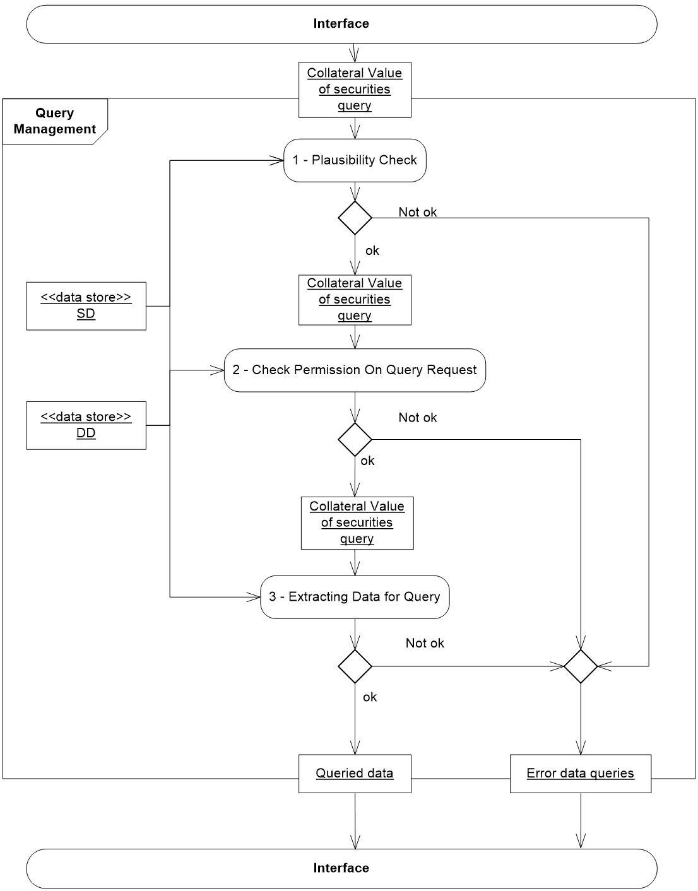
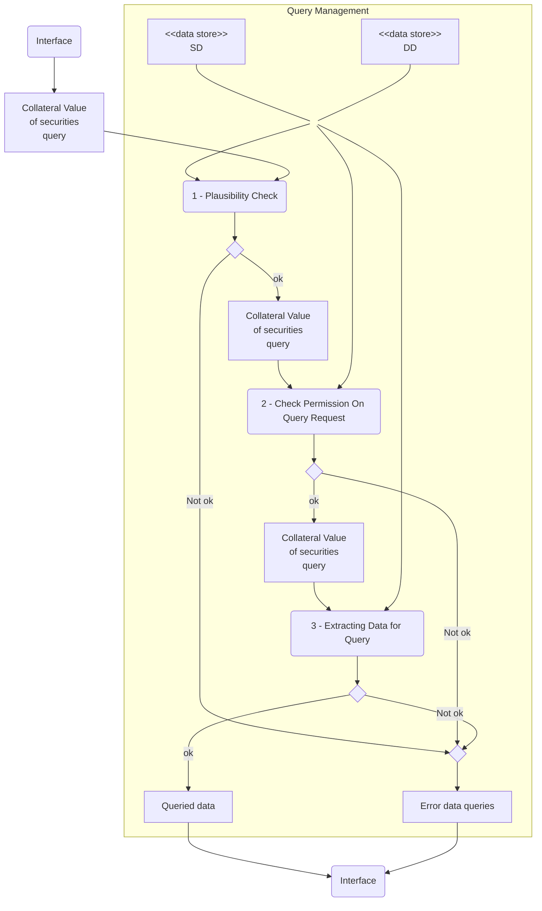

# Collateral-query processing with data stores

## Source evidence

[src-000356](../../../../../../../../raw-input/target2securities_t2s/ISO20022_MDR_Target2Securities_August_2026_v1.zip) archive member `ISO20022_MDR_Target2Securities_August_2026_v1/Target2-Securities_CollateralReporting_MessageSet/ISO20022_MDRPart1_Target2Securities_CollateralReporting_2023_2024_v2.docx`; BusinessProcess Description / BusinessProcess Flow; direct-body paragraph P134; word/media/image3.emf. [Unchanged original figure](../../../../../../assets/src-000356/originals/image3.emf).

## Mermaid reconstruction

## Roles, activities and alternatives

The interface submits a collateral-value-of-securities query into Query Management. Plausibility, permission and extraction run in order. Each Not ok route merges into Error data queries; successive ok routes reach Queried data. Both outputs return to the interface. The SD and DD data stores connect to a common trunk supplying all three processing steps; the artwork does not assign one store exclusively to one check. The SD/DD acronyms are retained without unsupported expansion because the supplied glossary does not define them. Three repeated query object boxes are kept as separate occurrences. Boundary and object-underlining presentation remain fully available in the original.

| Source-scoped role | Canonical reference |
| --- | --- |
| system member | [system member](../../../../../../../../shared/reference/participants/participant-src-000356-system-member.md) |
| system transaction administrator | [system transaction administrator](../../../../../../../../shared/reference/participants/participant-src-000356-system-transaction-administrator.md) |
| central system | [central system](../../../../../../../../shared/reference/participants/participant-src-000356-central-system.md) |
| settlement infrastructure | [settlement infrastructure](../../../../../../../../shared/reference/participants/participant-src-000356-settlement-infrastructure.md) |

Source responsibilities/conditions: [T9](../../documents/src-000356/tables/tbl-0009.md).

## Exact message evidence

| Source family | Exact supplied definition | Companion MDR Part2 locator |
| --- | --- | --- |
| colr.001 | [colr.001.001.02](../../../../../messages/colr.001.001.02/index.md) | src-000357; 2 colr.001.001.02 CollateralValueQueryV02; file pages4-15 |
| colr.002 | [colr.002.001.02](../../../../../messages/colr.002.001.02/index.md) | src-000357; 3 colr.002.001.02 CollateralValueReportV02; file pages16-39 |

Reusable flows: [Query Management Process](../../flows/flow-src-000356-p138-query-management-process.md).

## Review evidence

Compared the complete source artwork, its complete Word-rendered page and the Mermaid reconstruction. Checked all hierarchy levels and14 links, the six query categories and25 leaf labels, SD/DD common-store connections, all three success/failure checks, actor lanes, query/response directions and mutually exclusive rejection/execution paths where applicable. The long taxonomy was additionally compared in three readable focused views. Source geometry and rendering conventions remain documented as presentation limitations. Mermaid12.3.0 / Chromium156.0.8078.81; visual comparison2026-11-09 Europe/Warsaw.

[Compared reconstruction](../../../../../../assets/src-000356/reconstructed/fig-0003.png); [Complete Word page14](../../../../../../assets/src-000356/source-page-renders/word-page-14.png).
