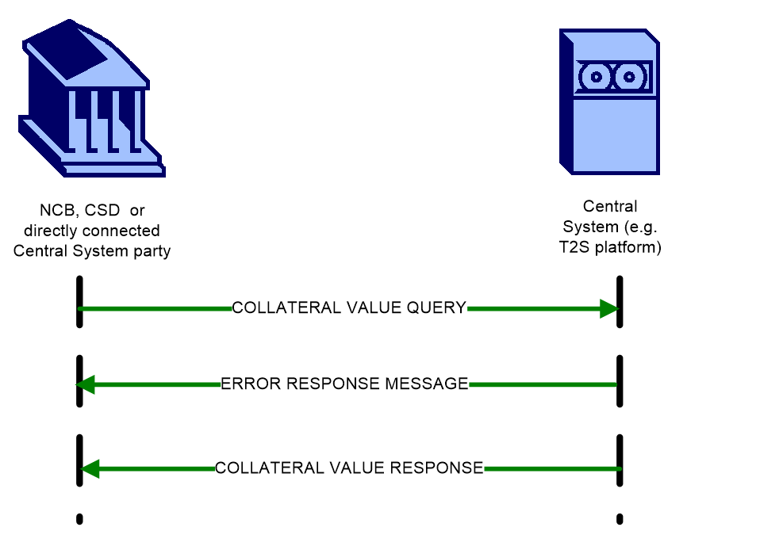
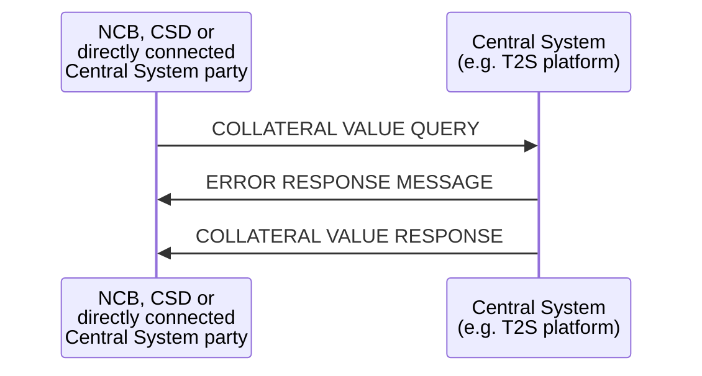

# Collateral-value communication overview

## Source evidence

[src-000356](../../../../../../../../raw-input/target2securities_t2s/ISO20022_MDR_Target2Securities_August_2026_v1.zip) archive member `ISO20022_MDR_Target2Securities_August_2026_v1/Target2-Securities_CollateralReporting_MessageSet/ISO20022_MDRPart1_Target2Securities_CollateralReporting_2023_2024_v2.docx`; BusinessTransactions; direct-body paragraph P147; word/media/image9.emf. [Unchanged original figure](../../../../../../assets/src-000356/originals/image9.emf).

## Mermaid reconstruction

## Roles, activities and alternatives

An NCB, CSD or directly connected Central System party queries the Central System for current securities collateral value. The source picture shows both error and value response arrows; P148 explicitly says they are mutually exclusive. No sequential error-then-success requirement is inferred. P148 describes the value as the intraday-credit amount a party may receive by collateralising its securities. P83 requires the actual selection timestamp and balance snapshot time/types in the response context. This is collateral-value reporting, not securities movement reversal or a collateral creation instruction.

| Source-scoped role | Canonical reference |
| --- | --- |
| system member | [system member](../../../../../../../../shared/reference/participants/participant-src-000356-system-member.md) |
| system transaction administrator | [system transaction administrator](../../../../../../../../shared/reference/participants/participant-src-000356-system-transaction-administrator.md) |
| national central bank ncb | [national central bank ncb](../../../../../../../../shared/reference/participants/participant-src-000356-national-central-bank-ncb.md) |
| central securities depositories csd | [central securities depositories csd](../../../../../../../../shared/reference/participants/participant-src-000356-central-securities-depositories-csd.md) |
| settlement infrastructure direct participant | [settlement infrastructure direct participant](../../../../../../../../shared/reference/participants/participant-src-000356-settlement-infrastructure-direct-participant.md) |
| central system | [central system](../../../../../../../../shared/reference/participants/participant-src-000356-central-system.md) |

## Exact message evidence

| Source family | Exact supplied definition | Companion MDR Part2 locator |
| --- | --- | --- |
| colr.001 | [colr.001.001.02](../../../../../messages/colr.001.001.02/index.md) | src-000357; 2 colr.001.001.02 CollateralValueQueryV02; file pages4-15 |
| colr.002 | [colr.002.001.02](../../../../../messages/colr.002.001.02/index.md) | src-000357; 3 colr.002.001.02 CollateralValueReportV02; file pages16-39 |

Reusable flows: [Query Management Process](../../flows/flow-src-000356-p138-query-management-process.md).

## Review evidence

Compared the complete source artwork, its complete Word-rendered page and the Mermaid reconstruction. Checked all hierarchy levels and14 links, the six query categories and25 leaf labels, SD/DD common-store connections, all three success/failure checks, actor lanes, query/response directions and mutually exclusive rejection/execution paths where applicable. The long taxonomy was additionally compared in three readable focused views. Source geometry and rendering conventions remain documented as presentation limitations. Mermaid12.3.0 / Chromium156.0.8078.81; visual comparison2026-11-09 Europe/Warsaw.

[Compared reconstruction](../../../../../../assets/src-000356/reconstructed/fig-0009.png); [Complete Word page17](../../../../../../assets/src-000356/source-page-renders/word-page-17.png).
