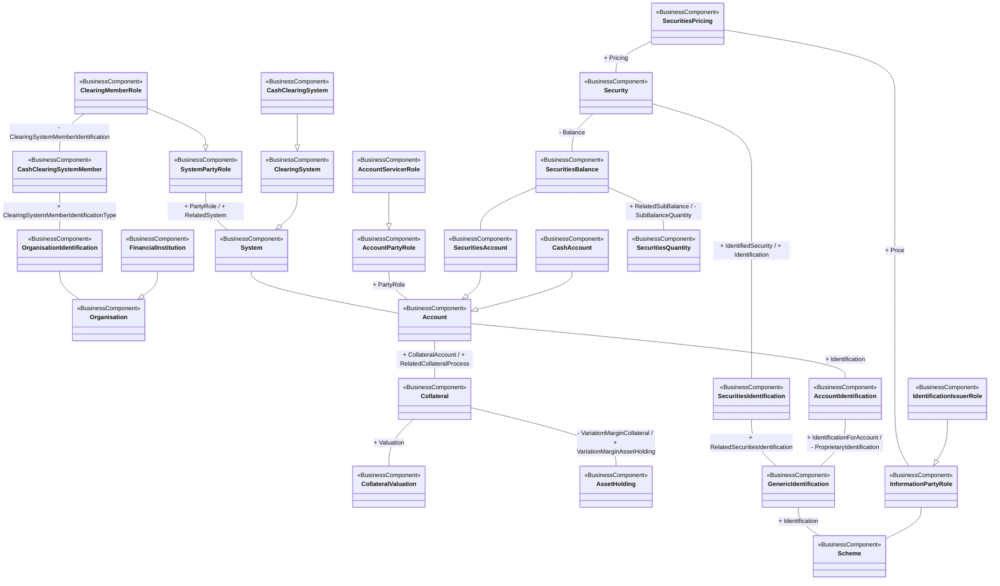

# T2S collateral-reporting conceptual model

[src-000358](../../../../../../../../../raw-input/target2securities_t2s/ISO20022_MDR_Target2Securities_August_2026_v1.zip) archive member `ISO20022_MDR_Target2Securities_August_2026_v1/Target2-Securities_CollateralReporting_MessageSet/ISO20022_MDRPart3_Target2Securities_CollateralReporting_2023_2024_v1.xlsx`, CollateralReporting!A1:AC61; xl/drawings/drawing2.xml; anchor 1. Original image SHA-256: b78f4d1c9e2ec21942295f69819a30be26c19038526be40f163a31465c60e1ca.

[Original complete figure](../../../../../../../assets/src-000358/media/image2.png) · [Rendered Mermaid SVG](../../../../../../../assets/src-000358/reconstructed/src-000358-fig-0002.svg) · [Rendered Mermaid PNG](../../../../../../../assets/src-000358/reconstructed/src-000358-fig-0002.png)

## Source reconstruction

## Entities and relationships

The model links system membership and organisation identification to account, account servicing, securities/cash account types and collateral valuation/variation margin. Securities balance connects security, account and quantity. Securities and account identifications link generic identification and scheme; information and identification-issuer roles provide separately scoped identification context. Association labels near SecuritiesPricing and Security refer to different links: Pricing on price/security, IdentifiedSecurity and Identification on security/identification. No payment or reporting message direction is supplied.

All 27 visible node occurrences and 28 relationship lines are retained. No numeric multiplicity is shown in this source view, so none is inferred. Printed package labels and absent labels are preserved in the entity register; the reconstruction adds no package boundaries absent from the source. Association labels retain literal +/− prefixes and combined end names. Their re-layout position is not additional navigability evidence. The native class inheritance marker is reserved for the source’s hollow-triangle generalizations. Source editor/navigation icons are omitted as interface decoration; no business entity or relationship is excluded.

## Complete relationship register

| From node | To node | Source relationship kind | Visible source label(s) | From-end multiplicity | To-end multiplicity |
| --- | --- | --- | --- | --- | --- |
| ClearingMemberRole | SystemPartyRole | generalization: subtype to supertype | (unlabelled in source) | not printed | not printed |
| SystemPartyRole | System | association | + PartyRole / + RelatedSystem | not printed | not printed |
| ClearingMemberRole | CashClearingSystemMember | association | - ClearingSystemMemberIdentification | not printed | not printed |
| CashClearingSystemMember | OrganisationIdentification | association | + ClearingSystemMemberIdentificationType | not printed | not printed |
| OrganisationIdentification | Organisation | association | (unlabelled in source) | not printed | not printed |
| FinancialInstitution | Organisation | generalization: subtype to supertype | (unlabelled in source) | not printed | not printed |
| ClearingSystem | System | generalization: subtype to supertype | (unlabelled in source) | not printed | not printed |
| CashClearingSystem | ClearingSystem | generalization: subtype to supertype | (unlabelled in source) | not printed | not printed |
| System | Account | association | (unlabelled in source) | not printed | not printed |
| AccountServicerRole | AccountPartyRole | generalization: subtype to supertype | (unlabelled in source) | not printed | not printed |
| AccountPartyRole | Account | association | + PartyRole | not printed | not printed |
| SecuritiesAccount | Account | generalization: subtype to supertype | (unlabelled in source) | not printed | not printed |
| CashAccount | Account | generalization: subtype to supertype | (unlabelled in source) | not printed | not printed |
| Account | Collateral | association | + CollateralAccount / + RelatedCollateralProcess | not printed | not printed |
| Collateral | CollateralValuation | association | + Valuation | not printed | not printed |
| Collateral | AssetHolding | association | - VariationMarginCollateral / + VariationMarginAssetHolding | not printed | not printed |
| SecuritiesPricing | Security | association | + Pricing | not printed | not printed |
| Security | SecuritiesBalance | association | - Balance | not printed | not printed |
| SecuritiesBalance | SecuritiesAccount | association | (unlabelled in source) | not printed | not printed |
| SecuritiesBalance | SecuritiesQuantity | association | + RelatedSubBalance / - SubBalanceQuantity | not printed | not printed |
| Security | SecuritiesIdentification | association | + IdentifiedSecurity / + Identification | not printed | not printed |
| Account | AccountIdentification | association | + Identification | not printed | not printed |
| SecuritiesIdentification | GenericIdentification | association | + RelatedSecuritiesIdentification | not printed | not printed |
| AccountIdentification | GenericIdentification | association | + IdentificationForAccount / - ProprietaryIdentification | not printed | not printed |
| GenericIdentification | Scheme | association | + Identification | not printed | not printed |
| SecuritiesPricing | InformationPartyRole | association | + Price | not printed | not printed |
| InformationPartyRole | Scheme | association | (unlabelled in source) | not printed | not printed |
| IdentificationIssuerRole | InformationPartyRole | generalization: subtype to supertype | (unlabelled in source) | not printed | not printed |

## Entity definitions and precise workbook locators

| Visible label | Source package / stereotype | Definition evidence |
| --- | --- | --- |
| SystemPartyRole | not printed in figure / BusinessComponent | [FullBusinessModel!A1700:D1700](../sheets/02-fullbusinessmodel/tbl-0010.md) — Role played by a party in a system. |
| ClearingMemberRole | not printed in figure / BusinessComponent | [FullBusinessModel!A1708:D1708](../sheets/02-fullbusinessmodel/tbl-0010.md) — Member of an exchange's clearing corporation, responsible for executing client trades and involved in the clearing of trades. |
| CashClearingSystemMember | not printed in figure / BusinessComponent | [FullBusinessModel!A1288:D1288](../sheets/02-fullbusinessmodel/tbl-0008.md) — Unique and unambiguous identifier for a clearing system member, as assigned by the clearing system. In some clearing systems, the accounts of the clearing system members are also assigned an identifier. The identifier can be used when transmitting, reconciling and confirming payment orders or security transfer instructions prior to settlement, and may include the netting of instructions and the establishment of final positions for settlement. |
| OrganisationIdentification | not printed in figure / BusinessComponent | [FullBusinessModel!A490:D490](../sheets/02-fullbusinessmodel/tbl-0004.md) — Unique and unambiguous way to identify an organisation. |
| Organisation | not printed in figure / BusinessComponent | [FullBusinessModel!A395:D395](../sheets/02-fullbusinessmodel/tbl-0003.md) — Organised structure that is set up for a particular purpose. For example, a business, government body, department, charity, or financial institution. |
| FinancialInstitution | not printed in figure / BusinessComponent | [FullBusinessModel!A594:D594](../sheets/02-fullbusinessmodel/tbl-0004.md) — Organisation established primarily to provide financial services. |
| System | not printed in figure / BusinessComponent | [FullBusinessModel!A1664:D1664](../sheets/02-fullbusinessmodel/tbl-0010.md) — Set of integrated applications that provides centralised services such as clearing, netting, reconciliation, trading and/or settlement. |
| ClearingSystem | not printed in figure / BusinessComponent | [FullBusinessModel!A1689:D1689](../sheets/02-fullbusinessmodel/tbl-0010.md) — Specifies the system which plays a role in the clearing process. |
| CashClearingSystem | not printed in figure / BusinessComponent | [FullBusinessModel!A1694:D1694](../sheets/02-fullbusinessmodel/tbl-0010.md) — Clearing system that processes only cash transfers. |
| AccountPartyRole | not printed in figure / BusinessComponent | [FullBusinessModel!A785:D785](../sheets/02-fullbusinessmodel/tbl-0005.md) — Role played by a party in the context of account operations. |
| AccountServicerRole | not printed in figure / BusinessComponent | [FullBusinessModel!A1400:D1400](../sheets/02-fullbusinessmodel/tbl-0008.md) — Party that manages the account on behalf of the account owner, that is manages the registration and booking of entries on the account, calculates balances on the account and provides information about the account. |
| Account | not printed in figure / BusinessComponent | [FullBusinessModel!A521:D521](../sheets/02-fullbusinessmodel/tbl-0004.md) — Record of transactions in specific types of assets, maintained by a servicing party on behalf of one or more owning parties. Business relationship between an account servicer and one or more account owners. |
| SecuritiesAccount | not printed in figure / BusinessComponent | [FullBusinessModel!A764:D764](../sheets/02-fullbusinessmodel/tbl-0005.md) — Account to or from which a securities entry is made. |
| CashAccount | not printed in figure / BusinessComponent | [FullBusinessModel!A556:D556](../sheets/02-fullbusinessmodel/tbl-0004.md) — Account to or from which a cash entry is made. |
| Collateral | not printed in figure / BusinessComponent | [FullBusinessModel!A2586:D2586](../sheets/02-fullbusinessmodel/tbl-0014.md) — Assets pledged by a debtor to secure a loan or an exposure and subject to seizure in the event of default. |
| CollateralValuation | not printed in figure / BusinessComponent | [FullBusinessModel!A3133:D3133](../sheets/02-fullbusinessmodel/tbl-0017.md) — Provides details about the valuation of each piece of collateral that is posted. |
| AssetHolding | not printed in figure / BusinessComponent | [FullBusinessModel!A1622:D1622](../sheets/02-fullbusinessmodel/tbl-0010.md) — Specifies in terms of value and quantity the assets. |
| SecuritiesPricing | not printed in figure / BusinessComponent | [FullBusinessModel!A310:D310](../sheets/02-fullbusinessmodel/tbl-0003.md) — Characteristics related to the price of the security. |
| Security | not printed in figure / BusinessComponent | [FullBusinessModel!A22:D22](../sheets/02-fullbusinessmodel/tbl-0002.md) — Financial instruments representing a sum of rights of the investor vis-a-vis the issuer. |
| SecuritiesBalance | not printed in figure / BusinessComponent | [FullBusinessModel!A2561:D2561](../sheets/02-fullbusinessmodel/tbl-0014.md) — Net position of a segregated holding, in a single security, within the overall position held in a securities account. A securities balance is calculated from the sum of securities' receipts minus the sum of securities' deliveries. |
| SecuritiesQuantity | not printed in figure / BusinessComponent | [FullBusinessModel!A1402:D1402](../sheets/02-fullbusinessmodel/tbl-0009.md) — Quantity of a security. |
| SecuritiesIdentification | not printed in figure / BusinessComponent | [FullBusinessModel!A111:D111](../sheets/02-fullbusinessmodel/tbl-0002.md) — Unique and unambiguous identifier of a security, assigned under a formal or proprietary identification scheme. |
| AccountIdentification | not printed in figure / BusinessComponent | [FullBusinessModel!A585:D585](../sheets/02-fullbusinessmodel/tbl-0004.md) — Unique identifier of an account, as assigned by the account servicer. |
| GenericIdentification | not printed in figure / BusinessComponent | [FullBusinessModel!A152:D152](../sheets/02-fullbusinessmodel/tbl-0002.md) — Information related to a non-standardised identification, such as a proprietary party identification or account identification. |
| Scheme | not printed in figure / BusinessComponent | [FullBusinessModel!A678:D678](../sheets/02-fullbusinessmodel/tbl-0005.md) — Information regarding an enumerated code list and its owner. |
| InformationPartyRole | not printed in figure / BusinessComponent | [FullBusinessModel!A141:D141](../sheets/02-fullbusinessmodel/tbl-0002.md) — Role played by a party as source of information. |
| IdentificationIssuerRole | not printed in figure / BusinessComponent | [FullBusinessModel!A148:D148](../sheets/02-fullbusinessmodel/tbl-0002.md) — Entity that assigns the identification. |

## Participant and flow navigation

This is a conceptual entity model, not a message exchange diagram. A business component or relationship label is not automatically a functional participant or institution. [Message-set participant references](../../../participants.md) and [Message-set business flows](../../../flows/index.md) provide the independently sourced actor/process context. These references are navigational; source figure associations do not establish message direction.

## Rendering and visual review

2026-11-09: Mermaid 12.3.0 parsed and rendered successfully with Mermaid browser API + Chromium 156.0.8078.81. Compared complete source artwork against the final rendered Mermaid PNG; all visible entities, relationship lines, literal labels, printed stereotypes and any package labels reconciled. Inheritance triangles, association arrows and composition diamonds preserve source endpoint direction. No absent numerical multiplicity is inferred. [Renderer evidence](../../../../../../../../../work/t2s-workbook-models/render-report.json).

