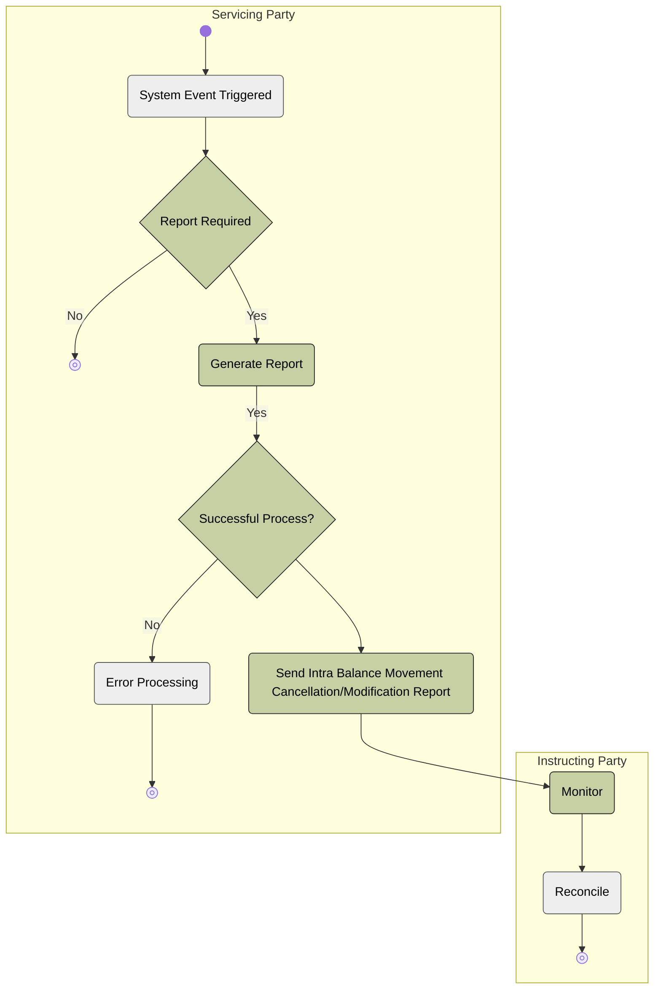

# Push modification and cancellation reporting activity

[src-000359](../../../../../../../../raw-input/target2securities_t2s/ISO20022_MDR_Target2Securities_August_2026_v1.zip) archive member `ISO20022_MDR_Target2Securities_August_2026_v1/Target2-Securities_IntraBalanceMovement_MessageSet/ISO20022_MDRPart1_Target2Securities_IntraBalanceMovement_2023_2024_v2.docx`; direct-body paragraph P201; Description of BusinessActivities / Intra-Balance Movement Modification/Cancellation Query/Report Process / Push Mode; Word-derived file page 25.

[Complete source figure / rendered composite](../../../../../../assets/src-000359/originals/image13.emf) · [Complete Word-page context](../../../../../../assets/src-000359/word-page-context/page-0025.png)

## Mermaid reconstruction

## Actors, entities and relationships

The reconstruction above retains the source-labelled entities, directed or undirected connectors, decision labels and lane boundaries. Each Mermaid line is the maintained relationship transcription; source activity-table definitions and responsibilities are linked below.

- [Account owner](../../../../../../../../shared/reference/participants/participant-src-000359-account-owner.md)
- [Instructing Party](../../../../../../../../shared/reference/participants/participant-src-000359-instructing-party.md)
- [Servicing Party](../../../../../../../../shared/reference/participants/participant-src-000359-servicing-party.md)

[Reusable flow: trigger, conditions, responsibilities and narrative](../../flows/flow-src-000359-p200-push-mode.md)

## Source tables and limitations

- [T16: BusinessProcess Description / Intra-Balance Management](../../documents/src-000359/tables/tbl-0016.md)
- [T23: Description of BusinessActivities / Intra-Balance Movement Modification/Cancellation Query/Report Process / Push Mode](../../documents/src-000359/tables/tbl-0023.md)

- T23 names Servicing/Executing Party Instructing Party jointly for the event initiator; the drawing places the event only in Servicing Party lane.
- T23 Error Processing says operational errors are added to a response before routing to Instructing Party; the source picture instead ends that error branch in the servicing lane. No missing response arrow is invented.
- Native Mermaid flowchart subgraphs retain source swimlane responsibility. Source start/end glyphs, labelled decisions and bars remain explicit. T19 defines bars as parallel actions; the original uses some bars at converging alternative paths, so no extra execution semantics are inferred.

[Source ambiguities: issue-000047](../../../../../../../../tracking/issues.md)

## Review evidence

Transcribed after direct original and complete native-composite inspection. Completed parsing, rendered comparison and whole-page review are recorded below.

<!-- INTRABALANCE-REVIEW-START -->
## Completed rendering and visual comparison

Mermaid browser API + Chromium 156.0.8078.81; Mermaid 12.3.0; 2026-11-09: parsing and rendering **pass**. [Rendered SVG](../../../../../../assets/src-000359/intrabalance/fig-0013.svg) · [Rendered PNG](../../../../../../assets/src-000359/intrabalance/fig-0013.png).

Original versus Mermaid: literal labels, connector endpoints/direction, decisions, solid/dashed lines, role boundaries and complete Word-page surroundings. Source-text labels clipped by the local Word rendering are explicitly disclosed, not presented as visibly read. Review **pass for extraction fidelity with the stated limitations**. Complete Word file page 25 was inspected; standalone picture reconstructions were also compared against their detailed original previews. Native sequence figures17–24 use the full Word composite, including original drawing text when labels are clipped.

[Hash-bound review and source-object inventory](../../../../../../../../tracking/reviews/intrabalance-diagrams.json). Contextual source ambiguities keep the page needs-review. This does not certify missing business context or hidden native layers.

<!-- INTRABALANCE-REVIEW-END -->
