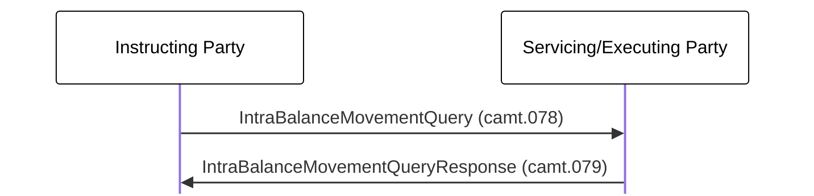

# Movement query and response exchange

[src-000359](../../../../../../../../raw-input/target2securities_t2s/ISO20022_MDR_Target2Securities_August_2026_v1.zip) archive member `ISO20022_MDR_Target2Securities_August_2026_v1/Target2-Securities_IntraBalanceMovement_MessageSet/ISO20022_MDRPart1_Target2Securities_IntraBalanceMovement_2023_2024_v2.docx`; direct-body paragraph P312; BusinessTransactions / Intra-Balance Movement Query/Response Process ; Word-derived file page 39.

[Complete source figure / rendered composite](../../../../../../assets/src-000359/word-page-context/page-0039.png) · [Complete Word-page context](../../../../../../assets/src-000359/word-page-context/page-0039.png)

## Mermaid reconstruction

## Actors, entities and relationships

| Step | Sender | Receiver | Complete source label | Line | Source colour |
| --- | --- | --- | --- | --- | --- |
| 1 | Instructing Party | Servicing/Executing Party | IntraBalanceMovementQuery (camt.078) | solid | green |
| 2 | Servicing/Executing Party | Instructing Party | IntraBalanceMovementQueryResponse (camt.079) | solid | green |

- [Instructing Party](../../../../../../../../shared/reference/participants/participant-src-000359-instructing-party.md)
- [Servicing/Executing Party](../../../../../../../../shared/reference/participants/participant-src-000359-servicing-executing-party.md)

[Reusable flow: trigger, conditions, responsibilities and narrative](../../flows/flow-src-000359-p310-intra-balance-movement-query-response-process.md)

## Source tables and limitations

- [T14: BusinessProcess Description / Intra-Balance Management](../../documents/src-000359/tables/tbl-0014.md)
- [T15: BusinessProcess Description / Intra-Balance Management](../../documents/src-000359/tables/tbl-0015.md)
- [T26: Description of BusinessActivities / Intra-Balance Movement Query/Response Process](../../documents/src-000359/tables/tbl-0026.md)

- Source-native text boxes and connector objects form a complete figure. The retained Word page is the complete composite; the small WMF bank pictograms are not treated as standalone diagrams.
- Solid/dashed connectors and their directions are preserved. Source colours are recorded per message step below; colours distinguish pictured context without asserting extra protocol semantics.
- Native Mermaid boxes replace institutional pictograms; labels define the functional participants and do not bind a role to one institution.

[Source ambiguities: issue-000047](../../../../../../../../tracking/issues.md)

## Review evidence

Transcribed after direct original and complete native-composite inspection. Completed parsing, rendered comparison and whole-page review are recorded below.

<!-- INTRABALANCE-REVIEW-START -->
## Completed rendering and visual comparison

Mermaid browser API + Chromium 156.0.8078.81; Mermaid 12.3.0; 2026-11-09: parsing and rendering **pass**. [Rendered SVG](../../../../../../assets/src-000359/intrabalance/fig-0024.svg) · [Rendered PNG](../../../../../../assets/src-000359/intrabalance/fig-0024.png).

Original versus Mermaid: literal labels, connector endpoints/direction, decisions, solid/dashed lines, role boundaries and complete Word-page surroundings. Source-text labels clipped by the local Word rendering are explicitly disclosed, not presented as visibly read. Review **pass for extraction fidelity with the stated limitations**. Complete Word file page 39 was inspected; standalone picture reconstructions were also compared against their detailed original previews. Native sequence figures17–24 use the full Word composite, including original drawing text when labels are clipped.

[Hash-bound review and source-object inventory](../../../../../../../../tracking/reviews/intrabalance-diagrams.json). Contextual source ambiguities keep the page needs-review. This does not certify missing business context or hidden native layers.

<!-- INTRABALANCE-REVIEW-END -->
