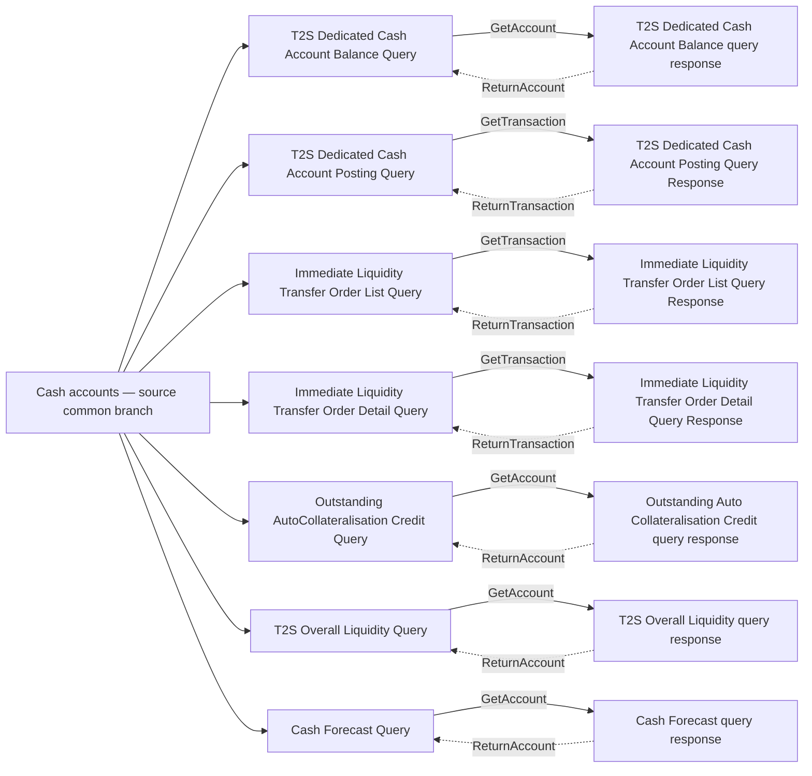

# Cash-query taxonomy detail 1

[Complete source context and query taxonomy](fig-0005.md); source src-000362, P131, word/media/image5.jpeg; Word13. Each query node branches from the common cash-account category, sends a solid labelled link rightward and receives a dashed labelled link leftward. Only the source green journal pair belongs to the supplied camt.064/065 scope. No version or family is inferred for other pairs.

| Source row | Query label | Forward link label | Response label | Return link label | Scope |
| --- | --- | --- | --- | --- | --- |
| 1 | T2S Dedicated Cash Account Balance Query | GetAccount | T2S Dedicated Cash Account Balance query response | ReturnAccount | Other context |
| 2 | T2S Dedicated Cash Account Posting Query | GetTransaction | T2S Dedicated Cash Account Posting Query Response | ReturnTransaction | Other context |
| 3 | Immediate Liquidity Transfer Order List Query | GetTransaction | Immediate Liquidity Transfer Order List Query Response | ReturnTransaction | Other context |
| 4 | Immediate Liquidity Transfer Order Detail Query | GetTransaction | Immediate Liquidity Transfer Order Detail Query Response | ReturnTransaction | Other context |
| 5 | Outstanding AutoCollateralisation Credit Query | GetAccount | Outstanding Auto Collateralisation Credit query response | ReturnAccount | Other context |
| 6 | T2S Overall Liquidity Query | GetAccount | T2S Overall Liquidity query response | ReturnAccount | Other context |
| 7 | Cash Forecast Query | GetAccount | Cash Forecast query response | ReturnAccount | Other context |

## Review evidence

Original image5.jpeg, enlarged source-label crops and complete Word13 compared with every query/response and exchange-link label. Native Mermaid12.3.0 / Chromium156.0.8078.81 rendering passed; visual comparison2026-11-09. [Compared detail](../../../../../../assets/src-000362/reconstructed/fig-0005-cash-1.png).
