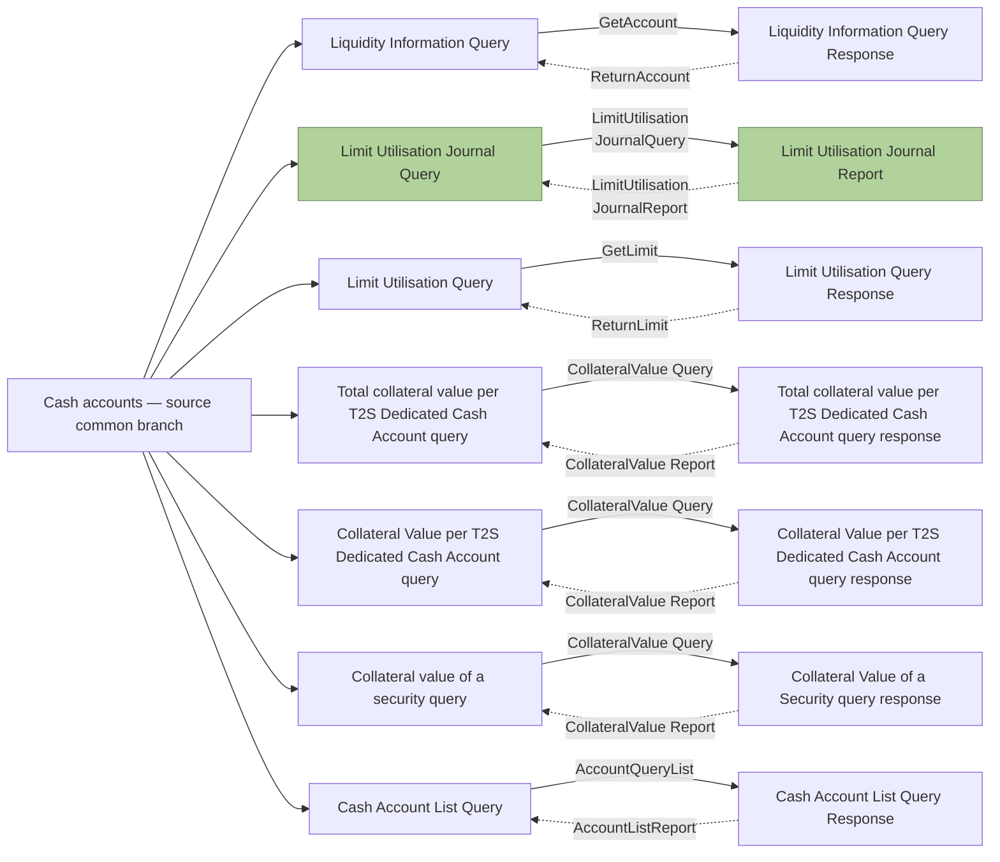

# Cash-query taxonomy detail 2

[Complete source context and query taxonomy](fig-0005.md); source src-000362, P131, word/media/image5.jpeg; Word13. Each query node branches from the common cash-account category, sends a solid labelled link rightward and receives a dashed labelled link leftward. Only the source green journal pair belongs to the supplied camt.064/065 scope. No version or family is inferred for other pairs.

| Source row | Query label | Forward link label | Response label | Return link label | Scope |
| --- | --- | --- | --- | --- | --- |
| 8 | Liquidity Information Query | GetAccount | Liquidity Information Query Response | ReturnAccount | Other context |
| 9 | Limit Utilisation Journal Query | LimitUtilisationJournalQuery | Limit Utilisation Journal Report | LimitUtilisationJournalReport | In scope (green) |
| 10 | Limit Utilisation Query | GetLimit | Limit Utilisation Query Response | ReturnLimit | Other context |
| 11 | Total collateral value per T2S Dedicated Cash Account query | CollateralValue Query | Total collateral value per T2S Dedicated Cash Account query response | CollateralValue Report | Other context |
| 12 | Collateral Value per T2S Dedicated Cash Account query | CollateralValue Query | Collateral Value per T2S Dedicated Cash Account query response | CollateralValue Report | Other context |
| 13 | Collateral value of a security query | CollateralValue Query | Collateral Value of a Security query response | CollateralValue Report | Other context |
| 14 | Cash Account List Query | AccountQueryList | Cash Account List Query Response | AccountListReport | Other context |

## Review evidence

Original image5.jpeg, enlarged source-label crops and complete Word13 compared with every query/response and exchange-link label. Native Mermaid12.3.0 / Chromium156.0.8078.81 rendering passed; visual comparison2026-11-09. [Compared detail](../../../../../../assets/src-000362/reconstructed/fig-0005-cash-2.png).
