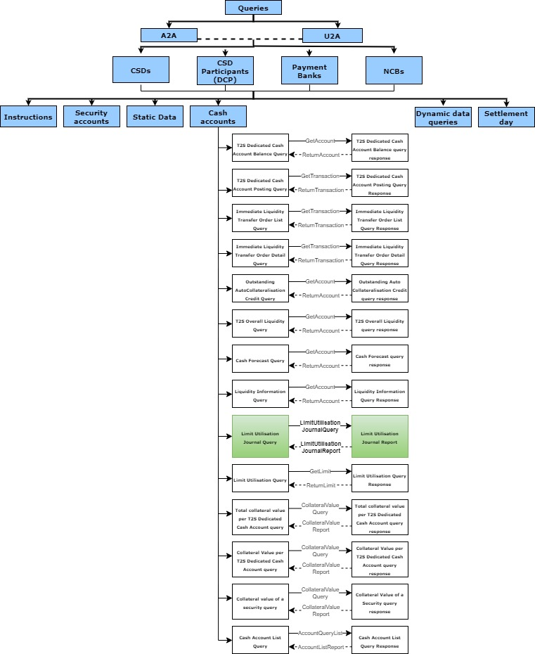
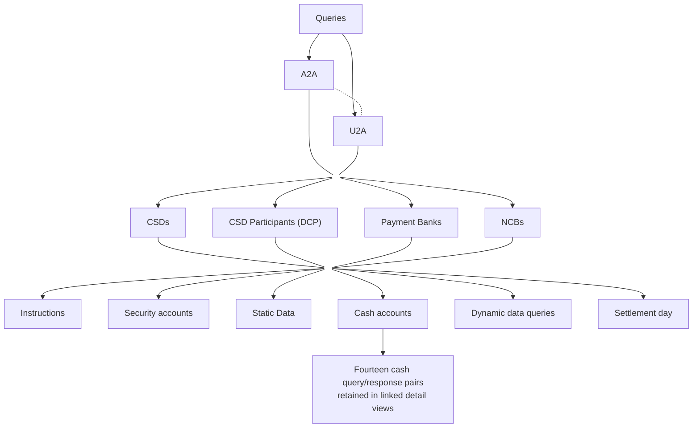

# Query taxonomy and limit-journal scope

## Source evidence

[src-000362](../../../../../../../../raw-input/target2securities_t2s/ISO20022_MDR_Target2Securities_August_2026_v1.zip) archive member `ISO20022_MDR_Target2Securities_August_2026_v1/Target2-Securities_LimitUtilisationJournal_MessageSet/ISO20022_MDRPart1_Target2Securities_LimitUtilisationJournal_v2.docx`; BusinessProcess Description; direct-body paragraph P131; word/media/image5.jpeg. [Unchanged original figure](../../../../../../assets/src-000362/originals/image5.jpeg).

## Mermaid reconstruction

## Roles, activities and alternatives

Queries branch into A2A/U2A and a shared actor/category taxonomy. The source includes a dashed A2A–U2A connector without a defined meaning, retained as dashed and not interpreted as a message. CSDs, CSD Participants (DCP), Payment Banks and NCBs feed six query categories. Cash accounts has fourteen query/response pairs, with forward solid and return dashed links; only the Limit Utilisation Journal pair is green/in scope. The complete source and two focused detail reconstructions preserve all28 leaf labels and28 message-type link labels. The reconstruction adds a clearly labelled detail-navigation box, not a source process. Other query types are context and are not assigned camt.064/065.

| Source-scoped role | Canonical reference |
| --- | --- |
| central securities depositories csd | [central securities depositories csd](../../../../../../../../shared/reference/participants/participant-src-000362-central-securities-depositories-csd.md) |
| direct connected participant dcp | [direct connected participant dcp](../../../../../../../../shared/reference/participants/participant-src-000362-direct-connected-participant-dcp.md) |
| csd participant | [csd participant](../../../../../../../../shared/reference/participants/participant-src-000362-csd-participant.md) |
| payment bank | [payment bank](../../../../../../../../shared/reference/participants/participant-src-000362-payment-bank.md) |
| national central bank ncb | [national central bank ncb](../../../../../../../../shared/reference/participants/participant-src-000362-national-central-bank-ncb.md) |

Source responsibilities/conditions: [T2](../../documents/src-000362/tables/tbl-0002.md), [T8](../../documents/src-000362/tables/tbl-0008.md).

## Exact message evidence

| Source family | Exact supplied definition | Companion MDR Part2 locator |
| --- | --- | --- |
| camt.064 | [camt.064.001.01](../../../../../messages/camt.064.001.01/index.md) | src-000363; 2 camt.064.001.01 LimitUtilisationJournalQueryV01; file pages4-8 |
| camt.065 | [camt.065.001.01](../../../../../messages/camt.065.001.01/index.md) | src-000363; 3 camt.065.001.01 LimitUtilisationJournalReportV01; file pages9-28 |

Reusable flows: [Query Report Process](../../flows/flow-src-000362-p132-query-report-process.md).

## Review evidence

Compared complete source artwork and complete Word pages with the rendered reconstruction. Checked six actor symbols and source stereotypes, association direction, source green reporting scope, all14 taxonomy query/response pairs with28 leaf labels and28 exchange labels, business-role mappings, ordered activities, exclusive validation branches, source join bar, scheduled push origin and message direction. The two identical context occurrences remain linked to one reconstruction. Mermaid12.3.0 / Chromium156.0.8078.81; comparison2026-11-09 Europe/Warsaw. [Compared reconstruction](../../../../../../assets/src-000362/reconstructed/fig-0005.png).

Complete source pages: [Word13](../../../../../../assets/src-000362/source-page-renders/word-page-13.png).

## Complete cash-query detail

[Pairs1–7](fig-0005-cash-1.md); [Pairs8–14, including green limit-journal scope](fig-0005-cash-2.md). All14 common-branch arrows,28 query/response labels and28 exchange-link labels are retained.
