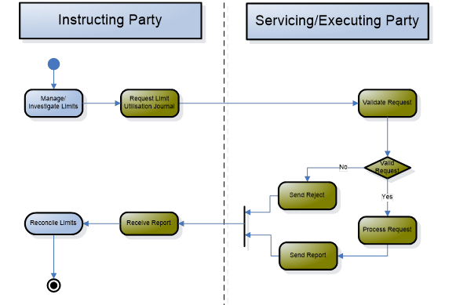
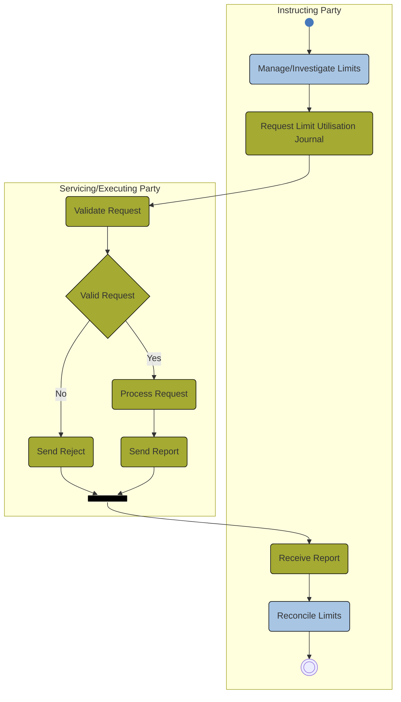

# Participant-triggered limit-journal pull activity

## Source evidence

[src-000362](../../../../../../../../raw-input/target2securities_t2s/ISO20022_MDR_Target2Securities_August_2026_v1.zip) archive member `ISO20022_MDR_Target2Securities_August_2026_v1/Target2-Securities_LimitUtilisationJournal_MessageSet/ISO20022_MDRPart1_Target2Securities_LimitUtilisationJournal_v2.docx`; Description of BusinessActivities / Pull mode; direct-body paragraph P138; word/media/image10.png. [Unchanged original figure](../../../../../../assets/src-000362/originals/image10.png).

## Mermaid reconstruction

## Roles, activities and alternatives

An instructing party investigating limits triggers Request Limit Utilisation Journal. The servicing/executing party validates the request: No sends a rejection report specifying the operational error; Yes processes and sends the requested report. Both paths reach the source black join bar and return to Receive Report, followed by Reconcile Limits and an end point. The native fork/join bar preserves the source mark without asserting parallel execution: the preceding Yes/No choice is exclusive. T8 requires limits to exist within the instructing party scope; the source states postconditions as none. T10 preserves technical and business validation and the communication-layer handoff.

| Source-scoped role | Canonical reference |
| --- | --- |
| instructing party | [instructing party](../../../../../../../../shared/reference/participants/participant-src-000362-instructing-party.md) |
| executing servicing party | [executing servicing party](../../../../../../../../shared/reference/participants/participant-src-000362-executing-servicing-party.md) |
| credit provider | [credit provider](../../../../../../../../shared/reference/participants/participant-src-000362-credit-provider.md) |
| credit consumer | [credit consumer](../../../../../../../../shared/reference/participants/participant-src-000362-credit-consumer.md) |
| responsible party | [responsible party](../../../../../../../../shared/reference/participants/participant-src-000362-responsible-party.md) |
| central securities depositories csd | [central securities depositories csd](../../../../../../../../shared/reference/participants/participant-src-000362-central-securities-depositories-csd.md) |
| national central bank ncb | [national central bank ncb](../../../../../../../../shared/reference/participants/participant-src-000362-national-central-bank-ncb.md) |
| payment bank | [payment bank](../../../../../../../../shared/reference/participants/participant-src-000362-payment-bank.md) |
| direct connected participant dcp | [direct connected participant dcp](../../../../../../../../shared/reference/participants/participant-src-000362-direct-connected-participant-dcp.md) |

Source responsibilities/conditions: [T8](../../documents/src-000362/tables/tbl-0008.md), [T10](../../documents/src-000362/tables/tbl-0010.md).

## Exact message evidence

| Source family | Exact supplied definition | Companion MDR Part2 locator |
| --- | --- | --- |
| camt.064 | [camt.064.001.01](../../../../../messages/camt.064.001.01/index.md) | src-000363; 2 camt.064.001.01 LimitUtilisationJournalQueryV01; file pages4-8 |
| camt.065 | [camt.065.001.01](../../../../../messages/camt.065.001.01/index.md) | src-000363; 3 camt.065.001.01 LimitUtilisationJournalReportV01; file pages9-28 |

Reusable flows: [Pull mode](../../flows/flow-src-000362-p137-pull-mode.md).

## Review evidence

Compared complete source artwork and complete Word pages with the rendered reconstruction. Checked six actor symbols and source stereotypes, association direction, source green reporting scope, all14 taxonomy query/response pairs with28 leaf labels and28 exchange labels, business-role mappings, ordered activities, exclusive validation branches, source join bar, scheduled push origin and message direction. The two identical context occurrences remain linked to one reconstruction. Mermaid12.3.0 / Chromium156.0.8078.81; comparison2026-11-09 Europe/Warsaw. [Compared reconstruction](../../../../../../assets/src-000362/reconstructed/fig-0010.png).

Complete source pages: [Word15](../../../../../../assets/src-000362/source-page-renders/word-page-15.png).

Presentation qualification: the source vertical black bar is rendered as a horizontal native fork/join bar in the top-down layout; its two incoming and one outgoing connections are retained. No additional synchronization condition is inferred.
