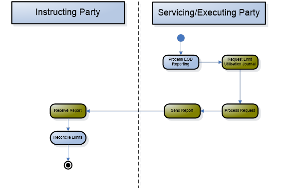
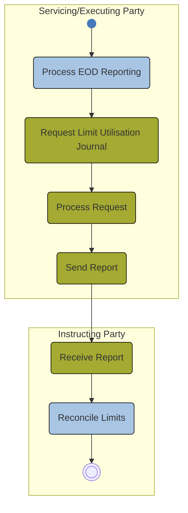

# Scheduled limit-journal push activity

## Source evidence

[src-000362](../../../../../../../../raw-input/target2securities_t2s/ISO20022_MDR_Target2Securities_August_2026_v1.zip) archive member `ISO20022_MDR_Target2Securities_August_2026_v1/Target2-Securities_LimitUtilisationJournal_MessageSet/ISO20022_MDRPart1_Target2Securities_LimitUtilisationJournal_v2.docx`; Description of BusinessActivities / Push mode; direct-body paragraph P144; word/media/image11.png. [Unchanged original figure](../../../../../../assets/src-000362/originals/image11.png).

## Mermaid reconstruction

## Roles, activities and alternatives

The executing/servicing party starts end-of-day reporting, internally requests and processes the report, then sends it to the instructing-party subscriber. No inbound query message is drawn or required for this push activity. T11 explicitly assigns Request, Process and Send to the executing/servicing party and Receive to the subscriber. Reconcile Limits follows receipt. T8 supplies the scheduled end-of-day trigger and existing-limit precondition; no additional acknowledgement, cancellation or reversal message is introduced.

| Source-scoped role | Canonical reference |
| --- | --- |
| instructing party | [instructing party](../../../../../../../../shared/reference/participants/participant-src-000362-instructing-party.md) |
| executing servicing party | [executing servicing party](../../../../../../../../shared/reference/participants/participant-src-000362-executing-servicing-party.md) |
| instructing party subscriber to receive the report | [instructing party subscriber to receive the report](../../../../../../../../shared/reference/participants/participant-src-000362-instructing-party-subscriber-to-receive-the-report.md) |
| credit provider | [credit provider](../../../../../../../../shared/reference/participants/participant-src-000362-credit-provider.md) |
| credit consumer | [credit consumer](../../../../../../../../shared/reference/participants/participant-src-000362-credit-consumer.md) |
| responsible party | [responsible party](../../../../../../../../shared/reference/participants/participant-src-000362-responsible-party.md) |

Source responsibilities/conditions: [T8](../../documents/src-000362/tables/tbl-0008.md), [T11](../../documents/src-000362/tables/tbl-0011.md).

## Exact message evidence

| Source family | Exact supplied definition | Companion MDR Part2 locator |
| --- | --- | --- |
| camt.065 | [camt.065.001.01](../../../../../messages/camt.065.001.01/index.md) | src-000363; 3 camt.065.001.01 LimitUtilisationJournalReportV01; file pages9-28 |

Reusable flows: [Push mode](../../flows/flow-src-000362-p143-push-mode.md).

## Review evidence

Compared complete source artwork and complete Word pages with the rendered reconstruction. Checked six actor symbols and source stereotypes, association direction, source green reporting scope, all14 taxonomy query/response pairs with28 leaf labels and28 exchange labels, business-role mappings, ordered activities, exclusive validation branches, source join bar, scheduled push origin and message direction. The two identical context occurrences remain linked to one reconstruction. Mermaid12.3.0 / Chromium156.0.8078.81; comparison2026-11-09 Europe/Warsaw. [Compared reconstruction](../../../../../../assets/src-000362/reconstructed/fig-0011.png).

Complete source pages: [Word16](../../../../../../assets/src-000362/source-page-renders/word-page-16.png).
