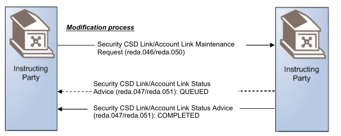
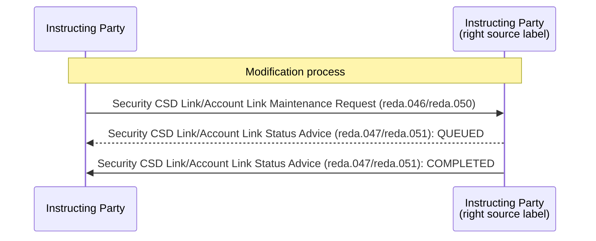

# Link modification confirmation sequence — source role-label conflict

## Source evidence

[src-000365](../../../../../../../../raw-input/target2securities_t2s/ISO20022_MDR_Target2Securities_August_2026_v1.zip) archive member `ISO20022_MDR_Target2Securities_August_2026_v1/Target2-Securities_LinkReferenceData_MessageSet/ISO20022_MDRPart1_Target2Securities_LinkReferenceData_v2.docx`; BusinessTransactions / Modification Process / Confirmation Scenario; direct-body paragraph P179; word/media/image11.png. [Unchanged original figure](../../../../../../assets/src-000365/originals/image11.png).

## Mermaid reconstruction

## Roles, activities and alternatives

The source shows the request left-to-right, an optional QUEUED advice right-to-left with a dashed line, and the final solid COMPLETED advice. The adjacent narrative says delayed processing might be reported, so QUEUED is not mandatory in every execution. Successful processing returns identification of the link. Both source actor boxes literally say Instructing Party (Word20/21, images11/12). The narrative identifies the receiving/responding role as Executing/Servicing Party. This reconstruction preserves the literal artwork; narrative message directions are maintained separately, and issue-000049 remains unresolved. No second institution identity is invented from the duplicate label.

| Source-scoped role | Canonical reference |
| --- | --- |
| instructing party | [instructing party](../../../../../../../../shared/reference/participants/participant-src-000365-instructing-party.md) |
| executing servicing party | [executing servicing party](../../../../../../../../shared/reference/participants/participant-src-000365-executing-servicing-party.md) |

## Exact message evidence

| Source family | Exact supplied definition | Companion MDR Part2 locator |
| --- | --- | --- |
| reda.046 | [reda.046.001.01](../../../../../messages/reda.046.001.01/index.md) | src-000366; 3 reda.046.001.01 SecurityCSDLinkMaintenanceRequestV01; file pages17-24 |
| reda.047 | [reda.047.001.01](../../../../../messages/reda.047.001.01/index.md) | src-000366; 4 reda.047.001.01 SecurityCSDLinkStatusAdviceV01; file pages25-34 |
| reda.050 | [reda.050.001.01](../../../../../messages/reda.050.001.01/index.md) | src-000366; 6 reda.050.001.01 AccountLinkMaintenanceRequestV01; file pages41-46 |
| reda.051 | [reda.051.001.01](../../../../../messages/reda.051.001.01/index.md) | src-000366; 7 reda.051.001.01 AccountLinkStatusAdviceV01; file pages47-54 |

Reusable flows: [Confirmation Scenario](../../flows/flow-src-000365-p177-confirmation-scenario.md).

## Review evidence

See recorded visual review below.

Complete native composite source: [Word file/printed page20](../../../../../../assets/src-000365/source-page-renders/word-page-20.png); [complete figure crop](../../../../../../assets/src-000365/source-page-renders/fig-0011-complete-crop.png). Original actor fragments are preserved separately and do not contain the native connector text.

## Recorded visual review

Compared all visible actor labels, business-role arrows, two overview activities, accepted/rejected decisions and retry path, three status messages, line styles and message directions with complete Word source pages. Identical complete activity previews have one canonical reconstruction while creation and modification rules remain distinct. Literal duplicate Instructing Party labels on modification sequences are preserved and qualified under issue-000049. Mermaid12.3.0 / Chromium156.0.8078.81 parse/render and visual comparison passed2026-11-09 Europe/Warsaw. [Compared reconstruction](../../../../../../assets/src-000365/reconstructed/fig-0011.png). Source pages: [Word20](../../../../../../assets/src-000365/source-page-renders/word-page-20.png).
