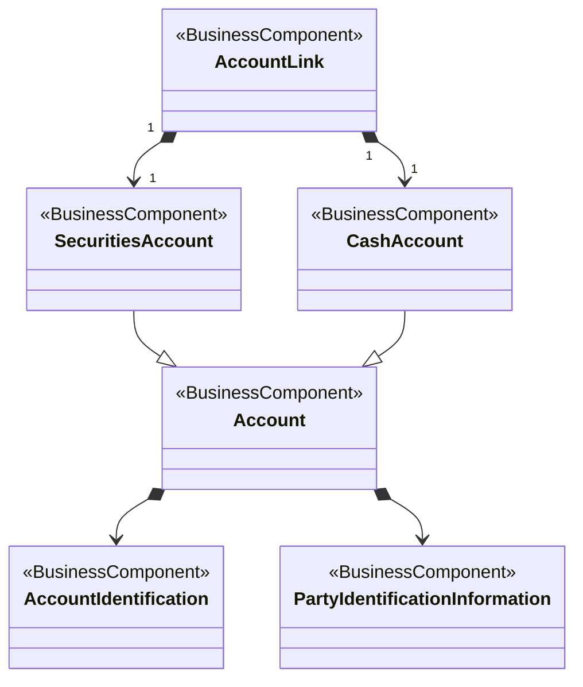

# T2S account-link reference-data conceptual model

[src-000367](../../../../../../../../../raw-input/target2securities_t2s/ISO20022_MDR_Target2Securities_August_2026_v1.zip) archive member `ISO20022_MDR_Target2Securities_August_2026_v1/Target2-Securities_LinkReferenceData_MessageSet/ISO20022_MDRPart3_Target2Securities_LinkReferenceData_v1.xlsx`, T2S - Link Reference!A1:M16; xl/drawings/drawing2.xml; anchor 1. Original image SHA-256: d793813e6a95b138253957bbdb0c6a4c833d6cfa79190fe023dec1803695c5ae.

[Original complete figure](../../../../../../../assets/src-000367/media/image2.png) · [Rendered Mermaid SVG](../../../../../../../assets/src-000367/reconstructed/src-000367-fig-0002.svg) · [Rendered Mermaid PNG](../../../../../../../assets/src-000367/reconstructed/src-000367-fig-0002.png)

## Source reconstruction

## Entities and relationships

SecuritiesAccount and CashAccount specialize Account. Account has directed composition to account identification and party-identification information. AccountLink has two directed composition associations, one to securities account and one to cash account, each with literal multiplicity 1 at both ends. The filled diamonds remain at Account or AccountLink; the arrowheads remain at the identification or linked-account end. These are source conceptual-model relationships, not inferred XML parentage.

All 6 visible node occurrences and 6 relationship lines are retained. The AccountLink–SecuritiesAccount and AccountLink–CashAccount links each print 1 at both ends. Those four values are preserved. No cardinality is inferred on other associations. Printed package labels and absent labels are preserved in the entity register; the reconstruction adds no package boundaries absent from the source. Association labels retain literal +/− prefixes and combined end names. Their re-layout position is not additional navigability evidence. The native class inheritance marker is reserved for the source’s hollow-triangle generalizations. Source editor/navigation icons are omitted as interface decoration; no business entity or relationship is excluded.

## Complete relationship register

| From node | To node | Source relationship kind | Visible source label(s) | From-end multiplicity | To-end multiplicity |
| --- | --- | --- | --- | --- | --- |
| SecuritiesAccount | Account | generalization: subtype to supertype | (unlabelled in source) | not printed | not printed |
| CashAccount | Account | generalization: subtype to supertype | (unlabelled in source) | not printed | not printed |
| Account | AccountIdentification | composition at from node, directed to to node | (unlabelled in source) | not printed | not printed |
| Account | PartyIdentificationInformation | composition at from node, directed to to node | (unlabelled in source) | not printed | not printed |
| AccountLink | SecuritiesAccount | composition at from node, directed to to node | (unlabelled in source) | 1 | 1 |
| AccountLink | CashAccount | composition at from node, directed to to node | (unlabelled in source) | 1 | 1 |

## Entity definitions and precise workbook locators

| Visible label | Source package / stereotype | Definition evidence |
| --- | --- | --- |
| Account | not printed in figure / BusinessComponent | [FullBusinessModel!A24:D24](../sheets/02-fullbusinessmodel/tbl-0002.md) — Record of transactions in specific types of assets, maintained by a servicing party on behalf of one or more owning parties. Business relationship between an account servicer and one or more account owners. |
| SecuritiesAccount | not printed in figure / BusinessComponent | [FullBusinessModel!A3797:D3797](../sheets/02-fullbusinessmodel/tbl-0020.md) — Account to or from which a securities entry is made. |
| CashAccount | not printed in figure / BusinessComponent | [FullBusinessModel!A548:D548](../sheets/02-fullbusinessmodel/tbl-0004.md) — Account to or from which a cash entry is made. |
| AccountIdentification | not printed in figure / BusinessComponent | [FullBusinessModel!A71:D71](../sheets/02-fullbusinessmodel/tbl-0002.md) — Unique identifier of an account, as assigned by the account servicer. |
| PartyIdentificationInformation | not printed in figure / BusinessComponent | [FullBusinessModel!A2983:D2983](../sheets/02-fullbusinessmodel/tbl-0016.md) — Unique and unambiguous way to identify a party |
| AccountLink | not printed in figure / BusinessComponent | [FullBusinessModel!A81:D81](../sheets/02-fullbusinessmodel/tbl-0002.md) — Defines the link between the accounts held with a market infrastructure. |

## Participant and flow navigation

This is a conceptual entity model, not a message exchange diagram. A business component or relationship label is not automatically a functional participant or institution. [Message-set participant references](../../../participants.md) and [Message-set business flows](../../../flows/index.md) provide the independently sourced actor/process context. These references are navigational; source figure associations do not establish message direction.

## Rendering and visual review

2026-11-09: Mermaid 12.3.0 parsed and rendered successfully with Mermaid browser API + Chromium 156.0.8078.81. Compared complete source artwork against the final rendered Mermaid PNG; all visible entities, relationship lines, literal labels, printed stereotypes and any package labels reconciled. Inheritance triangles, association arrows and composition diamonds preserve source endpoint direction. No absent numerical multiplicity is inferred. Checked all four printed multiplicity-1 labels on the two AccountLink composition associations. [Renderer evidence](../../../../../../../../../work/t2s-workbook-models/render-report.json).

