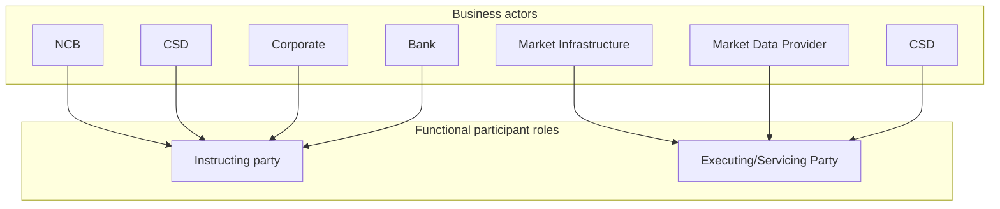

# Business actors and contextual participant roles

[src-000368](../../../../../../../../raw-input/target2securities_t2s/ISO20022_MDR_Target2Securities_August_2026_v1.zip) archive member `ISO20022_MDR_Target2Securities_August_2026_v1/Target2-Securities_PartyReferenceData_MessageSet/ISO20022_MDRPart1_Target2Securities_PartyReferenceData_2023_2024_v2.docx`; direct-body paragraph P111; Word-rendered file page 10. Standalone source artwork, additionally checked in Word-rendered file page 10.

[Complete original figure/context](../../../../../../assets/src-000368/originals/image1.png)

## Source reconstruction

## Participants

- [Instructing Party](../../../../../../../../shared/reference/participants/participant-src-000368-instructing-party.md)
- [Executing / Servicing Party](../../../../../../../../shared/reference/participants/participant-src-000368-executing-servicing-party.md)
- [National Central Bank (NCB)](../../../../../../../../shared/reference/participants/participant-src-000368-national-central-bank-ncb.md)
- [Central Securities Depositories (CSD)](../../../../../../../../shared/reference/participants/participant-src-000368-central-securities-depositories-csd.md)
- [Corporate](../../../../../../../../shared/reference/participants/participant-src-000368-corporate.md)
- [Bank](../../../../../../../../shared/reference/participants/participant-src-000368-bank.md)
- [Market Infrastructure](../../../../../../../../shared/reference/participants/participant-src-000368-market-infrastructure.md)
- [Market Data Provider](../../../../../../../../shared/reference/participants/participant-src-000368-market-data-provider.md)

## Entities and relationships

| Source | Destination | Condition or exchange | Line notation |
| --- | --- | --- | --- |
| NCB | Instructing party | Unlabelled connector | --&gt; |
| CSD | Instructing party | Unlabelled connector | --&gt; |
| Corporate | Instructing party | Unlabelled connector | --&gt; |
| Bank | Instructing party | Unlabelled connector | --&gt; |
| Market Infrastructure | Executing/Servicing Party | Unlabelled connector | --&gt; |
| Market Data Provider | Executing/Servicing Party | Unlabelled connector | --&gt; |
| CSD | Executing/Servicing Party | Unlabelled connector | --&gt; |

## Qualifications

- The original uses stick-person glyphs for the two functional roles and labelled institutional actor examples pointing toward them. Boxes and explicit group labels preserve the categories; no inheritance or institutional equivalence is inferred.
- The two CSD labels are separate occurrences. NCB appears only in this diagram, while T7 also gives Market Data Provider an instructing role. These scopes remain separate under issue-000046.

## Rendering and visual review

On 2026-11-09 this reconstruction parsed and rendered with Mermaid 12.3.0 / Mermaid browser API + Chromium 156.0.8078.81. The final rendering was directly compared with the complete source for labels, participants, connector endpoints/directions, decisions and line styles. All 47 Word pages were inspected for complete composition. **Visible-source fidelity: pass.** Source conflicts remain open where listed. Mermaid changes layout, actor glyphs, arrowhead styling and final-node centre fill; the original and textual relationship description preserve them.

[Rendered SVG](../../../../../../assets/src-000368/reconstructed-party-reference-data/fig-0001.svg) · [Rendered PNG](../../../../../../assets/src-000368/reconstructed-party-reference-data/fig-0001.png) · [Hash-bound review evidence](../../../../../../../../tracking/reviews/t2s-party-reference-data.json)
